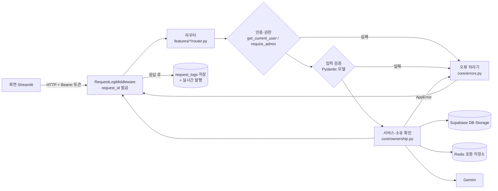
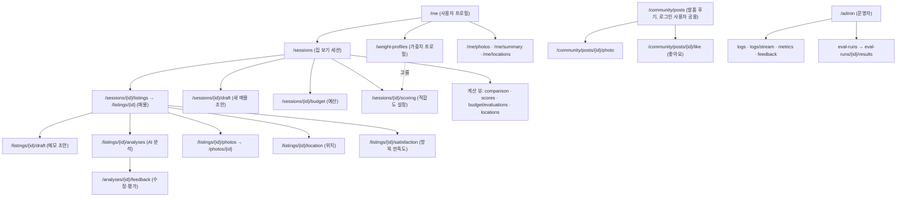

# API 설계 문서 — 집 보기 메모 비교 서비스

FastAPI 서버(`backend/`)가 제공하는 HTTP API의 설계 문서입니다. 화면(Streamlit `frontend/`)은 이 API만 호출합니다.
과제 기준(`docs/PROJECT_CONTEXT.md` 1절 "API 설계 문서")에 맞춰 리소스·메서드 규칙, 요청·응답 모델, 오류 응답 표준, 오류 예시를 정리하고,
코드가 REST 관례와 다른 부분은 9절에 사실대로 적습니다.

## 0. 문서 정보

| 항목 | 내용 |
|---|---|
| 기준 코드 | `main` 커밋 `8ee3752`(PR #29 병합 시점, F1~F14 포함) |
| 기준 파일 | `backend/app/main.py`, `backend/app/features/*/router.py`, 기능 폴더의 `schemas.py`, `backend/app/core/schemas.py`, `backend/app/core/errors.py` |
| 엔드포인트 수 | **69개**(기능 라우터 67 + `main.py`의 `/health`·`/ready` 2). 발품 후기 좋아요 E68·E69는 기준 커밋 뒤에 더했다 |
| 일치 확인 | `backend/tests/core/test_api_design_doc.py`가 4절 표와 7절 오류 코드 표를 코드와 비교한다(10절) |
| 관련 문서 | `docs/CONTRACT.md`(개발용 계약 메모), `docs/METRICS.md`(지표 정의), `docs/DB_DESIGN.md`(DB), `docs/SCREEN_DESIGN.md`(화면) |

권한 표기(4·5절에서 씀)

| 표기 | 뜻 | 인증 실패 시 |
|---|---|---|
| 공개 | 토큰 없이 호출 | - |
| 로그인 | 로그인한 사용자 누구나. 개인 소유가 아닌 데이터(평가 항목·후기 주제·발품 후기 읽기·좋아요)이거나 새로 만드는 본인 글 | 401 `AUTH_REQUIRED` |
| 본인 | 로그인 + 본인 데이터만. 남의 것·없는 것은 404(`*_NOT_FOUND`), 발품 후기 고치기·지우기(와 내 후기에 좋아요)만 403 `FORBIDDEN` | 401 `AUTH_REQUIRED` |
| 운영자 | 로그인 + `profiles.role = 'admin'` | 401 `AUTH_REQUIRED` / 일반 사용자 403 `FORBIDDEN` |

권한별 개수: 공개 6 · 로그인 7 · 본인 49 · 운영자 7 = 69.

## 1. 개요

| 항목 | 내용 |
|---|---|
| 기본 URL(배포) | `https://house-tour-notes-api-6bb5.onrender.com` (무료 서버라 잠들어 있으면 첫 요청이 최대 1분) |
| 기본 URL(로컬) | `http://localhost:8000` (`backend` 폴더에서 `uvicorn app.main:app`) |
| 자동 문서 | `/docs`(Swagger UI), `/openapi.json` — FastAPI가 코드에서 만든다. 오류 응답 형식은 9절 D10 참고 |
| 인증 | `Authorization: Bearer <access_token>`. 토큰은 `/auth/login`·`/auth/signup`·`/auth/refresh`가 주는 Supabase 액세스 토큰 |
| 요청 본문 | `application/json`(UTF-8). 사진 업로드만 `multipart/form-data`(필드 이름 `file`) |
| 응답 본문 | `application/json`. 실시간 로그만 `text/event-stream`(SSE) |
| 요청 ID | 모든 응답 헤더에 `X-Request-ID`(uuid4). 오류 응답 본문 `error.detail.request_id`와 같고, 운영 로그(`request_logs.request_id`)로 같은 요청을 찾을 수 있다 |
| 시각·날짜 | 시각은 ISO 8601 UTC(`2026-10-18T12:47:24Z`), 날짜는 `YYYY-MM-DD`. 토큰 만료만 Unix 초 |
| 금액 | 만원 단위 정수. `null`은 '미기재'(0으로 바꾸지 않음) |
| ID | UUID 문자열. 형식이 틀린 ID도 "없는 리소스"로 보고 404 |

요청 처리 흐름(공통)



- 미들웨어는 응답을 보낸 뒤 요청마다 로그 1행(경로 틀·메서드·상태 코드·처리 시간·AI 시간·오류 코드·프롬프트 버전·캐시 적중)을 저장하고 실시간으로 발행한다. `/health`, `/ready`, `/admin/logs/stream`은 기록하지 않는다.
- 로그와 오류 응답에는 메모 원문·주소·비밀번호·토큰을 남기지 않는다(경로는 `/listings/{listing_id}`처럼 틀로 저장).

## 2. 설계 원칙

### 2.1 리소스 중심 URL

- 리소스는 복수 명사 경로, 하나는 `/{리소스}/{id}`: `/sessions`, `/sessions/{session_id}`, `/listings/{listing_id}`, `/photos/{photo_id}`, `/weight-profiles/{profile_id}`, `/community/posts/{post_id}`.
- 소유 관계는 하위 경로로 표현한다: 세션의 매물 `/sessions/{session_id}/listings`, 매물의 분석 `/listings/{listing_id}/analyses`, 분석의 피드백 `/analyses/{analysis_id}/feedback`.
- 한 리소스에 하나만 있는 것은 단수 하위 리소스로 둔다: `/listings/{id}/draft`, `/listings/{id}/location`, `/listings/{id}/satisfaction`, `/sessions/{id}/budget`, `/sessions/{id}/scoring`, `/community/posts/{id}/photo`.
- 계산 결과(저장하지 않는 읽기 전용 뷰)는 명사 하위 경로로 둔다: `/sessions/{id}/comparison`, `/sessions/{id}/scores`, `/sessions/{id}/budget/evaluations`, `/sessions/{id}/locations`, `/me/summary`.
- 로그인한 사용자 자신은 `/me`로 부른다(`/me/photos`, `/me/locations`, `/me/password`).
- 운영자 전용은 `/admin` 아래에 둔다: `/admin/logs`, `/admin/metrics`, `/admin/feedback`, `/admin/eval-runs`.
- 경로는 소문자·하이픈(`weight-profiles`, `eval-runs`), 경로 변수·필드는 snake_case(`session_id`, `memo_text`).

### 2.2 메서드 의미

| 메서드 | 의미 | 이 API에서 | 멱등 |
|---|---|---|---|
| GET | 조회(상태를 바꾸지 않음) | 목록·하나·계산 결과·SSE | 예 |
| POST | 새 리소스 만들기 / 동작 실행 | 세션·매물·분석·피드백·사진·후기·가중치 프로필·평가 실행 만들기, 인증 동작(9절 D2) | 아니오 |
| PUT | 통째로 바꾸기(없으면 만듦) | 초안, 예산, 위치, 만족도, 세션 적합도 설정, 가중치 프로필 | 예 |
| PATCH | 보낸 필드만 바꾸기 | 세션, 매물 메모, 내 닉네임, 발품 후기 | 예(같은 본문 기준) |
| DELETE | 지우기 | 세션·매물·사진·초안·위치·가중치 프로필·후기·후기 사진 | 예(위치는 없어도 성공) |

- 과제 기준의 GET·POST·PUT·DELETE에 더해, 일부만 고치는 요청은 PATCH로 나눴다(9절 D1).
- 성공 응답은 모두 **200**이다. 만들기도 201이 아니고, 지우기는 204 대신 `{"ok": true}`(`OkOut`)를 준다(9절 D3).

### 2.3 공통 규칙

- 요청 본문의 모르는 필드는 무시한다(Pydantic 기본값). 길이·범위·형식을 어기면 422 `VALIDATION_ERROR`.
- 문자열 필수값은 앞뒤 공백을 지운 뒤 비어 있으면 422(세션 제목·메모·후기 칸·프로필 이름).
- 남의 리소스는 "없음"과 똑같이 404로 답해 존재 여부를 드러내지 않는다. 읽기가 공개된 발품 후기만 고치기·지우기를 403으로 구분한다.
- 목록은 배열 그대로 돌려준다(페이지 정보 없음, 9절 D6). 정렬은 엔드포인트별로 정해져 있다(5절).

## 3. 리소스 구조



## 4. 엔드포인트 전체 목록

코드(`app.openapi()`)의 엔드포인트 69개 전체입니다. 이 표의 (메서드, 경로)는 테스트가 코드와 비교합니다(10절). 엔드포인트를 더하거나 바꾸면 이 표와 5절을 함께 고칩니다.

| No | 메서드 | 경로 | 기능 | 권한 | 요청 → 응답(200) |
|---|---|---|---|---|---|
| E01 | GET | `/health` | 운영 | 공개 | - → `{"status": "ok"}` |
| E02 | GET | `/ready` | 운영 | 공개 | - → `{"db": bool, "redis": bool}`(db false면 503) |
| E03 | POST | `/auth/signup` | F1 인증 | 공개 | `SignupIn` → `SignupOut` |
| E04 | POST | `/auth/login` | F1 인증 | 공개 | `LoginIn` → `AuthTokensOut` |
| E05 | POST | `/auth/refresh` | F1 인증 | 공개 | `RefreshIn` → `AuthTokensOut` |
| E06 | POST | `/auth/logout` | F1 인증 | 공개 | (Bearer 선택) → `OkOut` |
| E07 | GET | `/me` | F1 인증 | 본인 | - → `ProfileOut` |
| E08 | GET | `/sessions` | F2 세션 | 본인 | - → `list[SessionOut]` |
| E09 | POST | `/sessions` | F2 세션 | 본인 | `SessionCreateIn` → `SessionOut` |
| E10 | GET | `/sessions/{session_id}` | F2 세션 | 본인 | - → `SessionOut` |
| E11 | PATCH | `/sessions/{session_id}` | F2 세션 | 본인 | `SessionUpdateIn` → `SessionOut` |
| E12 | DELETE | `/sessions/{session_id}` | F2 세션 | 본인 | - → `OkOut` |
| E13 | GET | `/sessions/{session_id}/listings` | F2 매물 | 본인 | - → `list[ListingOut]` |
| E14 | POST | `/sessions/{session_id}/listings` | F2 매물 | 본인 | `ListingCreateIn` → `ListingOut` |
| E15 | GET | `/listings/{listing_id}` | F2 매물 | 본인 | - → `ListingOut` |
| E16 | PATCH | `/listings/{listing_id}` | F2 매물 | 본인 | `ListingUpdateIn` → `ListingOut` |
| E17 | DELETE | `/listings/{listing_id}` | F2 매물 | 본인 | - → `OkOut` |
| E18 | GET | `/listings/{listing_id}/draft` | F3 초안 | 본인 | - → `DraftOut` |
| E19 | PUT | `/listings/{listing_id}/draft` | F3 초안 | 본인 | `DraftIn` → `DraftOut` |
| E20 | GET | `/sessions/{session_id}/draft` | F3 초안 | 본인 | - → `DraftOut` |
| E21 | PUT | `/sessions/{session_id}/draft` | F3 초안 | 본인 | `DraftIn` → `DraftOut` |
| E22 | DELETE | `/sessions/{session_id}/draft` | F3 초안 | 본인 | - → `OkOut` |
| E23 | POST | `/listings/{listing_id}/analyses` | F4·F5 분석 | 본인 | `AnalysisCreateIn`(본문 생략 가능) → `AnalysisOut` |
| E24 | GET | `/listings/{listing_id}/analyses/latest` | F4 분석 | 본인 | - → `AnalysisOut` |
| E25 | GET | `/sessions/{session_id}/comparison` | F6 비교표 | 본인 | `?filters=` → `ComparisonOut` |
| E26 | POST | `/analyses/{analysis_id}/feedback` | F7 수정·피드백 | 본인 | `FeedbackCreateIn` → `FeedbackSaveOut` |
| E27 | POST | `/listings/{listing_id}/photos` | F10 사진 | 본인 | multipart `file` → `PhotoOut` |
| E28 | GET | `/listings/{listing_id}/photos` | F10 사진 | 본인 | - → `list[PhotoOut]` |
| E29 | DELETE | `/photos/{photo_id}` | F10 사진 | 본인 | - → `OkOut` |
| E30 | PATCH | `/me` | F10 마이페이지 | 본인 | `NicknameUpdateIn` → `ProfileOut` |
| E31 | POST | `/me/password` | F10 마이페이지 | 본인 | `PasswordChangeWithCurrentIn` → `OkOut` |
| E32 | GET | `/me/photos` | F10 마이페이지 | 본인 | - → `list[MyPhotoOut]` |
| E33 | GET | `/me/summary` | F10 마이페이지 | 본인 | - → `MySummaryWithRecentOut` |
| E34 | GET | `/sessions/{session_id}/budget` | F11 예산 | 본인 | - → `BudgetOut` |
| E35 | PUT | `/sessions/{session_id}/budget` | F11 예산 | 본인 | `BudgetIn` → `BudgetOut` |
| E36 | GET | `/sessions/{session_id}/budget/evaluations` | F11 예산 | 본인 | - → `BudgetEvaluationsOut` |
| E37 | GET | `/score-items` | F12 가중치 | 로그인 | - → `ScoreItemsOut` |
| E38 | GET | `/weight-profiles` | F12 가중치 | 본인 | - → `list[WeightProfileOut]` |
| E39 | POST | `/weight-profiles` | F12 가중치 | 본인 | `WeightProfileIn` → `WeightProfileOut` |
| E40 | GET | `/weight-profiles/{profile_id}` | F12 가중치 | 본인 | - → `WeightProfileOut` |
| E41 | PUT | `/weight-profiles/{profile_id}` | F12 가중치 | 본인 | `WeightProfileIn` → `WeightProfileOut` |
| E42 | DELETE | `/weight-profiles/{profile_id}` | F12 가중치 | 본인 | - → `OkOut` |
| E43 | GET | `/listings/{listing_id}/satisfaction` | F12 가중치 | 본인 | - → `SatisfactionOut` |
| E44 | PUT | `/listings/{listing_id}/satisfaction` | F12 가중치 | 본인 | `SatisfactionIn` → `SatisfactionOut` |
| E45 | GET | `/sessions/{session_id}/scoring` | F12 가중치 | 본인 | - → `ScoringSettingOut` |
| E46 | PUT | `/sessions/{session_id}/scoring` | F12 가중치 | 본인 | `ScoringSettingIn` → `ScoringSettingOut` |
| E47 | GET | `/sessions/{session_id}/scores` | F12 가중치 | 본인 | `?filters=` → `ScoresOut` |
| E48 | GET | `/listings/{listing_id}/location` | F13 지도 | 본인 | - → `ListingLocationOut` |
| E49 | PUT | `/listings/{listing_id}/location` | F13 지도 | 본인 | `LocationIn` → `ListingLocationOut` |
| E50 | DELETE | `/listings/{listing_id}/location` | F13 지도 | 본인 | - → `OkOut` |
| E51 | GET | `/sessions/{session_id}/locations` | F13 지도 | 본인 | - → `list[SessionPinOut]` |
| E52 | GET | `/me/locations` | F13 지도 | 본인 | - → `MyPinsOut` |
| E53 | GET | `/community/topics` | F14 발품 후기 | 로그인 | - → `TopicsOut` |
| E54 | GET | `/community/posts` | F14 발품 후기 | 로그인 | `?address=&floor=&topic=&mine=&limit=&sort=` → `list[PostSummaryOut]` |
| E55 | POST | `/community/posts` | F14 발품 후기 | 로그인 | `PostIn` → `PostOut` |
| E56 | GET | `/community/posts/{post_id}` | F14 발품 후기 | 로그인 | - → `PostOut` |
| E57 | PATCH | `/community/posts/{post_id}` | F14 발품 후기 | 본인 | `PostUpdateIn` → `PostOut` |
| E58 | DELETE | `/community/posts/{post_id}` | F14 발품 후기 | 본인 | - → `OkOut` |
| E59 | POST | `/community/posts/{post_id}/photo` | F14 발품 후기 | 본인 | multipart `file` → `PostOut` |
| E60 | DELETE | `/community/posts/{post_id}/photo` | F14 발품 후기 | 본인 | - → `PostOut` |
| E68 | PUT | `/community/posts/{post_id}/like` | F14 발품 후기 | 로그인 | - → `PostLikeOut` |
| E69 | DELETE | `/community/posts/{post_id}/like` | F14 발품 후기 | 로그인 | - → `PostLikeOut` |
| E61 | GET | `/admin/logs` | F8 운영 로그 | 운영자 | `?from=&to=&status=&prompt_version=&after_id=&limit=&include_admin=` → `list[RequestLogOut]` |
| E62 | GET | `/admin/logs/stream` | F8 운영 로그 | 운영자 | 헤더 `Last-Event-ID` → SSE(`event: log`) |
| E63 | GET | `/admin/metrics` | F8 운영 로그 | 운영자 | `?from=&to=&prompt_version=&include_admin=` → `MetricsOut` |
| E64 | GET | `/admin/feedback` | F8 운영 로그 | 운영자 | `?rating=&limit=` → `list[FeedbackCaseOut]` |
| E65 | GET | `/admin/eval-runs` | F9 개선 전후 | 운영자 | - → `list[EvalRunSummaryOut]` |
| E66 | POST | `/admin/eval-runs` | F9 개선 전후 | 운영자 | `EvalRunCreateIn` → `EvalRunSummaryOut` |
| E67 | GET | `/admin/eval-runs/{run_id}/results` | F9 개선 전후 | 운영자 | `?compare_to=` → `EvalCompareOut` |

## 5. 기능별 상세

각 엔드포인트의 권한, 파라미터, 요청·응답 모델(필드는 6절), 동작 규칙, 주요 오류입니다.
모든 로그인 필요 엔드포인트는 토큰이 없거나 무효면 401 `AUTH_REQUIRED`, 요청 모델 검증에 실패하면 422 `VALIDATION_ERROR`이므로 표에서는 그 밖의 오류만 적습니다.
예시의 ID·토큰·주소·시각은 모두 가짜 값입니다. 응답 예시는 테스트용 가짜 DB·인증·AI로 실제 서버 코드를 실행해 얻은 값이고(ID만 읽기 쉽게 바꾸고 긴 목록은 줄임), 예산 판정 예시는 `docs/CONTRACT.md` 4절, SSE·평가 실행 예시는 코드의 모델에 맞춰 만든 값입니다.

### 5.1 운영 (`main.py`)

| No | 엔드포인트 | 권한 | 설명 | 응답 |
|---|---|---|---|---|
| E01 | `GET /health` | 공개 | 프로세스가 살아 있으면 항상 200. 외부 서비스를 보지 않는다 | `{"status": "ok"}` |
| E02 | `GET /ready` | 공개 | DB·Redis 연결 확인. DB가 안 되면 503, Redis만 안 되면 200 | `{"db": true, "redis": true}` |

### 5.2 F1 인증 (`features/auth/router.py`)

| No | 엔드포인트 | 권한 | 요청 | 응답 | 동작·주요 오류 |
|---|---|---|---|---|---|
| E03 | `POST /auth/signup` | 공개 | `SignupIn` | `SignupOut` | 메일 확인이 필요하면 `needs_email_confirm: true`이고 토큰은 null. 이미 가입한 이메일·약한 비밀번호는 422(`detail.reason`), 인증 서버 연결 실패 503 `CONFIG_MISSING` |
| E04 | `POST /auth/login` | 공개 | `LoginIn` | `AuthTokensOut` | 이메일·비밀번호 틀림 401 `INVALID_CREDENTIALS`, 메일 미확인 403 `EMAIL_NOT_CONFIRMED`. 프로필 행이 없으면 만든다 |
| E05 | `POST /auth/refresh` | 공개 | `RefreshIn` | `AuthTokensOut` | 만료·재사용된 리프레시 토큰 401 `AUTH_REQUIRED` |
| E06 | `POST /auth/logout` | 공개 | Bearer 토큰(선택) | `OkOut` | 토큰이 없거나 만료돼도 성공. 화면은 응답과 상관없이 토큰을 지운다 |
| E07 | `GET /me` | 본인 | - | `ProfileOut` | 내 프로필(닉네임·권한) |

```http
POST /auth/login
Content-Type: application/json

{"email": "user@example.com", "password": "secret123"}
```

```json
{
  "access_token": "eyJhbGciOi…(액세스 토큰, 생략)",
  "refresh_token": "r1…(리프레시 토큰, 생략)",
  "expires_at": 1792331244,
  "profile": {"id": "e5000000-0000-4000-8000-000000000001", "nickname": "user", "role": "user"}
}
```

### 5.3 F2 세션·매물 (`features/sessions/router.py`, `features/listings/router.py`)

| No | 엔드포인트 | 권한 | 요청 | 응답 | 동작·주요 오류 |
|---|---|---|---|---|---|
| E08 | `GET /sessions` | 본인 | - | `list[SessionOut]` | 내 세션, 만든 시각 최신순 |
| E09 | `POST /sessions` | 본인 | `SessionCreateIn` | `SessionOut` | 제목은 공백 제거 후 1~100자(빈 값 422) |
| E10 | `GET /sessions/{session_id}` | 본인 | - | `SessionOut` | 없거나 남의 세션 404 `SESSION_NOT_FOUND` |
| E11 | `PATCH /sessions/{session_id}` | 본인 | `SessionUpdateIn` | `SessionOut` | 보낸 필드만 고친다. `title` null·빈 값 422, `visit_date: null`은 방문일 지우기. 404 `SESSION_NOT_FOUND` |
| E12 | `DELETE /sessions/{session_id}` | 본인 | - | `OkOut` | 사진 파일 → 초안 → 세션 행 순서로 지우고, 매물·분석·피드백·예산 등은 DB CASCADE. 사진 파일 삭제 실패 503 `CLEANUP_FAILED`(세션은 남아 다시 삭제 가능). 404 `SESSION_NOT_FOUND` |
| E13 | `GET /sessions/{session_id}/listings` | 본인 | - | `list[ListingOut]` | `listing_no` 오름차순. 404 `SESSION_NOT_FOUND` |
| E14 | `POST /sessions/{session_id}/listings` | 본인 | `ListingCreateIn` | `ListingOut` | 매물 이름(`name`, 예: "1번방")은 공백 제거 후 1~30자로 필수(빈 값 422 "매물 이름을 입력하세요."). 메모는 공백 제거 후 1~5000자. `listing_no`는 DB 트리거가 매긴다. 저장 성공 시 그 세션의 새 매물 초안을 지운다. 404 `SESSION_NOT_FOUND` |
| E15 | `GET /listings/{listing_id}` | 본인 | - | `ListingOut` | 404 `LISTING_NOT_FOUND`(남의 매물 포함) |
| E16 | `PATCH /listings/{listing_id}` | 본인 | `ListingUpdateIn` | `ListingOut` | 메모만 고친다(빈 값 422). 메모가 바뀌면 `memo_updated_at` 갱신 → 분석이 있으면 `needs_reanalysis: true`. 그 매물의 초안을 지운다. 404 `LISTING_NOT_FOUND` |
| E17 | `DELETE /listings/{listing_id}` | 본인 | - | `OkOut` | 사진 파일 → 초안 → 매물 행. 분석·피드백·사진 행·위치·만족도는 CASCADE. 503 `CLEANUP_FAILED`, 404 `LISTING_NOT_FOUND` |

```http
POST /sessions/6f1c2a3e-0000-4000-8000-000000000001/listings
Authorization: Bearer <access_token>
Content-Type: application/json

{"name": "1번방", "memo_text": "역앞 원룸. 500에 45, 관리비 7(수도·인터넷 포함). 3층 남향. 채광 좋음, 곰팡이 없음. 수압 확인 못함."}
```

```json
{
  "id": "a1000000-0000-4000-8000-000000000001",
  "session_id": "6f1c2a3e-0000-4000-8000-000000000001",
  "listing_no": 1,
  "label": "1번방",
  "memo_text": "역앞 원룸. 500에 45, 관리비 7(수도·인터넷 포함). 3층 남향. 채광 좋음, 곰팡이 없음. 수압 확인 못함.",
  "memo_updated_at": "2026-10-18T12:47:24Z",
  "created_at": "2026-10-18T12:47:24Z",
  "latest_analysis_status": "none",
  "needs_reanalysis": false
}
```

### 5.4 F3 초안 (`features/drafts/router.py`)

메모를 정식 저장하기 전 Redis 호환 저장소에 24시간 보관합니다(`DRAFT_TTL_SEC`). 소유 확인을 먼저 하고(남의 것 404), 그다음 저장소를 쓸 수 없으면 503 `KV_UNAVAILABLE`입니다.

| No | 엔드포인트 | 권한 | 요청 | 응답 | 동작·주요 오류 |
|---|---|---|---|---|---|
| E18 | `GET /listings/{listing_id}/draft` | 본인 | - | `DraftOut` | 기존 매물 메모 수정 초안. 없음 404 `DRAFT_NOT_FOUND`, 24시간이 지나 사라짐 410 `DRAFT_EXPIRED`. 404 `LISTING_NOT_FOUND`, 503 `KV_UNAVAILABLE` |
| E19 | `PUT /listings/{listing_id}/draft` | 본인 | `DraftIn` | `DraftOut` | 통째로 덮어쓰고 만료 시각을 24시간 뒤로. 404 `LISTING_NOT_FOUND`, 503 `KV_UNAVAILABLE` |
| E20 | `GET /sessions/{session_id}/draft` | 본인 | - | `DraftOut` | 새 매물 입력 초안. 404 `DRAFT_NOT_FOUND`·`SESSION_NOT_FOUND`, 410 `DRAFT_EXPIRED`, 503 `KV_UNAVAILABLE` |
| E21 | `PUT /sessions/{session_id}/draft` | 본인 | `DraftIn` | `DraftOut` | 404 `SESSION_NOT_FOUND`, 503 `KV_UNAVAILABLE` |
| E22 | `DELETE /sessions/{session_id}/draft` | 본인 | - | `OkOut` | 없어도 성공. 404 `SESSION_NOT_FOUND`, 503 `KV_UNAVAILABLE` |

```json
{"memo_text": "역 5분, 500/45", "saved_at": "2026-10-18T12:47:24Z", "expires_at": "2026-10-19T12:47:24Z"}
```

### 5.5 F4·F5 AI 분석 (`features/analysis/router.py`)

| No | 엔드포인트 | 권한 | 요청 | 응답 | 동작·주요 오류 |
|---|---|---|---|---|---|
| E23 | `POST /listings/{listing_id}/analyses` | 본인 | `AnalysisCreateIn`(본문 생략 시 `use_cache: true`) | `AnalysisOut` | 저장된 메모를 Gemini로 정리해 **새 분석 행을 만든다**(재분석도 새 행, F5). `use_cache: false`면 캐시를 쓰지 않고 다시 부른다. 메모가 비면 422. AI 실패도 행을 저장한 뒤 오류로 답하고 `detail.analysis_id`를 준다: 형식 실패 502 `AI_FORMAT_ERROR`, 그 밖 Gemini 오류 502 `AI_UPSTREAM_ERROR`, 한도 429 `AI_RATE_LIMITED`, 시간 초과 504 `AI_TIMEOUT`. 파이프라인 미등록 503 `CONFIG_MISSING`. 404 `LISTING_NOT_FOUND` |
| E24 | `GET /listings/{listing_id}/analyses/latest` | 본인 | - | `AnalysisOut` | 최신 분석(성공·실패 무관) + 사용자 수정값(`fields.*.user_value`). 없음 404 `ANALYSIS_NOT_FOUND`, 404 `LISTING_NOT_FOUND` |

`AnalysisOut`는 중첩 모델 `FieldValue`(항목별 AI 값·사용자 값·표시 값)와 `CheckItem`(체크리스트 판정)을 담습니다. 체크리스트 9개 항목은 `confirmed_checks`·`unchecked`·`ambiguous_checks`·`missing_checks`로 겹치지 않게 나뉩니다.

```http
POST /listings/a1000000-0000-4000-8000-000000000001/analyses
Authorization: Bearer <access_token>
Content-Type: application/json

{"use_cache": true}
```

응답 200 `AnalysisOut`(`fields`는 9개 중 4개만 표시)

```json
{
  "id": "b2000000-0000-4000-8000-000000000001",
  "listing_id": "a1000000-0000-4000-8000-000000000001",
  "status": "success",
  "error_code": null,
  "prompt_version": "v1",
  "model": "gemini-3.5-flash-lite",
  "thinking_level": "minimal",
  "schema_version": "1",
  "created_at": "2026-10-18T12:47:24Z",
  "fields": {
    "label": {"ai_value": "역앞 원룸", "user_value": null, "value": "역앞 원룸", "edited": false},
    "deposit_manwon": {"ai_value": 500, "user_value": null, "value": 500, "edited": false},
    "monthly_rent_manwon": {"ai_value": 45, "user_value": null, "value": 45, "edited": false},
    "maintenance_includes": {"ai_value": ["수도", "인터넷"], "user_value": null, "value": ["수도", "인터넷"], "edited": false}
  },
  "checks": [
    {"item": "채광", "status": "confirmed", "evidence": "채광 좋음"},
    {"item": "곰팡이", "status": "confirmed", "evidence": "곰팡이 없음"},
    {"item": "수압", "status": "unchecked", "evidence": "수압 확인 못함"},
    {"item": "층수", "status": "confirmed", "evidence": "3층"},
    {"item": "교통", "status": "confirmed", "evidence": "역앞"}
  ],
  "confirmed_checks": ["채광", "곰팡이", "층수", "교통"],
  "unchecked": ["수압"],
  "ambiguous_checks": [],
  "missing_checks": ["소음", "난방", "옵션", "보안"],
  "ambiguous": [],
  "mixed_listings": false,
  "rating": null,
  "needs_reanalysis": false,
  "previous_overrides": {}
}
```

### 5.6 F6 비교표 (`features/comparison/router.py`)

| No | 엔드포인트 | 권한 | 요청 | 응답 | 동작·주요 오류 |
|---|---|---|---|---|---|
| E25 | `GET /sessions/{session_id}/comparison` | 본인 | 쿼리 `filters`(선택, 200자 이하, 쉼표 구분. 지금 등록된 필터: `within_budget`) | `ComparisonOut` | 매물별 최신 **성공** 분석 값 + 사용자 수정값. 열 11개 고정 + 추가 열(`budget` 예산, `score` 적합도). 매물이 2개 미만이면 `enough_listings: false`·안내 문구. 등록되지 않은 필터 이름은 무시. 404 `SESSION_NOT_FOUND` |

응답 200 `ComparisonOut`(일부: `fields`는 11개 중 2개, 행 1개만 표시)

```json
{
  "session_id": "6f1c2a3e-0000-4000-8000-000000000001",
  "enough_listings": true,
  "message": null,
  "fields": [{"key": "deposit_manwon", "title": "보증금"}, {"key": "monthly_cost_manwon", "title": "월 고정비"}],
  "providers": [{"key": "budget", "title": "예산"}, {"key": "score", "title": "적합도"}],
  "rows": [
    {
      "listing_id": "a1000000-0000-4000-8000-000000000001",
      "listing_no": 1,
      "label": "1번 집",
      "analysis_status": "success",
      "needs_reanalysis": false,
      "values": {"deposit_manwon": 500, "monthly_rent_manwon": 40, "maintenance_fee_manwon": 7, "monthly_cost_manwon": 47,
                 "followup_checks": ["소음", "수압", "난방", "옵션", "보안"]},
      "columns": {
        "budget": {"display": "예산 안", "status": "within", "tone": "good"},
        "score": {"display": "만족도 미입력", "status": "unrated", "tone": "muted"}
      }
    }
  ],
  "lowest": {"monthly_rent_manwon": ["a1000000-0000-4000-8000-000000000001"],
             "maintenance_fee_manwon": ["a1000000-0000-4000-8000-000000000001"]},
  "hidden_count": {}
}
```

### 5.7 F7 AI 결과 수정·피드백 (`features/feedback/router.py`)

| No | 엔드포인트 | 권한 | 요청 | 응답 | 동작·주요 오류 |
|---|---|---|---|---|---|
| E26 | `POST /analyses/{analysis_id}/feedback` | 본인 | `FeedbackCreateIn` | `FeedbackSaveOut` | 분석 결과는 바꾸지 않고 feedback 행을 쌓는다(최신 행이 유효). 필드 수정은 필드마다 1행(`action` set·revert), 평가·사유·의견은 `field_name: null`인 1행. 한 요청의 행은 한 번에 저장된다. 고칠 수 있는 항목은 `EDITABLE_FIELDS` 9개(`deposit_manwon`·`monthly_rent_manwon`·`maintenance_fee_manwon`·`maintenance_includes`·`transit`·`floor`·`direction`·`pros`·`cons`). 실패한 분석을 고치면 422, 아무것도 보내지 않으면 422. 404 `ANALYSIS_NOT_FOUND` |

`corrections`(nested `CorrectionIn` 목록)로 여러 필드를 한 번에 보내고, 한 필드만 고칠 때는 `field_name`·`corrected_value`·`action`을 본문에 바로 넣어도 됩니다(계약 모양, 내부에서 corrections 1개로 바꿈).

| 값 | 의미 |
|---|---|
| `action: "set"`(기본) + 값 | 그 값으로 고침. 금액은 0 이상 정수만(문자열 `"45"`·실수·true 불가), 목록 필드는 문자열 배열, 글 필드는 문자열 |
| `action: "set"` + `null` | '메모에 없음'으로 고침(금액·`transit`·`floor`·`direction`만. 목록 필드는 `[]`) |
| `action: "revert"` | 수정 취소(AI 값으로 되돌림). `corrected_value`는 보내지 않거나 null |

```http
POST /analyses/b2000000-0000-4000-8000-000000000001/feedback
Authorization: Bearer <access_token>
Content-Type: application/json

{
  "corrections": [{"field_name": "monthly_rent_manwon", "corrected_value": 40}],
  "rating": "down",
  "reason": "amount",
  "comment": "월세가 40이에요"
}
```

응답 200 `FeedbackSaveOut` — 맨 위는 대표 행(평가 행이 있으면 그것), `items`는 이번에 저장한 모든 행

```json
{
  "id": "c3000000-0000-4000-8000-000000000002",
  "analysis_id": "b2000000-0000-4000-8000-000000000001",
  "field_name": null, "corrected_value": null, "action": null,
  "rating": "down", "reason": "amount", "comment": "월세가 40이에요",
  "created_at": "2026-10-18T12:47:24Z",
  "items": [
    {"id": "c3000000-0000-4000-8000-000000000001", "analysis_id": "b2000000-0000-4000-8000-000000000001",
     "field_name": "monthly_rent_manwon", "corrected_value": 40, "action": "set",
     "rating": null, "reason": null, "comment": null, "created_at": "2026-10-18T12:47:24Z"},
    {"id": "c3000000-0000-4000-8000-000000000002", "analysis_id": "b2000000-0000-4000-8000-000000000001",
     "field_name": null, "corrected_value": null, "action": null,
     "rating": "down", "reason": "amount", "comment": "월세가 40이에요", "created_at": "2026-10-18T12:47:24Z"}
  ]
}
```

### 5.8 F10 사진·마이페이지 (`features/photos/router.py`, `features/mypage/router.py`)

| No | 엔드포인트 | 권한 | 요청 | 응답 | 동작·주요 오류 |
|---|---|---|---|---|---|
| E27 | `POST /listings/{listing_id}/photos` | 본인 | multipart `file`(JPG·PNG·WEBP, 10MB 이하. 형식은 파일 앞부분으로 판별) | `PhotoOut` | 비공개 버킷에 저장하고 서명 URL(600초)을 준다. 빈 파일·크기 초과·형식 불가 422(`detail.reason`: `empty_file`·`too_large`·`unsupported_type`), 저장소 실패 503 `STORAGE_UNAVAILABLE`, 404 `LISTING_NOT_FOUND` |
| E28 | `GET /listings/{listing_id}/photos` | 본인 | - | `list[PhotoOut]` | 올린 순서. 서명 URL을 못 만든 사진은 `url: null`(목록 전체는 성공). 404 `LISTING_NOT_FOUND` |
| E29 | `DELETE /photos/{photo_id}` | 본인 | - | `OkOut` | 파일 먼저 지우고 행 삭제. 파일 삭제 실패 503 `CLEANUP_FAILED`(행 유지), 404 `PHOTO_NOT_FOUND` |
| E30 | `PATCH /me` | 본인 | `NicknameUpdateIn` | `ProfileOut` | 닉네임만 바꾼다(1~20자, 제어 문자 불가). `role` 등 다른 필드는 무시 |
| E31 | `POST /me/password` | 본인 | `PasswordChangeWithCurrentIn` | `OkOut` | 현재 비밀번호를 확인한 뒤 바꾼다. 현재 비밀번호 틀림 401 `INVALID_CREDENTIALS`, 새 비밀번호가 같음 422(`reason: same_password`), 인증 서버 실패 503 `CONFIG_MISSING` |
| E32 | `GET /me/photos` | 본인 | - | `list[MyPhotoOut]` | 내 모든 사진, 최신순. 세션 제목·매물 번호·매물 이름 포함 |
| E33 | `GET /me/summary` | 본인 | - | `MySummaryWithRecentOut` | 세션·매물·분석·사진·피드백 수 + 최근 세션 5개 |

```json
{
  "id": "f6000000-0000-4000-8000-000000000001",
  "listing_id": "a1000000-0000-4000-8000-000000000001",
  "content_type": "image/png",
  "size_bytes": 72,
  "visibility": "private",
  "created_at": "2026-10-18T12:47:24Z",
  "url": "https://<project>.supabase.co/storage/v1/object/sign/listing-photos/…(서명 URL)",
  "url_expires_at": "2026-10-18T12:57:24Z"
}
```

### 5.9 F11 예산 (`features/budget/router.py`)

| No | 엔드포인트 | 권한 | 요청 | 응답 | 동작·주요 오류 |
|---|---|---|---|---|---|
| E34 | `GET /sessions/{session_id}/budget` | 본인 | - | `BudgetOut` | 설정한 적 없으면 두 상한과 `updated_at`이 null. 404 `SESSION_NOT_FOUND` |
| E35 | `PUT /sessions/{session_id}/budget` | 본인 | `BudgetIn` | `BudgetOut` | 두 상한을 통째로 바꾼다. 비우려면 null, 음수 422. 404 `SESSION_NOT_FOUND` |
| E36 | `GET /sessions/{session_id}/budget/evaluations` | 본인 | - | `BudgetEvaluationsOut` | 매물별 판정(within·over·unknown)·사유·미기재 항목·다음 행동, `listing_no` 순. 미기재 금액을 0으로 채우지 않는다. 404 `SESSION_NOT_FOUND` |

`GET /sessions/{session_id}/budget/evaluations` 예시(`docs/CONTRACT.md` 4절) — 보증금 상한 1000, 월 고정비 상한 55, 매물 5개

```json
{
  "session_id": "6f1c2a3e-0000-4000-8000-000000000001",
  "budget_set": true,
  "counts": {"within": 1, "over": 2, "unknown": 2},
  "items": [
    {"listing_id": "a1000000-0000-4000-8000-000000000001", "listing_no": 1, "label": "1번 집",
     "status": "within", "status_label": "예산 안", "reason": "예산 안", "missing": [], "next_action": null},
    {"listing_id": "a1000000-0000-4000-8000-000000000002", "listing_no": 2, "label": "2번 집",
     "status": "unknown", "status_label": "판단 불가", "reason": "관리비 미기재", "missing": ["관리비"],
     "next_action": "관리비 17만원 이하면 예산 안"},
    {"listing_id": "a1000000-0000-4000-8000-000000000003", "listing_no": 3, "label": "3번 집",
     "status": "unknown", "status_label": "판단 불가", "reason": "분석 결과 없음", "missing": [],
     "next_action": "AI 정리를 실행하세요"},
    {"listing_id": "a1000000-0000-4000-8000-000000000004", "listing_no": 4, "label": "4번 집",
     "status": "over", "status_label": "예산 초과", "reason": "보증금 초과", "missing": [], "next_action": null},
    {"listing_id": "a1000000-0000-4000-8000-000000000005", "listing_no": 5, "label": "5번 집",
     "status": "over", "status_label": "예산 초과", "reason": "월 고정비 초과", "missing": [], "next_action": null}
  ]
}
```

`next_action` 규칙(unknown일 때만)은 `docs/CONTRACT.md` 4절 표를 따릅니다. 예산 미설정이면 `budget_set: false`, `counts` 모두 0, 각 항목 `status: null`·`status_label: "-"`·`reason: "예산 미설정"`입니다.

### 5.10 F12 항목 가중치화 (`features/scoring/router.py`)

적합도 = Σ(가중치 × 만족도) ÷ Σ가중치를 반올림(0.5 올림)한 0~100 정수입니다. 만족도를 입력한 항목만 쓰고, 프로필을 고르지 않았거나 쓰는 항목의 가중치가 모두 0이면 동일 가중치로 계산합니다. 같은 점수는 같은 순위(1, 2, 2, 4)입니다. 항목별 값은 `{item_key, 값}` 목록(nested 모델)으로 주고받고, 응답은 항상 평가 항목 9개 전체를 그 순서로 줍니다.

| No | 엔드포인트 | 권한 | 요청 | 응답 | 동작·주요 오류 |
|---|---|---|---|---|---|
| E37 | `GET /score-items` | 로그인 | - | `ScoreItemsOut` | 평가 항목 9개(체크리스트와 같음) |
| E38 | `GET /weight-profiles` | 본인 | - | `list[WeightProfileOut]` | 내 프로필, 만든 순서 |
| E39 | `POST /weight-profiles` | 본인 | `WeightProfileIn` | `WeightProfileOut` | 빠진 항목은 가중치 0. 없는 항목·같은 항목 두 번 422 |
| E40 | `GET /weight-profiles/{profile_id}` | 본인 | - | `WeightProfileOut` | 404 `WEIGHT_PROFILE_NOT_FOUND`(남의 것 포함) |
| E41 | `PUT /weight-profiles/{profile_id}` | 본인 | `WeightProfileIn` | `WeightProfileOut` | 이름·가중치를 통째로 바꾼다. 404 `WEIGHT_PROFILE_NOT_FOUND` |
| E42 | `DELETE /weight-profiles/{profile_id}` | 본인 | - | `OkOut` | 이 프로필을 고른 세션은 '프로필 없음(동일 가중치)'이 된다. 404 `WEIGHT_PROFILE_NOT_FOUND` |
| E43 | `GET /listings/{listing_id}/satisfaction` | 본인 | - | `SatisfactionOut` | 미입력 항목은 null. 404 `LISTING_NOT_FOUND` |
| E44 | `PUT /listings/{listing_id}/satisfaction` | 본인 | `SatisfactionIn` | `SatisfactionOut` | 통째로 바꾼다. 보낸 항목만 저장, `[]`는 전부 비우기. 0~100 밖 422. 404 `LISTING_NOT_FOUND` |
| E45 | `GET /sessions/{session_id}/scoring` | 본인 | - | `ScoringSettingOut` | 설정 전에는 켜짐·프로필 없음. 404 `SESSION_NOT_FOUND` |
| E46 | `PUT /sessions/{session_id}/scoring` | 본인 | `ScoringSettingIn` | `ScoringSettingOut` | 남의·없는 프로필 404 `WEIGHT_PROFILE_NOT_FOUND`, 404 `SESSION_NOT_FOUND` |
| E47 | `GET /sessions/{session_id}/scores` | 본인 | 쿼리 `filters`(E25와 같음) | `ScoresOut` | 필터를 통과한 매물끼리 순위. 꺼져 있으면 `rows: []`. 404 `SESSION_NOT_FOUND` |

```http
POST /weight-profiles
Content-Type: application/json

{"name": "여름 6개월", "weights": [{"item_key": "채광", "weight": 80}, {"item_key": "소음", "weight": 50}]}
```

응답 200 `WeightProfileOut`(가중치 9개 중 3개만 표시)

```json
{
  "id": "d4000000-0000-4000-8000-000000000001",
  "name": "여름 6개월",
  "weights": [{"item_key": "채광", "weight": 80}, {"item_key": "소음", "weight": 50}, {"item_key": "수압", "weight": 0}],
  "created_at": "2026-10-18T12:47:24Z",
  "updated_at": null
}
```

`GET /sessions/{session_id}/scores` 응답 200 `ScoresOut`(1번 집: 채광 90·소음 60 입력 → (80×90 + 50×60) ÷ 130 = 78.46 → 78)

```json
{
  "session_id": "6f1c2a3e-0000-4000-8000-000000000001",
  "setting": {"session_id": "6f1c2a3e-0000-4000-8000-000000000001", "enabled": true,
              "weight_profile_id": "d4000000-0000-4000-8000-000000000001", "weight_profile_name": "여름 6개월",
              "updated_at": "2026-10-18T12:47:24Z", "items": ["채광", "소음", "수압", "곰팡이", "난방", "층수", "옵션", "보안", "교통"]},
  "items": ["채광", "소음", "수압", "곰팡이", "난방", "층수", "옵션", "보안", "교통"],
  "rows": [
    {"listing_id": "a1000000-0000-4000-8000-000000000001", "listing_no": 1, "label": "1번 집",
     "score": 78, "rank": 1, "entered_count": 2, "total_items": 9},
    {"listing_id": "a1000000-0000-4000-8000-000000000002", "listing_no": 2, "label": "2번 집",
     "score": null, "rank": null, "entered_count": 0, "total_items": 9}
  ],
  "hidden_count": {}
}
```

### 5.11 F13 지도·매물 위치 (`features/map/router.py`)

주소·좌표는 메모와 따로 저장하고 AI 분석에 보내지 않습니다. 좌표는 화면의 지도 SDK가 주소를 바꾼 값입니다.

| No | 엔드포인트 | 권한 | 요청 | 응답 | 동작·주요 오류 |
|---|---|---|---|---|---|
| E48 | `GET /listings/{listing_id}/location` | 본인 | - | `ListingLocationOut` | 없으면 `location: null`(200). 404 `LISTING_NOT_FOUND` |
| E49 | `PUT /listings/{listing_id}/location` | 본인 | `LocationIn` | `ListingLocationOut` | 매물당 하나, 있으면 통째로 바꾼다. 도로명·지번 둘 다 없음·우편번호 형식·좌표 범위(위도 33~39, 경도 124~132) 422. 404 `LISTING_NOT_FOUND` |
| E50 | `DELETE /listings/{listing_id}/location` | 본인 | - | `OkOut` | 없어도 성공. 404 `LISTING_NOT_FOUND` |
| E51 | `GET /sessions/{session_id}/locations` | 본인 | - | `list[SessionPinOut]` | 위치가 있는 매물만 `listing_no` 순. 금액은 비교표와 같은 값(최신 성공 분석 + 수정값). 404 `SESSION_NOT_FOUND` |
| E52 | `GET /me/locations` | 본인 | - | `MyPinsOut` | 내 모든 세션의 위치 있는 매물(세션 최신순 → 매물 번호 순) + 전체 매물 수 |

```http
PUT /listings/a1000000-0000-4000-8000-000000000001/location
Content-Type: application/json

{"parcel_address": "예시시 예시구 예시동 123-45", "latitude": 37.55, "longitude": 126.97}
```

```json
{
  "listing_id": "a1000000-0000-4000-8000-000000000001",
  "location": {"road_address": null, "parcel_address": "예시시 예시구 예시동 123-45", "postal_code": null,
               "building_name": null, "latitude": 37.55, "longitude": 126.97, "updated_at": "2026-10-18T12:47:24Z"}
}
```

### 5.12 F14 발품 후기 (`features/community/router.py`)

로그인한 사용자 모두가 읽고, 작성자만 고치고 지웁니다. 응답에는 작성자 닉네임과 `is_mine`만 있고 작성자 ID·이메일은 없습니다. 좋아요는 남의 후기에만 누르고(한 사람이 한 글에 1번), 응답에는 좋아요 수와 내가 눌렀는지만 있고 누른 사람은 없습니다(`0141_community_likes.sql`).

| No | 엔드포인트 | 권한 | 요청 | 응답 | 동작·주요 오류 |
|---|---|---|---|---|---|
| E53 | `GET /community/topics` | 로그인 | - | `TopicsOut` | 주제 5개 |
| E54 | `GET /community/posts` | 로그인 | 쿼리 `address`(부분 일치, 200자 이하) · `floor`(-10~200) · `topic` · `mine`(기본 false) · `limit`(기본 50, 1~200) · `sort`(`latest` 기본 · `likes`) | `list[PostSummaryOut]` | 기본 최신순, `sort=likes`면 좋아요 많은순(같으면 최신순, 최근 1,000개 안에서 정렬). 주소는 공백·"번지"를 무시하고 부분 일치. 없는 주제·`sort` 값 422 |
| E55 | `POST /community/posts` | 로그인 | `PostIn` | `PostOut` | 필수 주소·주제·제목·본문, 선택 층·방문일. 제목·본문에 전화번호·이메일 모양이 있으면 422(`reason: contact_info`) |
| E56 | `GET /community/posts/{post_id}` | 로그인 | - | `PostOut` | 남의 글도 읽을 수 있다. 404 `POST_NOT_FOUND` |
| E57 | `PATCH /community/posts/{post_id}` | 본인 | `PostUpdateIn` | `PostOut` | 보낸 칸만 바꾼다. 필수 칸 null 422. 남의 글 403 `FORBIDDEN`, 404 `POST_NOT_FOUND` |
| E58 | `DELETE /community/posts/{post_id}` | 본인 | - | `OkOut` | 사진 파일 먼저 삭제. 실패 503 `CLEANUP_FAILED`(글 유지). 403 `FORBIDDEN`, 404 `POST_NOT_FOUND` |
| E59 | `POST /community/posts/{post_id}/photo` | 본인 | multipart `file`(JPG·PNG, 5MB 이하) | `PostOut` | 글당 1장, 이미 있으면 바꾼다. 422(`detail.reason`), 503 `STORAGE_UNAVAILABLE`, 403 `FORBIDDEN`, 404 `POST_NOT_FOUND` |
| E60 | `DELETE /community/posts/{post_id}/photo` | 본인 | - | `PostOut` | 사진만 지운다. 503 `CLEANUP_FAILED`, 403 `FORBIDDEN`, 404 `POST_NOT_FOUND` |
| E68 | `PUT /community/posts/{post_id}/like` | 로그인 | - | `PostLikeOut` | 좋아요 누르기. 여러 번 보내도 1번만 센다. 내 후기 403 `FORBIDDEN`, 404 `POST_NOT_FOUND` |
| E69 | `DELETE /community/posts/{post_id}/like` | 로그인 | - | `PostLikeOut` | 좋아요 취소. 누른 적이 없어도 200으로 현재 상태. 404 `POST_NOT_FOUND` |

```http
POST /community/posts
Content-Type: application/json

{"address": "예시시 예시구 예시동 123-45", "topic": "소음", "title": "밤 도로 소음",
 "body": "밤에 도로 소음이 큽니다.", "floor": 3, "visit_date": "2026-10-17"}
```

```json
{
  "id": "c9000000-0000-4000-8000-000000000001",
  "address": "예시시 예시구 예시동 123-45",
  "floor": 3, "topic": "소음", "visit_date": "2026-10-17",
  "title": "밤 도로 소음", "nickname": "집보기왕", "is_mine": true, "has_photo": false,
  "like_count": 0, "liked_by_me": false,
  "created_at": "2026-10-18T12:47:24Z", "updated_at": "2026-10-18T12:47:24Z",
  "body": "밤에 도로 소음이 큽니다.",
  "photo": null
}
```

### 5.13 F8 운영 로그 대시보드 (`features/admin_logs/router.py`)

모두 운영자 전용입니다(일반 사용자 403 `FORBIDDEN`). 시각 쿼리는 ISO 8601이고 시간대가 없으면 UTC로 봅니다. `from`이 `to`보다 늦으면 422.

| No | 엔드포인트 | 권한 | 쿼리·헤더 | 응답 | 동작·주요 오류 |
|---|---|---|---|---|---|
| E61 | `GET /admin/logs` | 운영자 | `from`·`to`(선택), `status`(success·error·4xx·5xx 또는 숫자 코드), `prompt_version`, `after_id`(≥0), `limit`(기본 100, 1~500), `include_admin`(기본 false: `/admin` 요청 제외) | `list[RequestLogOut]` | 기본 최신순(id 내림차순), `after_id`가 있으면 그 뒤를 id 오름차순(놓친 로그 재조회). `profile_id`는 앞 4자리만. 잘못된 `status` 422 |
| E62 | `GET /admin/logs/stream` | 운영자 | 헤더 `Last-Event-ID`(선택, 마지막으로 받은 로그 id) | `text/event-stream` | SSE. 연결하면 `Last-Event-ID` 뒤의 DB 로그를 먼저 보내고 새 로그를 이어 보낸다. 15초마다 연결 유지 신호. 실시간 저장소가 없으면 스트림을 열기 전에 503 `KV_UNAVAILABLE` |
| E63 | `GET /admin/metrics` | 운영자 | `from`·`to`(기본 최근 24시간), `prompt_version`, `include_admin` | `MetricsOut` | 요청 수·오류율·지연 p50/p95·AI 지연·캐시 적중률·형식 오류율. 시간별 추이·오류 코드별 개수·피드백 사유별 개수는 `extra`(정의는 `docs/METRICS.md`) |
| E64 | `GET /admin/feedback` | 운영자 | `rating`(up·down, 기본 down), `limit`(기본 20, 1~100) | `list[FeedbackCaseOut]` | 분석별 **최신** 전체 평가만, 최신순. 메모 앞 40자와 분석 요약 포함 |

SSE 이벤트 형식(`data`는 `RequestLogOut` JSON)

```text
event: log
id: 1024
data: {"id": 1024, "request_id": "5d0c1a2b-0000-4000-8000-000000000001", "profile_id": "e500****", "endpoint": "/listings/{listing_id}/analyses", "method": "POST", "status_code": 504, "latency_ms": 30120, "ai_latency_ms": 30010, "error_code": "AI_TIMEOUT", "prompt_version": "v1", "cache_hit": false, "created_at": "2026-10-18T12:47:24Z"}
```

`GET /admin/metrics` 응답 200 `MetricsOut`(`extra`는 일부만 표시)

```json
{
  "window_minutes": 1440,
  "request_count": 55,
  "error_rate": 0.38181818181818183,
  "p50_latency_ms": 1.0,
  "p95_latency_ms": 39.0,
  "ai_p50_latency_ms": 107.5,
  "ai_p95_latency_ms": 120.0,
  "cache_hit_rate": 0.0,
  "format_error_rate": 0.0,
  "extra": {
    "from": "2026-10-17T12:47:24Z", "to": "2026-10-18T12:47:24Z", "include_admin": false,
    "error_count": 21,
    "error_code_counts": {"VALIDATION_ERROR": 7, "AUTH_REQUIRED": 3, "AI_TIMEOUT": 1, "INTERNAL_ERROR": 1},
    "series": {"unit": "hour", "points": [{"start": "2026-10-18T12:00:00+00:00", "count": 55, "error_count": 21}]}
  }
}
```

### 5.14 F9 개선 전후 비교 (`features/evals/router.py`)

같은 평가 사례(가상 메모 20개)를 프롬프트 버전별로 실행해 정확도를 비교합니다. 모두 운영자 전용입니다.

| No | 엔드포인트 | 권한 | 요청 | 응답 | 동작·주요 오류 |
|---|---|---|---|---|---|
| E65 | `GET /admin/eval-runs` | 운영자 | - | `list[EvalRunSummaryOut]` | 최신순 최대 50개 |
| E66 | `POST /admin/eval-runs` | 운영자 | `EvalRunCreateIn` | `EvalRunSummaryOut` | 실행 행을 `status: "running"`으로 만들고 사례 실행은 백그라운드로 한다(진행은 E65로 확인). 빈 프롬프트 버전·없는 사례 key 422, 사례가 비었음 409 `EVAL_CASES_EMPTY`, 30분 안에 시작한 실행이 진행 중 409 `EVAL_RUN_IN_PROGRESS`(`detail.run_id`), 파이프라인 미등록 503 `CONFIG_MISSING` |
| E67 | `GET /admin/eval-runs/{run_id}/results` | 운영자 | 쿼리 `compare_to`(선택, 비교할 실행 id) | `EvalCompareOut` | 사례별 결과와 비교 실행의 같은 사례를 나란히. 두 실행의 조건(model·thinking_level·schema_version·사례 목록)이 다르면 `condition_mismatches`에 이름. 없는 실행(비교 대상 포함) 404 `EVAL_RUN_NOT_FOUND` |

```http
POST /admin/eval-runs
Content-Type: application/json

{"prompt_version": "v2", "case_keys": null}
```

```json
{
  "id": "a7000000-0000-4000-8000-000000000002", "prompt_version": "v2", "model": "gemini-3.5-flash-lite",
  "thinking_level": "minimal", "schema_version": "1", "status": "running", "case_count": 20,
  "field_accuracy": null, "hallucination_rate": null, "missing_check_accuracy": null, "format_error_rate": null,
  "error_message": null, "created_at": "2026-10-16T08:10:00Z", "finished_at": null,
  "failure_counts": {}, "result_count": 0, "error_case_count": 0
}
```

## 6. 데이터 모델 (Pydantic)

요청·응답 모델 69개(코드 기준, FastAPI가 만드는 multipart 본문 모델 2개 제외)의 필드입니다. 표는 각 모델의 `model_fields`에서 뽑았고, 설명·예시는 코드와 위 예시를 바탕으로 적었습니다.

- **필수/선택**은 모델 정의 기준입니다. 요청에서 '선택'은 보내지 않아도 되는 필드이고, 응답에서는 기본값이 있어도 항상 그 키가 응답에 들어갑니다.
- 타입 표기: `string`·`integer`·`number`·`boolean`·`datetime`(ISO 8601)·`date`(YYYY-MM-DD)·`any`(필드에 따라 다른 JSON 값), `A \| null`은 null 허용, `"a" \| "b"`는 정해진 값만.
- 제약: `min_length`·`max_length`(문자 수), `ge`·`le`(이상·이하), `pattern`(정규식). 모델 검사기(validator)가 추가로 검사하는 규칙은 설명 칸과 5절에 적었습니다.
- 다른 모델 이름이 타입인 필드는 **중첩(nested) 모델**입니다(예: `AnalysisOut.fields` → `FieldValue`, `ComparisonOut.rows` → `ComparisonRow` → `ColumnValue`, `ScoresOut.setting` → `ScoringSettingOut`, `MyPinsOut.pins` → `MyPinOut` → `LocationOut`, `EvalCompareOut.run` → `EvalRunSummaryOut`).
- 기능 폴더의 모델은 공통 계약(`core/schemas.py`) 모델을 상속해 필드를 더한 것입니다(제목 옆 "상속").

### 6.1 인증·공통 (E03~E07)

#### SignupIn — `core/schemas.py`

| 필드 | 타입 | 필수 | 기본값 | 제약 | 설명 | 예시 |
|---|---|---|---|---|---|---|
| `email` | string | 필수 | - | min_length=3, max_length=254, pattern=^[^@\s]+@[^@\s]+\.[^@\s]+$ | 이메일(형식 검사) | `"user@example.com"` |
| `password` | string | 필수 | - | min_length=6, max_length=72 | 비밀번호 | `"(6~72자)"` |

#### LoginIn (상속: SignupIn) — `core/schemas.py`

| 필드 | 타입 | 필수 | 기본값 | 제약 | 설명 | 예시 |
|---|---|---|---|---|---|---|
| `email` | string | 필수 | - | min_length=3, max_length=254, pattern=^[^@\s]+@[^@\s]+\.[^@\s]+$ | 이메일(형식 검사) | `"user@example.com"` |
| `password` | string | 필수 | - | min_length=6, max_length=72 | 비밀번호 | `"(6~72자)"` |

#### RefreshIn — `core/schemas.py`

| 필드 | 타입 | 필수 | 기본값 | 제약 | 설명 | 예시 |
|---|---|---|---|---|---|---|
| `refresh_token` | string | 필수 | - | min_length=1 | 토큰 갱신용 리프레시 토큰 | `"v1.rt…(생략)"` |

#### SignupOut — `core/schemas.py`

| 필드 | 타입 | 필수 | 기본값 | 제약 | 설명 | 예시 |
|---|---|---|---|---|---|---|
| `needs_email_confirm` | boolean | 필수 | - |  | 메일 확인이 필요하면 true(이때 토큰·profile은 null) | `false` |
| `access_token` | string \| null | 선택 | `null` |  | Supabase 액세스 토큰. 이후 요청의 Authorization: Bearer 값 | `"eyJ…(생략)"` |
| `refresh_token` | string \| null | 선택 | `null` |  | 토큰 갱신용 리프레시 토큰 | `"v1.rt…(생략)"` |
| `expires_at` | integer \| null | 선택 | `null` |  | 액세스 토큰 만료 시각(Unix 초, UTC) | `1792301400` |
| `profile` | ProfileOut \| null | 선택 | `null` |  | 로그인한 사용자 프로필(nested ProfileOut) | (하위 모델 예시 참고) |

#### AuthTokensOut — `core/schemas.py`

| 필드 | 타입 | 필수 | 기본값 | 제약 | 설명 | 예시 |
|---|---|---|---|---|---|---|
| `access_token` | string | 필수 | - |  | Supabase 액세스 토큰. 이후 요청의 Authorization: Bearer 값 | `"eyJ…(생략)"` |
| `refresh_token` | string | 필수 | - |  | 토큰 갱신용 리프레시 토큰 | `"v1.rt…(생략)"` |
| `expires_at` | integer | 필수 | - |  | 액세스 토큰 만료 시각(Unix 초, UTC) | `1792301400` |
| `profile` | ProfileOut | 필수 | - |  | 로그인한 사용자 프로필(nested ProfileOut) | (하위 모델 예시 참고) |

#### ProfileOut — `core/schemas.py`

| 필드 | 타입 | 필수 | 기본값 | 제약 | 설명 | 예시 |
|---|---|---|---|---|---|---|
| `id` | string | 필수 | - |  | 프로필 ID | `"e5000000-0000-4000-8000-000000000001"` |
| `nickname` | string | 필수 | - |  | 닉네임 | `"집보기왕"` |
| `role` | "user" \| "admin" | 필수 | - |  | 권한. user · admin(운영자) | `"user"` |

#### OkOut — `core/schemas.py`

| 필드 | 타입 | 필수 | 기본값 | 제약 | 설명 | 예시 |
|---|---|---|---|---|---|---|
| `ok` | boolean | 선택 | `true` |  | 처리 성공 여부(항상 true) | `true` |

### 6.2 세션·매물·초안 (E08~E22)

#### SessionCreateIn — `core/schemas.py`

| 필드 | 타입 | 필수 | 기본값 | 제약 | 설명 | 예시 |
|---|---|---|---|---|---|---|
| `title` | string | 필수 | - | min_length=1, max_length=100 | 세션 제목(앞뒤 공백 제거 후 1자 이상) | `"토요일 집 보기"` |
| `visit_date` | date \| null | 선택 | `null` |  | 방문일(YYYY-MM-DD). 없으면 null | `"2026-10-17"` |

#### SessionUpdateIn — `core/schemas.py`

| 필드 | 타입 | 필수 | 기본값 | 제약 | 설명 | 예시 |
|---|---|---|---|---|---|---|
| `title` | string \| null | 선택 | `null` | min_length=1, max_length=100 | 보내면 바꿈. null·빈 값은 422 | `"일요일 집 보기"` |
| `visit_date` | date \| null | 선택 | `null` |  | 보내면 바꿈. null을 보내면 지움 | `"2026-10-17"` |

#### SessionOut — `core/schemas.py`

| 필드 | 타입 | 필수 | 기본값 | 제약 | 설명 | 예시 |
|---|---|---|---|---|---|---|
| `id` | string | 필수 | - |  | 고유 ID(UUID 문자열) | `"6f1c2a3e-0000-4000-8000-000000000001"` |
| `title` | string | 필수 | - |  | 제목 | `"토요일 집 보기"` |
| `visit_date` | date \| null | 선택 | `null` |  | 방문일(YYYY-MM-DD). 없으면 null | `"2026-10-17"` |
| `created_at` | datetime | 필수 | - |  | 만든 시각(UTC) | `"2026-10-18T05:30:00Z"` |
| `listing_count` | integer | 선택 | `0` |  | 세션의 매물 수 | `3` |

#### ListingCreateIn — `core/schemas.py`

| 필드 | 타입 | 필수 | 기본값 | 제약 | 설명 | 예시 |
|---|---|---|---|---|---|---|
| `name` | string | 선택 | `""` | max_length=30 | 매물 이름(필수, 1~30자). 앞뒤 공백 제거 후 1자 이상이어야 저장, 빈 값은 422. `listings.name`(0009)에 저장 | `"1번방"` |
| `memo_text` | string | 선택 | `""` | max_length=5000 | 메모(앞뒤 공백 제거 후 1자 이상이어야 저장, 빈 값은 422) | `"역 5분, 500/45, 관리비 7, 남향, 수압 좋음"` |

#### ListingUpdateIn — `core/schemas.py`

| 필드 | 타입 | 필수 | 기본값 | 제약 | 설명 | 예시 |
|---|---|---|---|---|---|---|
| `memo_text` | string | 필수 | - | max_length=5000 | 새 메모(빈 값은 422) | `"역 5분, 500/40, 관리비 7, 남향, 수압 좋음"` |

#### ListingOut — `core/schemas.py`

| 필드 | 타입 | 필수 | 기본값 | 제약 | 설명 | 예시 |
|---|---|---|---|---|---|---|
| `id` | string | 필수 | - |  | 고유 ID(UUID 문자열) | `"a1000000-0000-4000-8000-000000000001"` |
| `session_id` | string | 필수 | - |  | 집 보기 세션 ID | `"6f1c2a3e-0000-4000-8000-000000000001"` |
| `listing_no` | integer | 필수 | - |  | 세션 안 매물 번호(DB 트리거가 매김, 지운 번호는 다시 쓰지 않음) | `1` |
| `label` | string | 필수 | - |  | 화면 표시 이름. 매물 이름(`listings.name`, 예: "1번방")이 있으면 그것, 없으면(0009 이전 매물) "N번 집"(`core.repo.listing_label`) | `"1번 집"` |
| `memo_text` | string | 필수 | - |  | 매물 메모 원문 | `"역 5분, 500/45, 관리비 7, 남향, 수압 좋음"` |
| `memo_updated_at` | datetime | 필수 | - |  | 메모를 마지막으로 바꾼 시각(DB 트리거) | `"2026-10-18T05:30:00Z"` |
| `created_at` | datetime | 필수 | - |  | 만든 시각(UTC) | `"2026-10-18T05:30:00Z"` |
| `latest_analysis_status` | "none" \| "success" \| "failed" | 선택 | `"none"` |  | 최신 분석 상태. none · success · failed | `"success"` |
| `needs_reanalysis` | boolean | 선택 | `false` |  | 분석 뒤 메모가 바뀌어 다시 분석해야 하는지 | `false` |

#### DraftIn — `core/schemas.py`

| 필드 | 타입 | 필수 | 기본값 | 제약 | 설명 | 예시 |
|---|---|---|---|---|---|---|
| `memo_text` | string | 필수 | - | max_length=5000 | 임시 저장할 메모(빈 값도 저장) | `"역 5분, 500/45, 관리"` |

#### DraftOut — `core/schemas.py`

| 필드 | 타입 | 필수 | 기본값 | 제약 | 설명 | 예시 |
|---|---|---|---|---|---|---|
| `memo_text` | string | 필수 | - |  | 임시 저장된 메모 | `"역 5분, 500/45, 관리"` |
| `saved_at` | datetime | 필수 | - |  | 임시 저장 시각(UTC) | `"2026-10-18T05:30:00Z"` |
| `expires_at` | datetime | 필수 | - |  | 보관 만료 시각(저장 후 24시간) | `"2026-10-19T05:30:00Z"` |

### 6.3 AI 분석 (E23·E24)

#### AnalysisCreateIn — `core/schemas.py`

| 필드 | 타입 | 필수 | 기본값 | 제약 | 설명 | 예시 |
|---|---|---|---|---|---|---|
| `use_cache` | boolean | 선택 | `true` |  | 같은 메모의 이전 AI 결과(캐시)를 쓸지. false면 AI를 다시 부름(재분석) | `true` |

#### AnalysisOut — `core/schemas.py`

| 필드 | 타입 | 필수 | 기본값 | 제약 | 설명 | 예시 |
|---|---|---|---|---|---|---|
| `id` | string | 필수 | - |  | 고유 ID(UUID 문자열) | `"b2000000-0000-4000-8000-000000000001"` |
| `listing_id` | string | 필수 | - |  | 매물 ID | `"a1000000-0000-4000-8000-000000000001"` |
| `status` | "success" \| "failed" | 필수 | - |  | 분석 상태. success · failed | `"success"` |
| `error_code` | string \| null | 선택 | `null` |  | 실패 코드(FMT·AI_TIMEOUT 등). 성공이면 null | `null` |
| `prompt_version` | string | 필수 | - |  | 프롬프트 버전 | `"v2"` |
| `model` | string | 필수 | - |  | AI 모델 이름 | `"gemini-3.5-flash-lite"` |
| `thinking_level` | string \| null | 선택 | `null` |  | 모델 사고 수준 설정 | `"minimal"` |
| `schema_version` | string | 필수 | - |  | 분석 결과 스키마 버전 | `"1"` |
| `created_at` | datetime | 필수 | - |  | 만든 시각(UTC) | `"2026-10-18T05:30:00Z"` |
| `fields` | dict[string, FieldValue] | 선택 | `{}` |  | 항목 이름 → 값(nested FieldValue). label + EDITABLE_FIELDS 9개 | `{"monthly_rent_manwon": {"ai_value": 45, "user_value": null, "value": 45, "edited": false}}` |
| `checks` | list[CheckItem] | 선택 | `[]` |  | 체크리스트 판정 목록(nested CheckItem) | `[{"item": "수압", "status": "confirmed", "evidence": "수압 좋음"}]` |
| `confirmed_checks` | list[string] | 선택 | `[]` |  | 확인한 체크리스트 항목 | `["수압", "교통"]` |
| `unchecked` | list[string] | 선택 | `[]` |  | 확인 못 한 항목 | `[]` |
| `ambiguous_checks` | list[string] | 선택 | `[]` |  | 애매한 항목 | `[]` |
| `missing_checks` | list[string] | 선택 | `[]` |  | 메모에 언급이 없는 항목(빠진 확인 항목) | `["채광", "소음", "곰팡이", "난방", "층수", "옵션", "보안"]` |
| `ambiguous` | list[string] | 선택 | `[]` |  | 해석이 애매한 메모 구절 | `[]` |
| `mixed_listings` | boolean | 선택 | `false` |  | 메모에 집이 둘 이상 섞였는지 | `false` |
| `rating` | "up" \| "down" \| null | 선택 | `null` |  | 이 분석에 대한 최신 전체 평가 | `null` |
| `needs_reanalysis` | boolean | 선택 | `false` |  | 분석 뒤 메모가 바뀌었는지 | `false` |
| `previous_overrides` | dict[string, any] | 선택 | `{}` |  | 이전 분석에서 사용자가 고친 값(재분석 뒤 다시 적용할 때 참고) | `{}` |

#### FieldValue — `core/schemas.py`

| 필드 | 타입 | 필수 | 기본값 | 제약 | 설명 | 예시 |
|---|---|---|---|---|---|---|
| `ai_value` | any | 선택 | `null` |  | AI가 정리한 값 | `45` |
| `user_value` | any | 선택 | `null` |  | 사용자가 고친 값 | `40` |
| `value` | any | 선택 | `null` |  | 화면에 보일 값(edited면 user_value, 아니면 ai_value) | `40` |
| `edited` | boolean | 선택 | `false` |  | 사용자 수정이 적용 중인지 | `true` |

#### CheckItem — `core/analysis_contract.py`

| 필드 | 타입 | 필수 | 기본값 | 제약 | 설명 | 예시 |
|---|---|---|---|---|---|---|
| `item` | "채광" \| "소음" \| "수압" \| "곰팡이" \| "난방" \| "층수" \| "옵션" \| "보안" \| "교통" | 필수 | - |  | 체크리스트 항목(채광·소음·수압·곰팡이·난방·층수·옵션·보안·교통) | `"수압"` |
| `status` | "confirmed" \| "unchecked" \| "ambiguous" | 필수 | - |  | confirmed(확인) · unchecked(확인 못함) · ambiguous(애매) | `"confirmed"` |
| `evidence` | string | 필수 | - |  | 판정 근거가 된 메모 구절 | `"수압 좋음"` |

### 6.4 비교표·수정·피드백 (E25·E26)

#### ComparisonOut — `core/schemas.py`

| 필드 | 타입 | 필수 | 기본값 | 제약 | 설명 | 예시 |
|---|---|---|---|---|---|---|
| `session_id` | string | 필수 | - |  | 집 보기 세션 ID | `"6f1c2a3e-0000-4000-8000-000000000001"` |
| `enough_listings` | boolean | 필수 | - |  | 매물이 2개 이상인지. false면 rows가 비고 message가 옴 | `true` |
| `message` | string \| null | 선택 | `null` |  | 매물이 부족할 때 안내 문구 | `null` |
| `fields` | list[FieldTitle] | 선택 | `[]` |  | 비교표 기본 열(nested FieldTitle, 11개 고정 순서) | `[{"key": "deposit_manwon", "title": "보증금"}]` |
| `providers` | list[FieldTitle] | 선택 | `[]` |  | 추가 열(예산 budget · 적합도 score) | `[{"key": "budget", "title": "예산"}]` |
| `rows` | list[ComparisonRow] | 선택 | `[]` |  | 매물별 행(nested ComparisonRow, 필터 통과 행만) | (하위 모델 예시 참고) |
| `lowest` | dict[string, list[string]] | 선택 | `{}` |  | 월세·관리비 최저 매물 ID 목록 | `{"monthly_rent_manwon": ["a1000000-0000-4000-8000-000000000001"]}` |
| `hidden_count` | dict[string, integer] | 선택 | `{}` |  | 필터 이름 → 숨긴 행 수 | `{"within_budget": 1}` |

#### FieldTitle — `core/schemas.py`

| 필드 | 타입 | 필수 | 기본값 | 제약 | 설명 | 예시 |
|---|---|---|---|---|---|---|
| `key` | string | 필수 | - |  | 열 키 | `"deposit_manwon"` |
| `title` | string | 필수 | - |  | 열 제목 | `"보증금"` |

#### ComparisonRow — `core/schemas.py`

| 필드 | 타입 | 필수 | 기본값 | 제약 | 설명 | 예시 |
|---|---|---|---|---|---|---|
| `listing_id` | string | 필수 | - |  | 매물 ID | `"a1000000-0000-4000-8000-000000000001"` |
| `listing_no` | integer | 필수 | - |  | 세션 안 매물 번호(DB 트리거가 매김, 지운 번호는 다시 쓰지 않음) | `1` |
| `label` | string | 필수 | - |  | 화면 표시 이름. 매물 이름(`listings.name`, 예: "1번방")이 있으면 그것, 없으면(0009 이전 매물) "N번 집"(`core.repo.listing_label`) | `"1번 집"` |
| `analysis_status` | "none" \| "success" \| "failed" | 필수 | - |  | 최신 분석 상태 | `"success"` |
| `needs_reanalysis` | boolean | 선택 | `false` |  | 분석 뒤 메모가 바뀌어 다시 분석해야 하는지 | `false` |
| `values` | dict[string, any] | 선택 | `{}` |  | 열 키 → 값(사용자 수정 반영, 분석이 없으면 {}) | `{"deposit_manwon": 500, "monthly_cost_manwon": 52}` |
| `columns` | dict[string, ColumnValue] | 선택 | `{}` |  | 추가 열 키 → 표시 값(nested ColumnValue) | `{"budget": {"display": "예산 안", "status": "within", "tone": "good"}}` |

#### ColumnValue — `core/registry.py`

| 필드 | 타입 | 필수 | 기본값 | 제약 | 설명 | 예시 |
|---|---|---|---|---|---|---|
| `display` | string | 필수 | - |  | 표시 문구 | `"예산 안"` |
| `status` | string \| null | 선택 | `null` |  | 상태 키(예: within·over·unknown·error) | `"within"` |
| `tone` | "default" \| "good" \| "bad" \| "muted" | 선택 | `"default"` |  | 표시 색 구분 | `"good"` |

#### FeedbackCreateIn (상속: FeedbackIn) — `features/feedback/schemas.py`

| 필드 | 타입 | 필수 | 기본값 | 제약 | 설명 | 예시 |
|---|---|---|---|---|---|---|
| `field_name` | string \| null | 선택 | `null` |  | 한 필드만 고칠 때(계약 모양). corrections와 함께 써도 됨 | `null` |
| `corrected_value` | any | 선택 | `null` |  | field_name의 고친 값 | `null` |
| `action` | "set" \| "revert" \| null | 선택 | `null` |  | field_name과 함께만. 생략하면 set | `null` |
| `rating` | "up" \| "down" \| null | 선택 | `null` |  | 전체 평가. up(좋음) · down(나쁨) | `"down"` |
| `reason` | "amount" \| "not_in_memo" \| "missing_info" \| "pros_cons" \| "check_error" \| "other" \| null | 선택 | `null` |  | 평가 사유. amount(금액) · not_in_memo(메모에 없는 내용) · missing_info(빠진 정보) · pros_cons(장단점) · check_error(체크리스트) · other | `"amount"` |
| `comment` | string \| null | 선택 | `null` | max_length=500 | 의견(500자 이하) | `"월세가 틀렸어요"` |
| `corrections` | list[CorrectionIn] | 선택 | `[]` | max_length=9 | 여러 필드 수정(nested CorrectionIn, 같은 필드 두 번 불가) | `[{"field_name": "monthly_rent_manwon", "corrected_value": 40}]` |

#### CorrectionIn — `features/feedback/schemas.py`

| 필드 | 타입 | 필수 | 기본값 | 제약 | 설명 | 예시 |
|---|---|---|---|---|---|---|
| `field_name` | string | 필수 | - |  | 고칠 항목(EDITABLE_FIELDS) | `"monthly_rent_manwon"` |
| `corrected_value` | any | 선택 | `null` |  | 고친 값. set이면 키를 꼭 보냄. 금액은 0 이상 정수 또는 null, 목록 필드는 문자열 배열 | `40` |
| `action` | "set" \| "revert" | 선택 | `"set"` |  | set · revert | `"set"` |

#### FeedbackSaveOut (상속: FeedbackOut) — `features/feedback/schemas.py`

| 필드 | 타입 | 필수 | 기본값 | 제약 | 설명 | 예시 |
|---|---|---|---|---|---|---|
| `id` | string | 필수 | - |  | 고유 ID(UUID 문자열) | `"c3000000-0000-4000-8000-000000000001"` |
| `analysis_id` | string | 필수 | - |  | 분석 결과 ID | `"b2000000-0000-4000-8000-000000000001"` |
| `field_name` | string \| null | 선택 | `null` |  | 고친 항목 이름(EDITABLE_FIELDS 9개). null이면 전체 평가 행 | `"monthly_rent_manwon"` |
| `corrected_value` | any | 선택 | `null` |  | 고친 값. action "set"+null은 '메모에 없음', "revert"는 null | `40` |
| `action` | "set" \| "revert" \| null | 선택 | `null` |  | 필드 수정 동작. set(고침) · revert(AI 값으로 되돌림). 전체 평가 행은 null | `"set"` |
| `rating` | "up" \| "down" \| null | 선택 | `null` |  | 전체 평가. up(좋음) · down(나쁨) | `"down"` |
| `reason` | "amount" \| "not_in_memo" \| "missing_info" \| "pros_cons" \| "check_error" \| "other" \| null | 선택 | `null` |  | 평가 사유. amount(금액) · not_in_memo(메모에 없는 내용) · missing_info(빠진 정보) · pros_cons(장단점) · check_error(체크리스트) · other | `"amount"` |
| `comment` | string \| null | 선택 | `null` |  | 의견(500자 이하) | `"월세가 틀렸어요"` |
| `created_at` | datetime | 필수 | - |  | 만든 시각(UTC) | `"2026-10-18T05:30:00Z"` |
| `items` | list[FeedbackOut] | 선택 | `[]` |  | 이번에 저장한 모든 행(nested FeedbackOut) | `[{"id": "…", "field_name": "monthly_rent_manwon", "corrected_value": 40, "action": "set"}]` |

#### FeedbackOut — `core/schemas.py`

| 필드 | 타입 | 필수 | 기본값 | 제약 | 설명 | 예시 |
|---|---|---|---|---|---|---|
| `id` | string | 필수 | - |  | 고유 ID(UUID 문자열) | `"c3000000-0000-4000-8000-000000000001"` |
| `analysis_id` | string | 필수 | - |  | 분석 결과 ID | `"b2000000-0000-4000-8000-000000000001"` |
| `field_name` | string \| null | 선택 | `null` |  | 고친 항목 이름(EDITABLE_FIELDS 9개). null이면 전체 평가 행 | `"monthly_rent_manwon"` |
| `corrected_value` | any | 선택 | `null` |  | 고친 값. action "set"+null은 '메모에 없음', "revert"는 null | `40` |
| `action` | "set" \| "revert" \| null | 선택 | `null` |  | 필드 수정 동작. set(고침) · revert(AI 값으로 되돌림). 전체 평가 행은 null | `"set"` |
| `rating` | "up" \| "down" \| null | 선택 | `null` |  | 전체 평가. up(좋음) · down(나쁨) | `"down"` |
| `reason` | "amount" \| "not_in_memo" \| "missing_info" \| "pros_cons" \| "check_error" \| "other" \| null | 선택 | `null` |  | 평가 사유. amount(금액) · not_in_memo(메모에 없는 내용) · missing_info(빠진 정보) · pros_cons(장단점) · check_error(체크리스트) · other | `"amount"` |
| `comment` | string \| null | 선택 | `null` |  | 의견(500자 이하) | `"월세가 틀렸어요"` |
| `created_at` | datetime | 필수 | - |  | 만든 시각(UTC) | `"2026-10-18T05:30:00Z"` |

### 6.5 사진·마이페이지 (E27~E33)

#### PhotoOut — `core/schemas.py`

| 필드 | 타입 | 필수 | 기본값 | 제약 | 설명 | 예시 |
|---|---|---|---|---|---|---|
| `id` | string | 필수 | - |  | 고유 ID(UUID 문자열) | `"f6000000-0000-4000-8000-000000000001"` |
| `listing_id` | string | 필수 | - |  | 매물 ID | `"a1000000-0000-4000-8000-000000000001"` |
| `content_type` | string | 필수 | - |  | image/jpeg · image/png · image/webp | `"image/jpeg"` |
| `size_bytes` | integer | 필수 | - |  | 파일 크기(바이트) | `482133` |
| `visibility` | "private" \| "public" | 선택 | `"private"` |  | 공개 범위. 지금은 항상 private | `"private"` |
| `created_at` | datetime | 필수 | - |  | 만든 시각(UTC) | `"2026-10-18T05:30:00Z"` |
| `url` | string \| null | 선택 | `null` |  | 서명 URL(유효 시간 동안만 열림). 만들지 못하면 null | `"https://<project>.supabase.co/storage/v1/object/sign/…"` |
| `url_expires_at` | datetime \| null | 선택 | `null` |  | 서명 URL 만료 시각(UTC) | `"2026-10-18T05:40:00Z"` |

#### MyPhotoOut (상속: PhotoOut) — `core/schemas.py`

| 필드 | 타입 | 필수 | 기본값 | 제약 | 설명 | 예시 |
|---|---|---|---|---|---|---|
| `id` | string | 필수 | - |  | 고유 ID(UUID 문자열) | `"f6000000-0000-4000-8000-000000000001"` |
| `listing_id` | string | 필수 | - |  | 매물 ID | `"a1000000-0000-4000-8000-000000000001"` |
| `content_type` | string | 필수 | - |  | image/jpeg · image/png · image/webp | `"image/jpeg"` |
| `size_bytes` | integer | 필수 | - |  | 파일 크기(바이트) | `482133` |
| `visibility` | "private" \| "public" | 선택 | `"private"` |  | 공개 범위. 지금은 항상 private | `"private"` |
| `created_at` | datetime | 필수 | - |  | 만든 시각(UTC) | `"2026-10-18T05:30:00Z"` |
| `url` | string \| null | 선택 | `null` |  | 서명 URL(유효 시간 동안만 열림). 만들지 못하면 null | `"https://<project>.supabase.co/storage/v1/object/sign/…"` |
| `url_expires_at` | datetime \| null | 선택 | `null` |  | 서명 URL 만료 시각(UTC) | `"2026-10-18T05:40:00Z"` |
| `session_id` | string | 필수 | - |  | 집 보기 세션 ID | `"6f1c2a3e-0000-4000-8000-000000000001"` |
| `session_title` | string | 필수 | - |  | 사진이 속한 세션 제목 | `"토요일 집 보기"` |
| `listing_no` | integer | 필수 | - |  | 사진이 속한 매물 번호 | `1` |
| `listing_label` | string | 선택 | `""` |  | 사진이 속한 매물 이름(없으면 "N번 집") | `"1번방"` |

#### NicknameUpdateIn (상속: MeUpdateIn) — `features/mypage/router.py`

| 필드 | 타입 | 필수 | 기본값 | 제약 | 설명 | 예시 |
|---|---|---|---|---|---|---|
| `nickname` | string | 필수 | - | min_length=1, max_length=20 | 새 닉네임(앞뒤 공백 제거, 줄바꿈·제어 문자 불가). 다른 필드는 무시 | `"집보기왕"` |

#### PasswordChangeWithCurrentIn (상속: PasswordChangeIn) — `features/mypage/router.py`

| 필드 | 타입 | 필수 | 기본값 | 제약 | 설명 | 예시 |
|---|---|---|---|---|---|---|
| `new_password` | string | 필수 | - | min_length=6, max_length=72 | 새 비밀번호(지금 비밀번호와 달라야 함) | `"(새 비밀번호 6~72자)"` |
| `current_password` | string | 필수 | - | min_length=1, max_length=72 | 지금 비밀번호(확인용) | `"(지금 비밀번호)"` |

#### MySummaryWithRecentOut (상속: MySummaryOut) — `features/mypage/router.py`

| 필드 | 타입 | 필수 | 기본값 | 제약 | 설명 | 예시 |
|---|---|---|---|---|---|---|
| `session_count` | integer | 선택 | `0` |  | 세션 수 | `2` |
| `listing_count` | integer | 선택 | `0` |  | 매물 수 | `5` |
| `analysis_count` | integer | 선택 | `0` |  | 분석 실행 수(성공·실패 포함) | `7` |
| `photo_count` | integer | 선택 | `0` |  | 사진 수 | `3` |
| `feedback_count` | integer | 선택 | `0` |  | 피드백 행 수 | `4` |
| `recent_sessions` | list[SessionOut] | 선택 | `[]` |  | 최근 세션 5개(nested SessionOut) | (하위 모델 예시 참고) |

### 6.6 예산 (E34~E36)

#### BudgetIn — `core/schemas.py`

| 필드 | 타입 | 필수 | 기본값 | 제약 | 설명 | 예시 |
|---|---|---|---|---|---|---|
| `deposit_max_manwon` | integer \| null | 선택 | `null` | ge=0 | 보증금 상한(만원). null = 상한 없음 | `1000` |
| `monthly_max_manwon` | integer \| null | 선택 | `null` | ge=0 | 월 고정비(월세+관리비) 상한(만원). null = 상한 없음 | `55` |

#### BudgetOut — `core/schemas.py`

| 필드 | 타입 | 필수 | 기본값 | 제약 | 설명 | 예시 |
|---|---|---|---|---|---|---|
| `session_id` | string | 필수 | - |  | 집 보기 세션 ID | `"6f1c2a3e-0000-4000-8000-000000000001"` |
| `deposit_max_manwon` | integer \| null | 선택 | `null` |  | 보증금 상한(만원). null = 상한 없음 | `1000` |
| `monthly_max_manwon` | integer \| null | 선택 | `null` |  | 월 고정비(월세+관리비) 상한(만원). null = 상한 없음 | `55` |
| `updated_at` | datetime \| null | 선택 | `null` |  | 설정 시각. 설정한 적 없으면 null | `"2026-10-18T05:30:00Z"` |

#### BudgetEvaluationsOut — `features/budget/schemas.py`

| 필드 | 타입 | 필수 | 기본값 | 제약 | 설명 | 예시 |
|---|---|---|---|---|---|---|
| `session_id` | string | 필수 | - |  | 집 보기 세션 ID | `"6f1c2a3e-0000-4000-8000-000000000001"` |
| `budget_set` | boolean | 필수 | - |  | 상한이 하나라도 있으면 true | `true` |
| `counts` | BudgetCountsOut | 필수 | - |  | 판정별 매물 수(nested BudgetCountsOut) | (하위 모델 예시 참고) |
| `items` | list[BudgetEvaluationOut] | 선택 | `[]` |  | 매물별 판정(nested BudgetEvaluationOut, listing_no 순) | (하위 모델 예시 참고) |

#### BudgetCountsOut — `features/budget/schemas.py`

| 필드 | 타입 | 필수 | 기본값 | 제약 | 설명 | 예시 |
|---|---|---|---|---|---|---|
| `within` | integer | 선택 | `0` |  | 예산 안 | `1` |
| `over` | integer | 선택 | `0` |  | 예산 초과 | `2` |
| `unknown` | integer | 선택 | `0` |  | 판단 불가 | `2` |

#### BudgetEvaluationOut — `features/budget/schemas.py`

| 필드 | 타입 | 필수 | 기본값 | 제약 | 설명 | 예시 |
|---|---|---|---|---|---|---|
| `listing_id` | string | 필수 | - |  | 매물 ID | `"a1000000-0000-4000-8000-000000000001"` |
| `listing_no` | integer | 필수 | - |  | 세션 안 매물 번호(DB 트리거가 매김, 지운 번호는 다시 쓰지 않음) | `2` |
| `label` | string | 필수 | - |  | 화면 표시 이름. 매물 이름(`listings.name`, 예: "1번방")이 있으면 그것, 없으면(0009 이전 매물) "N번 집"(`core.repo.listing_label`) | `"2번 집"` |
| `status` | "within" \| "over" \| "unknown" \| null | 선택 | `null` |  | within · over · unknown. 예산 미설정이면 null | `"unknown"` |
| `status_label` | string | 필수 | - |  | 예산 안 · 예산 초과 · 판단 불가, 미설정이면 "-" | `"판단 불가"` |
| `reason` | string | 필수 | - |  | 판정 사유 | `"관리비 미기재"` |
| `missing` | list[string] | 선택 | `[]` |  | unknown일 때 미기재 항목(보증금·월세·관리비) | `["관리비"]` |
| `next_action` | string \| null | 선택 | `null` |  | unknown일 때만. 무엇을 하면 판정되는지 | `"관리비 17만원 이하면 예산 안"` |

### 6.7 항목 가중치화 (E37~E47)

#### ScoreItemsOut — `features/scoring/schemas.py`

| 필드 | 타입 | 필수 | 기본값 | 제약 | 설명 | 예시 |
|---|---|---|---|---|---|---|
| `items` | list[string] | 필수 | - |  | 평가 항목(SCORE_ITEMS 순서) | `["채광", "소음", "…"]` |

#### WeightProfileIn — `features/scoring/schemas.py`

| 필드 | 타입 | 필수 | 기본값 | 제약 | 설명 | 예시 |
|---|---|---|---|---|---|---|
| `name` | string | 필수 | - | min_length=1, max_length=30 | 프로필 이름(앞뒤 공백 제거 후 1~30자) | `"여름 6개월"` |
| `weights` | list[WeightItemIn] | 선택 | `[]` |  | 항목별 가중치(nested WeightItemIn). 빠진 항목은 0, 같은 항목 두 번·없는 항목은 422 | `[{"item_key": "채광", "weight": 50}]` |

#### WeightItemIn — `features/scoring/schemas.py`

| 필드 | 타입 | 필수 | 기본값 | 제약 | 설명 | 예시 |
|---|---|---|---|---|---|---|
| `item_key` | string | 필수 | - |  | 평가 항목 이름(SCORE_ITEMS 9개 중 하나) | `"채광"` |
| `weight` | integer | 필수 | - | ge=0, le=100 | 가중치(0~100) | `50` |

#### WeightProfileOut — `features/scoring/schemas.py`

| 필드 | 타입 | 필수 | 기본값 | 제약 | 설명 | 예시 |
|---|---|---|---|---|---|---|
| `id` | string | 필수 | - |  | 고유 ID(UUID 문자열) | `"d4000000-0000-4000-8000-000000000001"` |
| `name` | string | 필수 | - |  | 이름 | `"여름 6개월"` |
| `weights` | list[WeightItemOut] | 필수 | - |  | SCORE_ITEMS 전체를 그 순서로(nested WeightItemOut) | `[{"item_key": "채광", "weight": 50}]` |
| `created_at` | datetime \| null | 선택 | `null` |  | 만든 시각(UTC) | `"2026-10-18T05:30:00Z"` |
| `updated_at` | datetime \| null | 선택 | `null` |  | 마지막으로 바꾼 시각(UTC) | `"2026-10-18T05:30:00Z"` |

#### WeightItemOut — `features/scoring/schemas.py`

| 필드 | 타입 | 필수 | 기본값 | 제약 | 설명 | 예시 |
|---|---|---|---|---|---|---|
| `item_key` | string | 필수 | - |  | 평가 항목 이름(SCORE_ITEMS 9개 중 하나) | `"채광"` |
| `weight` | integer | 필수 | - |  | 가중치(0~100) | `50` |

#### SatisfactionIn — `features/scoring/schemas.py`

| 필드 | 타입 | 필수 | 기본값 | 제약 | 설명 | 예시 |
|---|---|---|---|---|---|---|
| `items` | list[SatisfactionItemIn] | 선택 | `[]` |  | 항목별 만족도(nested SatisfactionItemIn). 빠진 항목은 미입력, [] = 전부 비우기 | `[{"item_key": "채광", "satisfaction": 90}]` |

#### SatisfactionItemIn — `features/scoring/schemas.py`

| 필드 | 타입 | 필수 | 기본값 | 제약 | 설명 | 예시 |
|---|---|---|---|---|---|---|
| `item_key` | string | 필수 | - |  | 평가 항목 이름(SCORE_ITEMS 9개 중 하나) | `"채광"` |
| `satisfaction` | integer | 필수 | - | ge=0, le=100 | 만족도(0~100) | `90` |

#### SatisfactionOut — `features/scoring/schemas.py`

| 필드 | 타입 | 필수 | 기본값 | 제약 | 설명 | 예시 |
|---|---|---|---|---|---|---|
| `listing_id` | string | 필수 | - |  | 매물 ID | `"a1000000-0000-4000-8000-000000000001"` |
| `items` | list[SatisfactionItemOut] | 필수 | - |  | SCORE_ITEMS 전체(nested SatisfactionItemOut) | `[{"item_key": "채광", "satisfaction": 90}]` |
| `entered_count` | integer | 필수 | - |  | 만족도를 입력한 항목 수 | `5` |
| `updated_at` | datetime \| null | 선택 | `null` |  | 입력 시각. 입력한 적 없으면 null | `"2026-10-18T05:30:00Z"` |

#### SatisfactionItemOut — `features/scoring/schemas.py`

| 필드 | 타입 | 필수 | 기본값 | 제약 | 설명 | 예시 |
|---|---|---|---|---|---|---|
| `item_key` | string | 필수 | - |  | 평가 항목 이름(SCORE_ITEMS 9개 중 하나) | `"채광"` |
| `satisfaction` | integer \| null | 선택 | `null` |  | 만족도. null = 미입력 | `90` |

#### ScoringSettingIn — `features/scoring/schemas.py`

| 필드 | 타입 | 필수 | 기본값 | 제약 | 설명 | 예시 |
|---|---|---|---|---|---|---|
| `enabled` | boolean | 필수 | - |  | 적합도 계산 켜기 | `true` |
| `weight_profile_id` | string \| null | 선택 | `null` |  | null = 동일 가중치 | `"d4000000-0000-4000-8000-000000000001"` |

#### ScoringSettingOut — `features/scoring/schemas.py`

| 필드 | 타입 | 필수 | 기본값 | 제약 | 설명 | 예시 |
|---|---|---|---|---|---|---|
| `session_id` | string | 필수 | - |  | 집 보기 세션 ID | `"6f1c2a3e-0000-4000-8000-000000000001"` |
| `enabled` | boolean | 선택 | `true` |  | 적합도 계산 켜짐(설정 전 기본 true) | `true` |
| `weight_profile_id` | string \| null | 선택 | `null` |  | 고른 가중치 프로필 ID. null = 동일 가중치 | `"d4000000-0000-4000-8000-000000000001"` |
| `weight_profile_name` | string \| null | 선택 | `null` |  | 고른 프로필 이름 | `"여름 6개월"` |
| `updated_at` | datetime \| null | 선택 | `null` |  | 설정 시각. 설정한 적 없으면 null | `"2026-10-18T05:30:00Z"` |
| `items` | list[string] | 선택 | (전체 목록) |  | 평가 항목(SCORE_ITEMS) | `["채광", "…"]` |

#### ScoresOut — `features/scoring/schemas.py`

| 필드 | 타입 | 필수 | 기본값 | 제약 | 설명 | 예시 |
|---|---|---|---|---|---|---|
| `session_id` | string | 필수 | - |  | 집 보기 세션 ID | `"6f1c2a3e-0000-4000-8000-000000000001"` |
| `setting` | ScoringSettingOut | 필수 | - |  | 세션 설정(nested ScoringSettingOut) | (하위 모델 예시 참고) |
| `items` | list[string] | 필수 | - |  | 평가 항목 | `["채광", "…"]` |
| `rows` | list[ScoreRow] | 필수 | - |  | 매물별 점수(nested ScoreRow). 꺼져 있으면 []. 순위 → 매물 번호 순 | (하위 모델 예시 참고) |
| `hidden_count` | dict[string, integer] | 선택 | `{}` |  | 필터 이름 → 숨긴 매물 수 | `{"within_budget": 1}` |

#### ScoreRow — `features/scoring/schemas.py`

| 필드 | 타입 | 필수 | 기본값 | 제약 | 설명 | 예시 |
|---|---|---|---|---|---|---|
| `listing_id` | string | 필수 | - |  | 매물 ID | `"a1000000-0000-4000-8000-000000000001"` |
| `listing_no` | integer | 필수 | - |  | 세션 안 매물 번호(DB 트리거가 매김, 지운 번호는 다시 쓰지 않음) | `1` |
| `label` | string | 필수 | - |  | 화면 표시 이름. 매물 이름(`listings.name`, 예: "1번방")이 있으면 그것, 없으면(0009 이전 매물) "N번 집"(`core.repo.listing_label`) | `"1번 집"` |
| `score` | integer \| null | 선택 | `null` |  | 적합도 0~100. null = 만족도 미입력 | `78` |
| `rank` | integer \| null | 선택 | `null` |  | 이 응답 rows 안의 순위(같은 점수는 같은 순위) | `1` |
| `entered_count` | integer | 선택 | `0` |  | 만족도를 입력한 항목 수 | `5` |
| `total_items` | integer | 선택 | `0` |  | 평가 항목 수 | `9` |

### 6.8 발품 후기 (E53~E60, E68·E69)

#### TopicsOut — `features/community/schemas.py`

| 필드 | 타입 | 필수 | 기본값 | 제약 | 설명 | 예시 |
|---|---|---|---|---|---|---|
| `topics` | list[string] | 필수 | - |  | 후기 주제 목록 | `["구조·설비", "소음", "채광", "주변 환경", "기타"]` |

#### PostIn — `features/community/schemas.py`

| 필드 | 타입 | 필수 | 기본값 | 제약 | 설명 | 예시 |
|---|---|---|---|---|---|---|
| `address` | string | 필수 | - | min_length=1, max_length=200 | 지번 주소(공백 정리 후 저장) | `"예시시 예시구 예시동 123-45"` |
| `topic` | string | 필수 | - |  | 후기 주제(TOPICS 5개 중 하나) | `"구조·설비"` |
| `title` | string | 필수 | - | min_length=1, max_length=100 | 제목(전화번호·이메일 모양이 있으면 422) | `"밤 도로 소음"` |
| `body` | string | 필수 | - | min_length=1, max_length=3000 | 본문(전화번호·이메일 모양이 있으면 422) | `"보일러실이 욕실 안에 있어 점검 때 불편합니다."` |
| `floor` | integer \| null | 선택 | `null` | ge=-10, le=200 | 층수(-10~200, 0 불가, 지하는 -1부터) | `3` |
| `visit_date` | date \| null | 선택 | `null` |  | 방문일(YYYY-MM-DD). 없으면 null | `"2026-10-17"` |

#### PostUpdateIn — `features/community/schemas.py`

| 필드 | 타입 | 필수 | 기본값 | 제약 | 설명 | 예시 |
|---|---|---|---|---|---|---|
| `address` | string \| null | 선택 | `null` | min_length=1, max_length=200 | 보내면 바꿈. null 불가 | `"예시시 예시구 예시동 123-45"` |
| `topic` | string \| null | 선택 | `null` |  | 보내면 바꿈. null 불가 | `"소음"` |
| `title` | string \| null | 선택 | `null` | min_length=1, max_length=100 | 보내면 바꿈. null 불가 | `"토요일 집 보기"` |
| `body` | string \| null | 선택 | `null` | min_length=1, max_length=3000 | 보내면 바꿈. null 불가 | `"밤에 도로 소음이 큽니다."` |
| `floor` | integer \| null | 선택 | `null` | ge=-10, le=200 | 보내면 바꿈. null이면 지움 | `3` |
| `visit_date` | date \| null | 선택 | `null` |  | 보내면 바꿈. null이면 지움 | `"2026-10-17"` |

#### PostSummaryOut — `features/community/schemas.py`

| 필드 | 타입 | 필수 | 기본값 | 제약 | 설명 | 예시 |
|---|---|---|---|---|---|---|
| `id` | string | 필수 | - |  | 고유 ID(UUID 문자열) | `"c9000000-0000-4000-8000-000000000001"` |
| `address` | string | 필수 | - |  | 지번 주소(공백 정리 후 저장) | `"예시시 예시구 예시동 123-45"` |
| `floor` | integer \| null | 필수 | - |  | 층수(-10~200, 0 불가, 지하는 -1부터) | `3` |
| `topic` | string | 필수 | - |  | 후기 주제(TOPICS 5개 중 하나) | `"소음"` |
| `visit_date` | date \| null | 필수 | - |  | 방문일(YYYY-MM-DD). 없으면 null | `"2026-10-17"` |
| `title` | string | 필수 | - |  | 제목 | `"밤 도로 소음"` |
| `nickname` | string | 필수 | - |  | 작성자 닉네임(작성자 ID·이메일은 주지 않음) | `"집보기왕"` |
| `is_mine` | boolean | 필수 | - |  | 내가 쓴 글인지 | `true` |
| `has_photo` | boolean | 필수 | - |  | 사진이 있는지 | `false` |
| `like_count` | integer | 선택 | `0` |  | 좋아요 수 | `8` |
| `liked_by_me` | boolean | 선택 | `false` |  | 내가 좋아요를 눌렀는지(내 글은 항상 false) | `true` |
| `created_at` | datetime | 필수 | - |  | 만든 시각(UTC) | `"2026-10-18T05:30:00Z"` |
| `updated_at` | datetime | 필수 | - |  | 마지막으로 바꾼 시각(UTC) | `"2026-10-18T05:30:00Z"` |

#### PostOut (상속: PostSummaryOut) — `features/community/schemas.py`

| 필드 | 타입 | 필수 | 기본값 | 제약 | 설명 | 예시 |
|---|---|---|---|---|---|---|
| `id` | string | 필수 | - |  | 고유 ID(UUID 문자열) | `"c9000000-0000-4000-8000-000000000001"` |
| `address` | string | 필수 | - |  | 지번 주소(공백 정리 후 저장) | `"예시시 예시구 예시동 123-45"` |
| `floor` | integer \| null | 필수 | - |  | 층수(-10~200, 0 불가, 지하는 -1부터) | `3` |
| `topic` | string | 필수 | - |  | 후기 주제(TOPICS 5개 중 하나) | `"소음"` |
| `visit_date` | date \| null | 필수 | - |  | 방문일(YYYY-MM-DD). 없으면 null | `"2026-10-17"` |
| `title` | string | 필수 | - |  | 제목 | `"밤 도로 소음"` |
| `nickname` | string | 필수 | - |  | 작성자 닉네임(작성자 ID·이메일은 주지 않음) | `"집보기왕"` |
| `is_mine` | boolean | 필수 | - |  | 내가 쓴 글인지 | `true` |
| `has_photo` | boolean | 필수 | - |  | 사진이 있는지 | `false` |
| `like_count` | integer | 선택 | `0` |  | 좋아요 수 | `8` |
| `liked_by_me` | boolean | 선택 | `false` |  | 내가 좋아요를 눌렀는지(내 글은 항상 false) | `true` |
| `created_at` | datetime | 필수 | - |  | 만든 시각(UTC) | `"2026-10-18T05:30:00Z"` |
| `updated_at` | datetime | 필수 | - |  | 마지막으로 바꾼 시각(UTC) | `"2026-10-18T05:30:00Z"` |
| `body` | string | 필수 | - |  | 후기 본문 | `"밤에 도로 소음이 큽니다."` |
| `photo` | PostPhotoOut \| null | 선택 | `null` |  | 사진(nested PostPhotoOut). 없으면 null | `null` |

#### PostLikeOut — `features/community/schemas.py`

| 필드 | 타입 | 필수 | 기본값 | 제약 | 설명 | 예시 |
|---|---|---|---|---|---|---|
| `post_id` | string | 필수 | - |  | 후기 ID | `"c9000000-0000-4000-8000-000000000001"` |
| `like_count` | integer | 필수 | - |  | 누르기·취소 뒤 좋아요 수 | `9` |
| `liked_by_me` | boolean | 필수 | - |  | 내가 눌렀는지 | `true` |

#### PostPhotoOut — `features/community/schemas.py`

| 필드 | 타입 | 필수 | 기본값 | 제약 | 설명 | 예시 |
|---|---|---|---|---|---|---|
| `id` | string | 필수 | - |  | 고유 ID(UUID 문자열) | `"f6000000-0000-4000-8000-000000000002"` |
| `content_type` | string | 필수 | - |  | image/jpeg · image/png | `"image/jpeg"` |
| `size_bytes` | integer | 필수 | - |  | 파일 크기(바이트) | `482133` |
| `url` | string \| null | 선택 | `null` |  | 서명 URL(유효 시간 동안만 열림). 만들지 못하면 null | `"https://<project>.supabase.co/storage/v1/object/sign/…"` |
| `url_expires_at` | datetime \| null | 선택 | `null` |  | 서명 URL 만료 시각(UTC) | `"2026-10-18T05:40:00Z"` |

### 6.9 지도·매물 위치 (E48~E52)

#### LocationIn — `features/map/schemas.py`

| 필드 | 타입 | 필수 | 기본값 | 제약 | 설명 | 예시 |
|---|---|---|---|---|---|---|
| `road_address` | string \| null | 선택 | `null` | max_length=200 | 도로명 주소(도로명·지번 중 하나 필수) | `"예시시 예시구 예시로 12"` |
| `parcel_address` | string \| null | 선택 | `null` | max_length=200 | 지번 주소(도로명·지번 중 하나 필수) | `"예시시 예시구 예시동 123-45"` |
| `postal_code` | string \| null | 선택 | `null` |  | 우편번호(숫자 5자리) | `"01234"` |
| `building_name` | string \| null | 선택 | `null` | max_length=100 | 건물 이름 | `"예시빌라"` |
| `latitude` | number | 필수 | - | ge=33.0, le=39.0 | 위도(화면의 지도 SDK가 바꾼 값) | `37.55` |
| `longitude` | number | 필수 | - | ge=124.0, le=132.0 | 경도 | `126.97` |

#### ListingLocationOut — `features/map/schemas.py`

| 필드 | 타입 | 필수 | 기본값 | 제약 | 설명 | 예시 |
|---|---|---|---|---|---|---|
| `listing_id` | string | 필수 | - |  | 매물 ID | `"a1000000-0000-4000-8000-000000000001"` |
| `location` | LocationOut \| null | 선택 | `null` |  | 저장한 위치(nested LocationOut). 없으면 null | `{"parcel_address": "예시시 예시구 예시동 123-45", "latitude": 37.55, "longitude": 126.97}` |

#### LocationOut — `features/map/schemas.py`

| 필드 | 타입 | 필수 | 기본값 | 제약 | 설명 | 예시 |
|---|---|---|---|---|---|---|
| `road_address` | string \| null | 선택 | `null` |  | 도로명 주소 | `"예시시 예시구 예시로 12"` |
| `parcel_address` | string \| null | 선택 | `null` |  | 지번 주소 | `"예시시 예시구 예시동 123-45"` |
| `postal_code` | string \| null | 선택 | `null` |  | 우편번호(숫자 5자리) | `"01234"` |
| `building_name` | string \| null | 선택 | `null` |  | 건물 이름 | `"예시빌라"` |
| `latitude` | number | 필수 | - |  | 위도(화면의 지도 SDK가 바꾼 값) | `37.55` |
| `longitude` | number | 필수 | - |  | 경도 | `126.97` |
| `updated_at` | datetime \| null | 선택 | `null` |  | 마지막으로 바꾼 시각(UTC) | `"2026-10-18T05:30:00Z"` |

#### SessionPinOut — `features/map/schemas.py`

| 필드 | 타입 | 필수 | 기본값 | 제약 | 설명 | 예시 |
|---|---|---|---|---|---|---|
| `listing_id` | string | 필수 | - |  | 매물 ID | `"a1000000-0000-4000-8000-000000000001"` |
| `listing_no` | integer | 필수 | - |  | 세션 안 매물 번호(DB 트리거가 매김, 지운 번호는 다시 쓰지 않음) | `1` |
| `label` | string | 필수 | - |  | 화면 표시 이름. 매물 이름(`listings.name`, 예: "1번방")이 있으면 그것, 없으면(0009 이전 매물) "N번 집"(`core.repo.listing_label`) | `"1번 집"` |
| `location` | LocationOut | 필수 | - |  | 위치(nested LocationOut) | (하위 모델 예시 참고) |
| `deposit_manwon` | integer \| null | 선택 | `null` |  | 보증금(만원) | `1000` |
| `monthly_rent_manwon` | integer \| null | 선택 | `null` |  | 월세(만원) | `40` |
| `maintenance_fee_manwon` | integer \| null | 선택 | `null` |  | 관리비(만원) | `7` |
| `analyzed` | boolean | 선택 | `false` |  | 성공한 AI 분석이 있는지(없으면 금액이 모두 null) | `true` |

#### MyPinOut (상속: SessionPinOut) — `features/map/schemas.py`

| 필드 | 타입 | 필수 | 기본값 | 제약 | 설명 | 예시 |
|---|---|---|---|---|---|---|
| `listing_id` | string | 필수 | - |  | 매물 ID | `"a1000000-0000-4000-8000-000000000001"` |
| `listing_no` | integer | 필수 | - |  | 세션 안 매물 번호(DB 트리거가 매김, 지운 번호는 다시 쓰지 않음) | `1` |
| `label` | string | 필수 | - |  | 화면 표시 이름. 매물 이름(`listings.name`, 예: "1번방")이 있으면 그것, 없으면(0009 이전 매물) "N번 집"(`core.repo.listing_label`) | `"1번 집"` |
| `location` | LocationOut | 필수 | - |  | 위치(nested LocationOut) | (하위 모델 예시 참고) |
| `deposit_manwon` | integer \| null | 선택 | `null` |  | 보증금(만원) | `1000` |
| `monthly_rent_manwon` | integer \| null | 선택 | `null` |  | 월세(만원) | `40` |
| `maintenance_fee_manwon` | integer \| null | 선택 | `null` |  | 관리비(만원) | `7` |
| `analyzed` | boolean | 선택 | `false` |  | 성공한 AI 분석이 있는지(없으면 금액이 모두 null) | `true` |
| `session_id` | string | 필수 | - |  | 집 보기 세션 ID | `"6f1c2a3e-0000-4000-8000-000000000001"` |
| `session_title` | string | 필수 | - |  | 매물이 속한 세션 제목 | `"토요일 집 보기"` |
| `memo_text` | string | 선택 | `""` |  | 매물 메모(목록 미리보기용, 본인 것만) | `"역 5분, 500/45, 관리비 7, 남향, 수압 좋음"` |
| `analysis_status` | "none" \| "success" \| "failed" | 선택 | `"none"` |  | 최신 분석 상태 | `"success"` |
| `needs_reanalysis` | boolean | 선택 | `false` |  | 분석 뒤 메모가 바뀌었는지 | `false` |

#### MyPinsOut — `features/map/schemas.py`

| 필드 | 타입 | 필수 | 기본값 | 제약 | 설명 | 예시 |
|---|---|---|---|---|---|---|
| `pins` | list[MyPinOut] | 필수 | - |  | 핀 목록(nested MyPinOut). 세션 최신순 → 매물 번호 순 | (하위 모델 예시 참고) |
| `listing_count` | integer | 필수 | - |  | 내 매물 전체 수(위치가 없는 매물 포함) | `5` |

### 6.10 운영 로그·개선 전후 비교 (E61~E67)

#### RequestLogOut — `core/schemas.py`

| 필드 | 타입 | 필수 | 기본값 | 제약 | 설명 | 예시 |
|---|---|---|---|---|---|---|
| `id` | integer \| null | 선택 | `null` |  | 로그 ID(SSE 이벤트 id로도 씀) | `1024` |
| `request_id` | string | 필수 | - |  | 요청 ID(응답 헤더 X-Request-ID와 같음) | `"3f2b…(uuid4)"` |
| `profile_id` | string \| null | 선택 | `null` |  | 요청한 사용자(앞 4자리 + ****로 가림) | `"e500****"` |
| `endpoint` | string | 필수 | - |  | 경로 틀(예: /listings/{listing_id}/analyses) | `"/listings/{listing_id}/analyses"` |
| `method` | string | 필수 | - |  | HTTP 메서드 | `"POST"` |
| `status_code` | integer | 필수 | - |  | 응답 상태 코드 | `200` |
| `latency_ms` | integer | 필수 | - |  | 전체 처리 시간(ms) | `2140` |
| `ai_latency_ms` | integer \| null | 선택 | `null` |  | AI 호출 시간(ms). AI를 안 부르면 null | `1980` |
| `error_code` | string \| null | 선택 | `null` |  | 오류 코드(7절) | `null` |
| `prompt_version` | string \| null | 선택 | `null` |  | 프롬프트 버전 | `"v2"` |
| `cache_hit` | boolean \| null | 선택 | `null` |  | AI 결과 캐시를 썼는지 | `false` |
| `created_at` | datetime | 필수 | - |  | 기록 시각(UTC) | `"2026-10-18T05:30:00Z"` |

#### MetricsOut — `core/schemas.py`

| 필드 | 타입 | 필수 | 기본값 | 제약 | 설명 | 예시 |
|---|---|---|---|---|---|---|
| `window_minutes` | integer | 필수 | - |  | 집계 구간 길이(분) | `1440` |
| `request_count` | integer | 선택 | `0` |  | 요청 수 | `312` |
| `error_rate` | number \| null | 선택 | `null` |  | 오류(4xx·5xx) 비율(0~1). 요청이 없으면 null | `0.04` |
| `p50_latency_ms` | number \| null | 선택 | `null` |  | 응답 시간 중앙값(ms) | `180.0` |
| `p95_latency_ms` | number \| null | 선택 | `null` |  | 응답 시간 95번째 백분위(ms) | `2400.0` |
| `ai_p50_latency_ms` | number \| null | 선택 | `null` |  | AI 호출 시간 중앙값(ms) | `1900.0` |
| `ai_p95_latency_ms` | number \| null | 선택 | `null` |  | AI 호출 시간 95번째 백분위(ms) | `3100.0` |
| `cache_hit_rate` | number \| null | 선택 | `null` |  | AI 캐시 적중률(0~1) | `0.3` |
| `format_error_rate` | number \| null | 선택 | `null` |  | AI 형식 오류 비율(0~1) | `0.0` |
| `extra` | dict[string, any] | 선택 | `{}` |  | 구간별·엔드포인트별·피드백 사유별 상세(docs/METRICS.md). 예: feedback_reason_counts | `{"feedback_reason_counts": {"amount": 2}}` |

#### FeedbackCaseOut (상속: FeedbackAdminOut) — `features/admin_logs/feedback_cases.py`

| 필드 | 타입 | 필수 | 기본값 | 제약 | 설명 | 예시 |
|---|---|---|---|---|---|---|
| `id` | string | 필수 | - |  | 고유 ID(UUID 문자열) | `"c3000000-0000-4000-8000-000000000001"` |
| `analysis_id` | string | 필수 | - |  | 분석 결과 ID | `"b2000000-0000-4000-8000-000000000001"` |
| `field_name` | string \| null | 선택 | `null` |  | 고친 항목 이름(EDITABLE_FIELDS 9개). null이면 전체 평가 행 | `"monthly_rent_manwon"` |
| `corrected_value` | any | 선택 | `null` |  | 고친 값. action "set"+null은 '메모에 없음', "revert"는 null | `40` |
| `action` | "set" \| "revert" \| null | 선택 | `null` |  | 필드 수정 동작. set(고침) · revert(AI 값으로 되돌림). 전체 평가 행은 null | `"set"` |
| `rating` | "up" \| "down" \| null | 선택 | `null` |  | 전체 평가. up(좋음) · down(나쁨) | `"down"` |
| `reason` | "amount" \| "not_in_memo" \| "missing_info" \| "pros_cons" \| "check_error" \| "other" \| null | 선택 | `null` |  | 평가 사유. amount(금액) · not_in_memo(메모에 없는 내용) · missing_info(빠진 정보) · pros_cons(장단점) · check_error(체크리스트) · other | `"amount"` |
| `comment` | string \| null | 선택 | `null` |  | 의견(500자 이하) | `"월세가 틀렸어요"` |
| `created_at` | datetime | 필수 | - |  | 만든 시각(UTC) | `"2026-10-18T05:30:00Z"` |
| `listing_id` | string \| null | 선택 | `null` |  | 평가한 분석의 매물 ID | `"a1000000-0000-4000-8000-000000000001"` |
| `prompt_version` | string \| null | 선택 | `null` |  | 그 분석의 프롬프트 버전 | `"v2"` |
| `memo_head` | string \| null | 선택 | `null` |  | 메모 앞 40자(줄바꿈은 공백) | `"역 5분, 500/45, 관리비 7, 남향, 수압 좋음"` |
| `analysis_summary` | string \| null | 선택 | `null` |  | 분석 요약 한 줄 | `"역앞 원룸 · 보증금 500만원 · 월세 45만원 · 관리비 7만원"` |

#### EvalRunCreateIn — `core/schemas.py`

| 필드 | 타입 | 필수 | 기본값 | 제약 | 설명 | 예시 |
|---|---|---|---|---|---|---|
| `prompt_version` | string | 필수 | - | min_length=1, max_length=50 | 평가할 프롬프트 버전 | `"v2"` |
| `case_keys` | list[string] \| null | 선택 | `null` |  | 실행할 사례 key 목록. null이면 전체 | `null` |

#### EvalRunSummaryOut (상속: EvalRunOut) — `features/evals/schemas.py`

| 필드 | 타입 | 필수 | 기본값 | 제약 | 설명 | 예시 |
|---|---|---|---|---|---|---|
| `id` | string | 필수 | - |  | 고유 ID(UUID 문자열) | `"a7000000-0000-4000-8000-000000000002"` |
| `prompt_version` | string | 필수 | - |  | 프롬프트 버전 | `"v2"` |
| `model` | string | 필수 | - |  | AI 모델 이름 | `"gemini-3.5-flash-lite"` |
| `thinking_level` | string \| null | 선택 | `null` |  | 모델 사고 수준 설정 | `"minimal"` |
| `schema_version` | string | 필수 | - |  | 분석 결과 스키마 버전 | `"1"` |
| `status` | "running" \| "done" \| "failed" | 필수 | - |  | running · done · failed | `"done"` |
| `case_count` | integer | 선택 | `0` |  | 실행 사례 수 | `20` |
| `field_accuracy` | number \| null | 선택 | `null` |  | 필드 정확도(0~1) | `0.956` |
| `hallucination_rate` | number \| null | 선택 | `null` |  | 메모에 없는 값을 만든 비율(0~1) | `0.0` |
| `missing_check_accuracy` | number \| null | 선택 | `null` |  | 빠진 확인 항목 정확도(0~1) | `0.75` |
| `format_error_rate` | number \| null | 선택 | `null` |  | AI 형식 오류 비율(0~1) | `0.0` |
| `error_message` | string \| null | 선택 | `null` |  | 실행 실패 사유 | `null` |
| `created_at` | datetime | 필수 | - |  | 만든 시각(UTC) | `"2026-10-18T05:30:00Z"` |
| `finished_at` | datetime \| null | 선택 | `null` |  | 끝난 시각 | `"2026-10-16T08:12:00Z"` |
| `failure_counts` | dict[string, integer] | 선택 | `{}` |  | 실패 유형(NUM·HAL·MIS·CHK·FMT)별 사례 수 | `{"NUM": 2, "CHK": 5}` |
| `result_count` | integer | 선택 | `0` |  | 지금까지 저장된 사례 결과 수(진행 표시) | `20` |
| `error_case_count` | integer | 선택 | `0` |  | AI 오류(시간 초과·한도 등)로 끝난 사례 수 | `0` |

#### EvalCompareOut (상속: EvalResultsOut) — `features/evals/schemas.py`

| 필드 | 타입 | 필수 | 기본값 | 제약 | 설명 | 예시 |
|---|---|---|---|---|---|---|
| `run` | EvalRunSummaryOut | 필수 | - |  | 기준 실행(nested EvalRunSummaryOut) | (하위 모델 예시 참고) |
| `compare_run` | EvalRunSummaryOut \| null | 선택 | `null` |  | 비교 실행(compare_to). 없으면 null | `"(EvalRunSummaryOut 또는 null)"` |
| `results` | list[EvalResultDetailOut] | 선택 | `[]` |  | 사례별 결과(nested EvalResultDetailOut) | (하위 모델 예시 참고) |
| `condition_mismatches` | list[string] | 선택 | `[]` |  | 두 실행의 조건 중 다른 것(model·thinking_level·schema_version·case_list) | `[]` |

#### EvalResultDetailOut (상속: EvalResultOut) — `features/evals/schemas.py`

| 필드 | 타입 | 필수 | 기본값 | 제약 | 설명 | 예시 |
|---|---|---|---|---|---|---|
| `case_key` | string | 필수 | - |  | 사례 key | `"case_01"` |
| `tags` | list[string] | 선택 | `[]` |  | 사례 태그 | `["숫자"]` |
| `status` | string | 필수 | - |  | success 또는 파이프라인 오류 코드 | `"success"` |
| `field_matches` | dict[string, any] | 선택 | `{}` |  | 필드별 정답 일치 여부 | `{"deposit_manwon": true}` |
| `failure_codes` | list[string] | 선택 | `[]` |  | 실패 유형(NUM·HAL·MIS·CHK·FMT) | `["CHK"]` |
| `output_json` | dict[string, any] \| null | 선택 | `null` |  | AI 정리 결과 | `{"deposit_manwon": 500, "monthly_rent_manwon": 45}` |
| `compare_status` | string \| null | 선택 | `null` |  | 비교 실행의 같은 사례 상태 | `"success"` |
| `compare_field_matches` | dict[string, any] \| null | 선택 | `null` |  | 비교 실행의 필드 일치 | `{"deposit_manwon": true}` |
| `compare_failure_codes` | list[string] \| null | 선택 | `null` |  | 비교 실행의 실패 유형 | `[]` |
| `case_id` | string | 필수 | - |  | 사례 ID | `"a8000000-0000-4000-8000-000000000001"` |
| `memo_text` | string \| null | 선택 | `null` |  | 평가 사례 메모(가상 데이터) | `"역 5분, 500/45, 관리비 7, 남향, 수압 좋음"` |
| `criteria` | string \| null | 선택 | `null` |  | 채점 기준 글 | `"월세 45, 관리비 미기재"` |
| `expected_json` | dict[string, any] \| null | 선택 | `null` |  | 정답 | `{"deposit_manwon": 500, "monthly_rent_manwon": 45}` |
| `mixed_listings_match` | boolean \| null | 선택 | `null` |  | mixed_listings 판정 일치 | `true` |
| `compare_output_json` | dict[string, any] \| null | 선택 | `null` |  | 비교 실행의 AI 결과 | `{"deposit_manwon": 500, "monthly_rent_manwon": 45}` |
| `compare_mixed_listings_match` | boolean \| null | 선택 | `null` |  | 비교 실행의 mixed_listings 일치 | `true` |

## 7. 오류 응답 표준

### 7.1 형식

모든 오류(4xx·5xx)는 같은 JSON 모양입니다. `core/errors.py`의 `error_body()`가 만들고, 기능 코드는 `raise AppError(상태, 코드, 메시지, detail)`로 냅니다.

```json
{
  "error": {
    "code": "SESSION_NOT_FOUND",
    "message": "세션을 찾을 수 없습니다.",
    "detail": {"request_id": "5d0c1a2b-0000-4000-8000-000000000001"}
  }
}
```

논리 모델 `ErrorResponse`(코드에서는 Pydantic 모델이 아니라 사전으로 만든다, 9절 D10)

| 모델 | 필드 | 타입 | 필수 | 설명 | 예시 |
|---|---|---|---|---|---|
| ErrorResponse | `error` | ErrorBody | 필수 | 오류 내용(nested) | - |
| ErrorBody | `code` | string | 필수 | 오류 코드(7.2 표). 화면은 이 값으로 문구·동작을 고른다 | `"VALIDATION_ERROR"` |
| ErrorBody | `message` | string | 필수 | 사용자에게 보여 줄 한국어 문구. 사용자 입력을 넣지 않는다 | `"입력값을 확인해 주세요."` |
| ErrorBody | `detail` | ErrorDetail | 필수 | 상세 정보(nested). 항상 `request_id`가 있다 | - |
| ErrorDetail | `request_id` | string | 필수 | 요청 ID(응답 헤더 `X-Request-ID`, 운영 로그와 같음) | `"5d0c1a2b-…"` |
| ErrorDetail | `fields` | list[FieldError] | 선택 | 입력 검증 오류 위치 목록(422) | - |
| ErrorDetail | `reason` | string | 선택 | 세부 사유 키(예: `unsupported_type`, `same_password`, `contact_info`, `user_already_exists`) | `"unsupported_type"` |
| ErrorDetail | 그 밖 | any | 선택 | 오류별 추가 값: `analysis_id`(AI 실패), `run_id`(평가 진행 중), `missing`(빠진 설정 이름), `unknown_case_keys`, `allowed_types`·`max_mb`(사진), `field`(후기 연락처 위치) | `{"analysis_id": "b2…"}` |
| FieldError | `loc` | list[string] | 필수 | 위치(`["body", "title"]`, `["query", "from"]`, 모델 전체 규칙이면 `["body"]`) | `["body", "email"]` |
| FieldError | `type` | string | 필수 | 오류 종류(Pydantic 종류 또는 `blank`·`empty`·`value_error`) | `"string_too_short"` |
| FieldError | `msg` | string | 필수 | 설명(Pydantic 기본 문구는 영어, 9절 D11) | `"String should have at least 6 characters"` |

`detail`에는 메모 원문·주소·비밀번호·토큰·키를 넣지 않습니다. 422 처리기는 Pydantic 오류의 입력값(`input`)을 빼고 `loc`·`type`·`msg`만 돌려줍니다.

### 7.2 오류 코드 전체

코드에서 실제로 내는 오류 코드 전체입니다. 이 표의 (코드, 상태)는 테스트가 코드와 비교합니다(10절).

| 코드 | HTTP | 분류 | 언제 | 화면·클라이언트 처리 |
|---|---|---|---|---|
| `VALIDATION_ERROR` | 422 | 4xx 요청 | 본문·쿼리 형식·길이·범위 위반, 빈 필수값, 업무 규칙 위반(실패한 분석 수정, 연락처 포함 등), 인증 서버의 4xx(중복 이메일·약한 비밀번호·요청 과다) | `message`를 보여 주고 `detail.fields`의 칸을 표시. 같은 요청을 그대로 다시 보내지 않는다 |
| `AUTH_REQUIRED` | 401 | 4xx 인증 | 토큰 없음·무효·만료, 리프레시 토큰 무효 | `/auth/refresh` 한 번 시도, 실패하면 로그인 화면 |
| `INVALID_CREDENTIALS` | 401 | 4xx 인증 | 로그인·비밀번호 변경 때 이메일·비밀번호 틀림 | 입력 화면에 문구 |
| `EMAIL_NOT_CONFIRMED` | 403 | 4xx 인증 | 메일 확인 전 로그인 | 메일 확인 안내 |
| `FORBIDDEN` | 403 | 4xx 권한 | 일반 사용자의 `/admin/*`, 남의 발품 후기 고치기·지우기 | 접근 불가 문구 |
| `SESSION_NOT_FOUND` | 404 | 4xx 리소스 | 없거나 남의 세션, 형식이 틀린 ID | 목록으로 돌아가기 |
| `LISTING_NOT_FOUND` | 404 | 4xx 리소스 | 없거나 남의 매물 | 〃 |
| `ANALYSIS_NOT_FOUND` | 404 | 4xx 리소스 | 없거나 남의 분석, 분석 전 매물의 최신 분석 조회 | "분석을 먼저 실행" 안내 |
| `PHOTO_NOT_FOUND` | 404 | 4xx 리소스 | 없거나 남의 사진 | 목록 새로고침 |
| `DRAFT_NOT_FOUND` | 404 | 4xx 리소스 | 임시 저장한 메모 없음 | 빈 입력칸(오류로 보이지 않음) |
| `WEIGHT_PROFILE_NOT_FOUND` | 404 | 4xx 리소스 | 없거나 남의 가중치 프로필 | 목록 새로고침 |
| `POST_NOT_FOUND` | 404 | 4xx 리소스 | 없는 발품 후기 | 목록으로 |
| `EVAL_RUN_NOT_FOUND` | 404 | 4xx 리소스 | 없는 평가 실행(비교 대상 포함) | 목록 새로고침 |
| `NOT_FOUND` | 404 | 4xx 요청 | 없는 경로 | - |
| `METHOD_NOT_ALLOWED` | 405 | 4xx 요청 | 경로는 있지만 허용하지 않는 메서드 | - |
| `EVAL_CASES_EMPTY` | 409 | 4xx 상태 충돌 | 평가 사례가 비어 있음 | 사례를 먼저 넣으라고 안내 |
| `EVAL_RUN_IN_PROGRESS` | 409 | 4xx 상태 충돌 | 진행 중인 평가 실행이 있음 | 끝난 뒤 다시 |
| `DRAFT_EXPIRED` | 410 | 4xx 리소스 | 임시 메모의 보관 기간(24시간)이 지남 | 만료 안내 후 빈 입력칸 |
| `AI_RATE_LIMITED` | 429 | 4xx 요청(한도) | Gemini 무료 등급 한도 초과 | 잠시 후 다시. 자동 재시도하지 않음 |
| `INTERNAL_ERROR` | 500 | 5xx 서버 | 처리하지 못한 예외, 프로필 생성 실패 | `request_id`와 함께 재시도 안내 |
| `AI_FORMAT_ERROR` | 502 | 5xx 외부 | AI 응답을 정해진 JSON으로 만들지 못함(2회 시도 후) | 다시 분석 버튼 |
| `AI_UPSTREAM_ERROR` | 502 | 5xx 외부 | 그 밖의 Gemini 오류 | 잠시 후 다시 |
| `CONFIG_MISSING` | 503 | 5xx 서버 | 서버 설정 누락(`detail.missing`에 이름만), 분석 파이프라인 미등록, 인증 서버 연결 실패 | 관리자 확인 |
| `KV_UNAVAILABLE` | 503 | 5xx 외부 | Redis 호환 저장소 연결 불가(초안·실시간 로그) | 초안 없이 계속 / 실시간 대신 목록 조회 |
| `STORAGE_UNAVAILABLE` | 503 | 5xx 외부 | 사진 저장 실패 | 다시 올리기 |
| `CLEANUP_FAILED` | 503 | 5xx 외부 | 사진 파일 삭제 실패로 삭제를 멈춤(데이터는 남음) | 다시 삭제 |
| `AI_TIMEOUT` | 504 | 5xx 외부 | AI 응답 시간 초과 | 잠시 후 다시 |
| `HTTP_ERROR` | 그 밖 | - | 프레임워크가 낸 HTTP 오류 중 위 401·403·404·405가 아닌 상태 코드(대비용 기본값, 상태 코드는 그 오류 그대로) | - |

### 7.3 4xx·5xx 처리 규칙

| 구분 | 규칙 |
|---|---|
| 4xx 공통 | 요청을 고쳐야 하는 오류. 같은 요청을 그대로 다시 보내도 결과가 같다(429 제외). 서버 로그 수준은 경고 이하이고 오류 코드는 운영 로그에 남는다 |
| 401 | 인증 문제는 모두 401 `AUTH_REQUIRED`(로그인 정보 틀림만 `INVALID_CREDENTIALS`). 화면 공통 API 함수(`frontend/core/api.py`)는 401을 받으면 `/auth/refresh`로 한 번 갱신해 다시 보내고, 그래도 401이면 로그인 상태를 지운다(`INVALID_CREDENTIALS`는 로그인을 유지하고 오류만 보여 줌). SSE 연결은 갱신 재시도를 하지 않는다 |
| 403 | 로그인은 됐지만 권한이 없음(운영자 전용, 남의 후기 수정·삭제, 메일 미확인) |
| 404 | 없는 리소스와 남의 리소스를 구분하지 않는다. 형식이 틀린 UUID도 404(9절 D7) |
| 409·410 | 리소스 상태 때문에 지금은 할 수 없음(진행 중인 실행, 만료된 초안) |
| 422 | 입력 검증. Pydantic 검증은 `detail.fields`, 업무 규칙은 `detail.fields` 또는 `detail.reason`(9절 D11) |
| 429 | AI 한도. 서버는 다시 부르지 않고 바로 알린다(무료 등급 보호) |
| 5xx 공통 | 서버·외부 서비스 문제. 사용자 입력과 상관없는 문구만 보여 주고 `request_id`를 남긴다 |
| 500 | 처리하지 못한 예외는 미들웨어가 잡아 500 `INTERNAL_ERROR`로 바꾼다. 서버 로그에는 예외 종류와 위치(파일:줄)만 남기고 예외 메시지(사용자 입력이 섞일 수 있음)는 남기지 않는다 |
| 502·504 | AI 실패. 실패한 분석도 `analyses`에 저장해(`status: failed`, `error_code`) 운영 대시보드에서 볼 수 있고, 응답 `detail.analysis_id`로 그 행을 가리킨다 |
| 503 | 설정·저장소·외부 연결 문제. 삭제 중 파일 정리가 실패하면 DB 행을 지우지 않고 멈춰 다시 시도할 수 있게 한다 |
| 로그 | 모든 오류 응답은 `request_logs`에 상태 코드·`error_code`와 함께 기록되고 운영 대시보드로 실시간 전달된다. AI 형식 실패는 로그에 `FMT`로 남는다 |

## 8. 오류 예시

아래 응답은 모두 테스트용 가짜 DB·인증·AI로 실제 서버 코드를 호출해 얻은 것입니다(`request_id`·ID만 바꿈).

### 8.1 없는 리소스 — 404

```http
GET /listings/00000000-0000-4000-8000-000000000000
Authorization: Bearer <access_token>
```

```json
{"error": {"code": "LISTING_NOT_FOUND", "message": "매물을 찾을 수 없습니다.",
           "detail": {"request_id": "5d0c1a2b-0000-4000-8000-000000000001"}}}
```

다른 사용자의 세션을 조회해도 같은 모양입니다: `GET /sessions/{남의 session_id}` → 404 `SESSION_NOT_FOUND`. 분석 전 매물의 `GET /listings/{id}/analyses/latest` → 404 `ANALYSIS_NOT_FOUND`("분석 결과가 없습니다. 분석을 먼저 실행하세요.").

### 8.2 잘못된 입력 — 422

Pydantic 모델 검증 실패(형식·길이)

```http
POST /auth/signup
Content-Type: application/json

{"email": "not-an-email", "password": "1"}
```

```json
{
  "error": {
    "code": "VALIDATION_ERROR",
    "message": "입력값을 확인해 주세요.",
    "detail": {
      "request_id": "5d0c1a2b-0000-4000-8000-000000000001",
      "fields": [
        {"loc": ["body", "email"], "type": "string_pattern_mismatch", "msg": "String should match pattern '^[^@\\s]+@[^@\\s]+\\.[^@\\s]+$'"},
        {"loc": ["body", "password"], "type": "string_too_short", "msg": "String should have at least 6 characters"}
      ]
    }
  }
}
```

업무 규칙 위반(공백뿐인 세션 제목) — 서버가 같은 `fields` 모양으로 만든다

```http
POST /sessions
Content-Type: application/json

{"title": "   "}
```

```json
{"error": {"code": "VALIDATION_ERROR", "message": "세션 제목을 입력하세요.",
           "detail": {"request_id": "5d0c1a2b-0000-4000-8000-000000000001",
                      "fields": [{"loc": ["body", "title"], "type": "blank", "msg": "세션 제목을 입력하세요."}]}}}
```

`detail.reason`을 쓰는 경우(사진 형식)

```json
{"error": {"code": "VALIDATION_ERROR", "message": "JPG·PNG·WEBP 사진만 올릴 수 있습니다.",
           "detail": {"request_id": "5d0c1a2b-0000-4000-8000-000000000001", "reason": "unsupported_type",
                      "allowed_types": ["image/jpeg", "image/png", "image/webp"], "max_mb": 10}}}
```

조회 조건 오류(`from` > `to`)

```http
GET /admin/logs?from=2026-10-18T10:00:00Z&to=2026-10-18T09:00:00Z
```

```json
{"error": {"code": "VALIDATION_ERROR", "message": "시작 시각이 끝 시각보다 늦습니다. 기간을 다시 고르세요.",
           "detail": {"request_id": "5d0c1a2b-0000-4000-8000-000000000001",
                      "fields": [{"loc": ["query", "from"], "type": "value_error", "msg": "from > to"}]}}}
```

### 8.3 인증 실패 — 401·403

토큰 없이 로그인 필요 API 호출

```http
GET /sessions
```

```json
{"error": {"code": "AUTH_REQUIRED", "message": "로그인이 필요합니다.",
           "detail": {"request_id": "5d0c1a2b-0000-4000-8000-000000000001"}}}
```

로그인 정보 틀림

```http
POST /auth/login
Content-Type: application/json

{"email": "user@example.com", "password": "wrong-pass"}
```

```json
{"error": {"code": "INVALID_CREDENTIALS", "message": "이메일 또는 비밀번호가 맞지 않습니다.",
           "detail": {"request_id": "5d0c1a2b-0000-4000-8000-000000000001"}}}
```

만료된 리프레시 토큰 → 401 `AUTH_REQUIRED`("로그인이 필요합니다. 다시 로그인해 주세요.")

일반 사용자가 운영 API 호출 → 403

```http
GET /admin/logs
Authorization: Bearer <일반 사용자 토큰>
```

```json
{"error": {"code": "FORBIDDEN", "message": "운영자만 볼 수 있습니다.",
           "detail": {"request_id": "5d0c1a2b-0000-4000-8000-000000000001"}}}
```

남의 발품 후기 고치기 → 403 `FORBIDDEN`("내가 쓴 후기만 고치거나 지울 수 있습니다.")

### 8.4 서버 오류 — 5xx

처리하지 못한 예외 → 500

```http
POST /listings/a1000000-0000-4000-8000-000000000002/analyses
```

```json
{"error": {"code": "INTERNAL_ERROR", "message": "서버에서 문제가 생겼습니다. 잠시 후 다시 시도해 주세요.",
           "detail": {"request_id": "5d0c1a2b-0000-4000-8000-000000000001"}}}
```

AI 시간 초과 → 504(실패한 분석 행도 저장되어 `analysis_id`를 준다)

```json
{"error": {"code": "AI_TIMEOUT", "message": "AI 응답이 늦습니다. 잠시 후 다시 시도해 주세요.",
           "detail": {"request_id": "5d0c1a2b-0000-4000-8000-000000000001",
                      "analysis_id": "b2000000-0000-4000-8000-000000000002"}}}
```

서버 설정 누락 → 503(값이 아니라 이름만)

```json
{"error": {"code": "CONFIG_MISSING", "message": "서버 설정이 끝나지 않았습니다. 관리자에게 알려 주세요.",
           "detail": {"request_id": "5d0c1a2b-0000-4000-8000-000000000001", "missing": ["GEMINI_API_KEY"]}}}
```

## 9. 설계 결정과 한계

코드는 이 문서 작업에서 바꾸지 않았습니다. 아래는 REST 관례·과제 기준과 다르거나 알아 둘 부분을 코드 그대로 적은 것입니다.

| No | 내용 | 이유·영향 |
|---|---|---|
| D1 | **PATCH 사용**: 세션(E11)·매물 메모(E16)·닉네임(E30)·발품 후기(E57)는 PATCH. 과제 기준은 GET·POST·PUT·DELETE | 보낸 필드만 바꾸는 의미를 PUT(통째로 바꾸기)과 구분했다. `PATCH /listings/{id}`는 고칠 수 있는 필드가 `memo_text` 하나라 사실상 통째 교체와 같다 |
| D2 | **동작형 POST**: `/auth/signup`·`/auth/login`·`/auth/refresh`·`/auth/logout`·`/me/password`는 리소스 생성이 아니라 동작 | 인증은 Supabase Auth에 맡기고 서버는 중계만 해서 리소스로 모델링하지 않았다 |
| D3 | **성공 상태 코드가 모두 200**: 만들기도 201이 아니고 `Location` 헤더가 없다. 삭제는 204 대신 200 + `{"ok": true}`. 백그라운드로 도는 평가 실행(E66)도 202가 아닌 200 + `status: "running"` | 모든 성공 응답이 JSON 본문을 갖도록 맞췄다. 만든 리소스의 ID는 응답 본문 `id`로 알 수 있다. 화면 공통 API 함수(`frontend/core/api.py`)는 204·빈 본문도 처리하므로 나중에 201·204로 바꿀 수 있다 |
| D4 | **AI 실패도 리소스가 생김**: E23은 AI가 실패해도 분석 행을 저장한 뒤 4xx/5xx로 답하고 `detail.analysis_id`를 준다 | 실패 기록을 운영 대시보드·지표에 남기기 위해서다. 실패 분석은 E24로 조회되고 수정(E26)은 422로 막는다 |
| D5 | **경로 모양**: `analyses/latest`(최신 하나를 가리키는 별칭), 단수 하위 리소스(`/draft`·`/location`·`/satisfaction`·`/budget`·`/scoring`·`/photo`), `/me/*` 별칭, 최상위 `/score-items` | 한 리소스에 하나만 있거나 사용자 자신을 가리키는 경우를 짧게 표현했다. 분석 목록 조회(`GET /listings/{id}/analyses`)는 없다 |
| D6 | **목록에 페이지 정보 없음**: 목록 응답은 배열 그대로이고 전체 개수·다음 페이지가 없다. `limit`은 E54·E61·E64에만 있고, 세션·매물·사진 목록은 전부 준다 | 과제 규모(사용자당 세션·매물 수십 개)에서 충분하다고 봤다. 많아지면 `limit`·커서를 더해야 한다 |
| D7 | **남의 리소스·잘못된 ID는 404**: 존재 여부를 숨기려고 403 대신 404, 형식이 틀린 UUID도 422 대신 404. 예외로 읽기가 공개된 발품 후기는 고치기·지우기를 403으로 구분 | 다른 사용자의 ID를 추측해도 존재를 알 수 없게 했다 |
| D8 | **쿼리로 필터 목록 전달**: `filters=within_budget,…`를 쉼표로 이어 보낸다. 등록되지 않은 이름은 오류 없이 무시 | 기능별로 행 필터를 등록하는 구조(`core/registry.py`)라 이름 목록만 넘긴다 |
| D9 | **SSE 스트림(E62)**: JSON이 아니라 `text/event-stream`이고, 연결 뒤에는 상태 코드를 바꿀 수 없어 오류는 연결 전에만 낸다. 인증은 `Authorization` 헤더라 브라우저 기본 EventSource로는 붙을 수 없다 | 화면(Streamlit)은 서버 쪽에서 httpx 스트리밍으로 헤더를 붙여 연결한다(`frontend/features/admin_logs/sse_listener.py`) |
| D10 | **오류 형식이 OpenAPI에 반영되지 않음**: `/docs`에는 FastAPI 기본 422 모델(`HTTPValidationError`, `detail` 배열)이 표시되지만 실제 응답은 7.1의 `{"error": …}` 모양이다. 오류 본문은 Pydantic 모델이 아니라 사전으로 만든다. `/ready`의 503도 표준 오류 모양이 아니라 `{"db": false, "redis": …}` | 실제 오류 모양은 이 문서 7절을 기준으로 본다. 라우터에 `responses=` 오류 모델을 선언하면 맞출 수 있다(코드 변경 필요) |
| D11 | **422 상세 모양이 두 가지**: Pydantic 검증은 `detail.fields`(`msg`는 Pydantic 기본 영어 문구), 일부 업무 규칙은 `detail.reason`(사진·인증·비밀번호·후기 연락처·평가 사례). 모델 전체 검사기 오류는 `loc`이 `["body"]`뿐이라 어느 칸인지 `msg`로만 알 수 있다 | 화면은 `message`(항상 한국어)를 보여 주고 `fields`·`reason`은 보조로 쓴다 |
| D12 | **인증 서버 오류의 상태 코드**: 이미 가입한 이메일(409에 가까움)·인증 요청 과다(429에 가까움)도 422 `VALIDATION_ERROR` + `detail.reason`. 인증 서버 연결 실패는 503 `CONFIG_MISSING` | 인증 오류를 한곳(`core/auth_provider.py`)에서 단순하게 바꾼 결과다 |
| D13 | **사진 규칙이 기능마다 다름**: 매물 사진은 JPG·PNG·WEBP 10MB(설정 `MAX_PHOTO_MB`), 발품 후기 사진은 JPG·PNG 5MB 고정 | 후기 사진은 다른 사용자에게 보이므로 따로 정했다(F14) |
| D14 | **로그인 요청에도 가입 규칙 적용**: `LoginIn`이 `SignupIn`을 상속해 로그인 비밀번호도 6자 미만이면 401이 아니라 422 | 모델을 재사용한 결과다 |
| D15 | **CONTRACT.md와 다른 점(코드 기준으로 적음)**: `GET /me/summary` 응답은 `MySummaryOut`이 아니라 `MySummaryWithRecentOut`(최근 세션 5개 추가). `PATCH /me` 닉네임 최대는 계약 30자가 아니라 20자(`NicknameUpdateIn`). `POST /me/password`는 `current_password`가 필수(`PasswordChangeWithCurrentIn`). `POST /analyses/{id}/feedback` 요청은 `FeedbackIn`을 넓힌 `FeedbackCreateIn`(`corrections` 목록), 응답은 `FeedbackSaveOut`. `GET /admin/feedback`은 `FeedbackAdminOut`을 넓힌 `FeedbackCaseOut`, `GET /admin/eval-runs/{id}/results`는 `EvalCompareOut` | 기능 폴더에서 계약 모델을 상속해 넓혔다. CONTRACT.md 갱신은 이 작업 범위 밖이다 |
| D16 | **버전 접두어 없음**: 경로에 `/v1`이 없다. 프롬프트 버전(`prompt_version`)과 분석 결과 스키마 버전(`schema_version`)은 응답 필드로 관리한다 | 화면과 서버를 같은 저장소에서 함께 배포하므로 API 버전을 나누지 않았다 |

## 10. 문서와 코드의 일치 확인

`backend/tests/core/test_api_design_doc.py`가 `check_merge.py check`(pytest)와 GitHub Actions에서 함께 돈다.

| 검사 | 기준 | 실패할 때 고칠 곳 |
|---|---|---|
| 엔드포인트 | 4절 표의 (메서드, 경로) 집합 = `app.openapi()`의 (메서드, 경로) 집합. 빠진 것·남은 것·같은 행 두 번 | 4절 표에 행을 더하거나 지우고, 5절 해당 기능 표도 고친다 |
| 오류 코드 | 코드(`backend/app/**/*.py`)에서 `AppError(상태, "코드", …)` 등으로 내는 (코드, 상태)가 모두 7.2 표에 있고, 표의 상태가 코드와 같음. 표에만 있고 코드에 없는 코드도 실패 | 7.2 표에 행을 더하거나 상태를 고치고, 필요하면 7.3·8절도 고친다 |

따라서 API를 바꾸는 PR(엔드포인트 추가·삭제·경로 변경, 새 오류 코드)은 이 문서도 함께 고쳐야 `check_merge`를 통과합니다. 요청·응답 모델 필드(6절)는 자동 검사하지 않으므로 모델을 바꾼 PR에서 6절 표를 직접 고칩니다.
