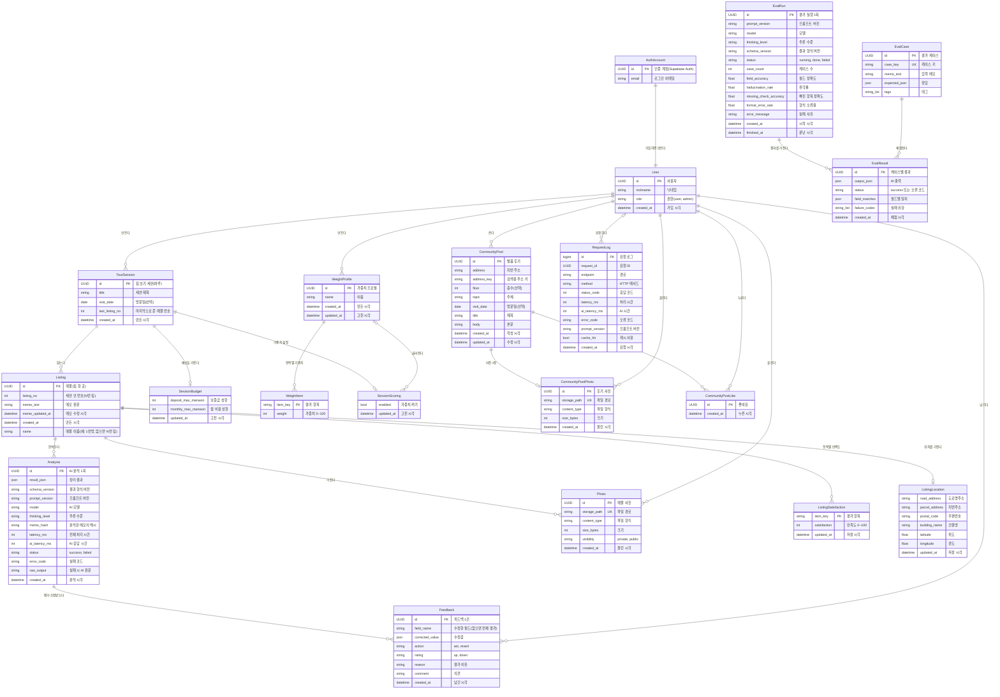

# 데이터베이스 설계서 (DB_DESIGN)

집 보기 메모 비교 서비스의 데이터베이스 설계서입니다. 실제 마이그레이션(`supabase/migrations/*.sql`)과 서버 코드(`backend/app/`)를 읽고 그 내용대로 썼습니다.
기준: `main` 2026-10-19 (PR #34까지 병합 뒤, 마이그레이션 `0001`~`0141`). DB를 바꾸는 PR은 이 문서도 같은 PR에서 고칩니다(`CLAUDE.md` 3절).

- DBMS: PostgreSQL (Supabase). 모든 테이블은 `public` 스키마에 있고, 로그인 계정은 Supabase가 관리하는 `auth.users`를 씁니다.
- 접근 경로: 서버(FastAPI)가 **사용자 토큰**(`authenticated` 역할, RLS 적용)과 **secret key**(`service_role`, 운영·관리 작업)로 접근합니다. 화면(Streamlit)은 DB에 직접 붙지 않습니다.
- 표기: **[DB]** 는 DB 제약(CHECK 등)으로 막는 규칙, **[API]** 는 서버의 Pydantic 모델·코드가 막는 규칙입니다.

## 목차

1. [개요](#1-개요)
2. [논리 ERD](#2-논리-erd)
3. [물리 ERD](#3-물리-erd)
4. [논리·물리 ERD 일치 확인](#4-논리물리-erd-일치-확인)
5. [테이블 명세](#5-테이블-명세)
6. [제약조건·인덱스 적용 이유](#6-제약조건인덱스-적용-이유)
7. [정규화(3NF)와 이상 확인](#7-정규화3nf와-이상-확인)
8. [권한과 행 수준 보안(RLS)](#8-권한과-행-수준-보안rls)
9. [트리거·함수](#9-트리거함수)
10. [문서 유지 규칙](#10-문서-유지-규칙)

---

## 1. 개요

### 1.1 영역과 테이블

| 영역 | 테이블 | 기능 | 마이그레이션 |
|---|---|---|---|
| 사용자 데이터(소유 사슬) | `profiles`, `tour_sessions`, `listings`, `analyses`, `feedback` | F1 인증, F2 세션·매물, F4·F5 AI 분석, F7 수정·피드백 | `0001_core.sql`, `0008_feedback_action.sql`, `0009_listing_name.sql`, `0010_listing_name_update.sql` |
| 사진 | `photos` | F10 매물 사진 | `0006_photos.sql` |
| 예산 | `session_budgets` | F11 세션 예산 | `0007_budget.sql` |
| 항목 가중치 | `weight_profiles`, `weight_items`, `listing_satisfactions`, `session_scoring` | F12 적합도 점수 | `0120_scoring.sql` |
| 매물 위치 | `listing_locations` | F13 내 매물 위치·지도 | `0131_listing_locations.sql` |
| 발품 후기 | `community_posts`, `community_post_photos`, `community_post_likes` | F14 커뮤니티 후기·좋아요 | `0140_community.sql`, `0141_community_likes.sql` |
| 운영(관리자 전용) | `request_logs`, `eval_cases`, `eval_runs`, `eval_results` | F8 실시간 로그, F9 개선 전후 평가 | `0002_ops.sql` |

권한·RLS는 `0003_rls.sql`과 각 기능 파일 끝에 있습니다. `0004`·`0005`는 예약 번호(파일 없음)이고, `0130_map_listings.sql`(서울역 더미 매물)은 저장소에서 빠졌으며 `0132_drop_map_listings.sql`이 이미 만든 테이블을 지웁니다. 따라서 최종 스키마의 `public` 테이블은 **19개**입니다(외부 `auth.users` 제외).

### 1.2 실행 순서

`0001` → `0002` → `0003` → `0006` → `0007` → `0008` → `0120` → `0131` → `0132` → `0140` → `0141`. 모든 파일은 `if not exists`·`drop … if exists`로 써서 여러 번 실행해도 안전합니다. 배포 DB에는 **서버를 배포하기 전에** 실행합니다(`docs/DEPLOY.md` 2단계).

### 1.3 공통 설계 규칙

| 규칙 | 내용 | 이유 |
|---|---|---|
| 기본키 | 대부분 `uuid` + `gen_random_uuid()`. `request_logs`만 `bigint identity` | UUID는 URL에 그대로 써도 순번이 드러나지 않고 서버가 미리 만들 필요가 없다. 로그는 행이 많고 순서대로 쌓이므로 작은 정수가 낫다 |
| 1:1 확장 테이블 | `session_budgets`, `session_scoring`, `listing_locations`는 부모 키를 그대로 PK로 쓴다(PK = FK) | 부모 하나에 행이 최대 하나임을 키로 보장한다 |
| 다대일 항목 테이블 | `weight_items`, `listing_satisfactions`는 (부모 id, `item_key`) 복합 PK | 같은 항목이 두 번 들어가지 않게 한다 |
| 시각 | 모두 `timestamptz`, `now()` 기본값, UTC로 저장. 화면이 KST로 바꿔 보여 준다 | 서버·DB 시간대와 상관없이 같은 시각을 가리킨다 |
| 금액 | 만원 단위 정수(`integer`). `null`은 "정하지 않음/메모에 없음" | 소수 오차가 없고, 0과 "모름"을 구분한다 |
| 문자열 | `text` + 필요한 곳에 `char_length(btrim(…)) between …` CHECK | PostgreSQL에서 `varchar(n)`과 `text`는 성능이 같다. 공백만 있는 값을 막으려고 `btrim` 길이로 검사한다 |
| 삭제 | 소유 사슬은 `on delete cascade`, 로그만 `on delete set null` | 사용자가 지운 데이터는 하위까지 남기지 않는다. 운영 로그는 통계용으로 남긴다 |
| 이름 | 테이블·컬럼은 영어 소문자 `snake_case`, 테이블은 복수형 | 서버 코드·API 필드 이름과 같게 쓴다 |

### 1.4 DB 밖에 두는 데이터

| 저장소 | 데이터 | 이 문서에서 다루지 않는 이유 |
|---|---|---|
| Supabase Auth `auth.users` | 이메일·비밀번호 해시 | Supabase가 관리한다. `profiles.auth_user_id`로만 연결한다 |
| Supabase Storage 버킷 `listing-photos`(비공개) | 사진 파일 | DB에는 경로(`storage_path`)만 둔다. 경로 규칙과 Storage 정책은 8.3절 |
| Redis 호환 저장소(KV) | 메모 초안(F3, TTL), AI 분석 캐시, 실시간 로그 브로커(F8) | 만료되는 임시 데이터라 관계형 테이블로 두지 않는다(`docs/CONTRACT.md` 2절 kv·broker) |

---

## 2. 논리 ERD

엔티티·속성·관계·카디널리티를 나타낸 개념 모델입니다. 키(PK)와 업무 속성만 쓰고, 외래키 컬럼은 관계선으로 나타냅니다(물리 ERD에서 컬럼이 됩니다).

### 2.1 엔티티 정의

| 엔티티 | 뜻 | 식별자 | 비고 |
|---|---|---|---|
| AuthAccount | 로그인 계정 | id | Supabase Auth가 관리(외부 엔티티) |
| User | 서비스 사용자 | id | 계정당 하나. 역할 user·admin |
| TourSession | 집 보기 하루(세션) | id | 사용자의 매물 묶음 |
| Listing | 본 집 한 곳(매물) | id (자연 키: 세션 + 번호) | 메모 원문과 사용자가 붙인 이름을 가진다 |
| Analysis | 메모를 AI로 정리한 1회 결과 | id | 재분석하면 새 인스턴스가 생긴다 |
| Feedback | 분석 결과에 대한 사용자 수정·평가 1건 | id | 필드 수정 또는 전체 평가 |
| Photo | 매물 사진 | id | 파일은 Storage |
| SessionBudget | 세션의 예산 상한 | (세션) | 세션에 종속된 약한 엔티티 |
| WeightProfile | 항목 가중치 묶음(예: 여름 6개월) | id | 계정 단위, 여러 세션에서 다시 쓴다 |
| WeightItem | 프로필의 항목별 가중치 | (프로필 + 항목) | 약한 엔티티 |
| ListingSatisfaction | 매물의 항목별 만족도 | (매물 + 항목) | 약한 엔티티 |
| SessionScoring | 세션의 가중치 설정 | (세션) | 약한 엔티티 |
| ListingLocation | 매물의 주소·좌표 | (매물) | 약한 엔티티 |
| CommunityPost | 지번 주소별 발품 후기 | id | 개인 매물과 연결하지 않는다 |
| CommunityPostPhoto | 후기 사진 | id (자연 키: 후기) | 후기당 1장 |
| CommunityPostLike | 후기에 누른 좋아요 1개 | id (자연 키: 후기 + 누른 사람) | 한 사람이 한 후기에 1번. 내 후기에는 못 누른다 |
| RequestLog | API 요청 1건의 로그 | id | 운영자만 본다 |
| EvalCase | 평가용 메모와 정답 | id (자연 키: case_key) | |
| EvalRun | 같은 기준으로 돌린 평가 1회 | id | 개선 전후 비교 단위 |
| EvalResult | 평가 1회에서 케이스 하나의 결과 | id (자연 키: 실행 + 케이스) | |

### 2.2 관계와 카디널리티

표기: `1` 정확히 하나, `0..1` 없거나 하나, `0..N` 없거나 여럿. 필수 여부는 자식 쪽 FK의 NOT NULL로 정합니다.

| 부모 | 자식 | 카디널리티 | 관계 | 물리 FK (ON DELETE) |
|---|---|---|---|---|
| AuthAccount | User | 1 : 1 | 가입하면 트리거가 만든다 | `profiles.auth_user_id` UNIQUE (CASCADE) |
| User | TourSession | 1 : 0..N | 세션을 만든다 | `tour_sessions.profile_id` (CASCADE) |
| TourSession | Listing | 1 : 0..N | 매물을 담는다 | `listings.session_id` (CASCADE) |
| Listing | Analysis | 1 : 0..N | 분석·재분석 | `analyses.listing_id` (CASCADE) |
| Analysis | Feedback | 1 : 0..N | 결과에 피드백 | `feedback.analysis_id` (CASCADE) |
| User | Feedback | 1 : 0..N | 피드백 작성자 | `feedback.profile_id` (CASCADE) |
| Listing | Photo | 1 : 0..N | 매물 사진 | `photos.listing_id` (CASCADE) |
| User | Photo | 1 : 0..N | 올린 사람 | `photos.profile_id` (CASCADE) |
| TourSession | SessionBudget | 1 : 0..1 | 예산 | `session_budgets.session_id` PK (CASCADE) |
| User | WeightProfile | 1 : 0..N | 가중치 프로필 | `weight_profiles.profile_id` (CASCADE) |
| WeightProfile | WeightItem | 1 : 0..N | 항목별 가중치 | `weight_items.weight_profile_id` PK 일부 (CASCADE) |
| Listing | ListingSatisfaction | 1 : 0..N | 항목별 만족도 | `listing_satisfactions.listing_id` PK 일부 (CASCADE) |
| TourSession | SessionScoring | 1 : 0..1 | 가중치 설정 | `session_scoring.session_id` PK (CASCADE) |
| WeightProfile | SessionScoring | 0..1 : 0..N | 세션이 고른 프로필(선택) | `session_scoring.weight_profile_id` NULL 허용 (SET NULL) |
| Listing | ListingLocation | 1 : 0..1 | 위치 | `listing_locations.listing_id` PK (CASCADE) |
| User | CommunityPost | 1 : 0..N | 후기 작성 | `community_posts.profile_id` (CASCADE) |
| CommunityPost | CommunityPostPhoto | 1 : 0..1 | 후기 사진 1장 | `community_post_photos.post_id` UNIQUE (CASCADE) |
| User | CommunityPostPhoto | 1 : 0..N | 올린 사람 | `community_post_photos.profile_id` (CASCADE) |
| CommunityPost | CommunityPostLike | 1 : 0..N | 후기가 받은 좋아요 | `community_post_likes.post_id` (CASCADE), UNIQUE(`post_id`, `profile_id`) |
| User | CommunityPostLike | 1 : 0..N | 누른 사람 | `community_post_likes.profile_id` (CASCADE) |
| User | RequestLog | 0..1 : 0..N | 요청한 사용자(로그인 전 요청은 사용자 없음) | `request_logs.profile_id` NULL 허용 (SET NULL) |
| EvalRun | EvalResult | 1 : 0..N | 실행의 결과 | `eval_results.run_id` (CASCADE) |
| EvalCase | EvalResult | 1 : 0..N | 케이스의 결과 | `eval_results.case_id` (CASCADE) |

---

## 3. 물리 ERD

실제 테이블·컬럼·타입·키입니다. `PK` 기본키, `FK` 외래키, `UK` UNIQUE. `auth_users`는 Supabase의 `auth.users`입니다(Mermaid에서 점을 쓸 수 없어 밑줄로 씀).

```mermaid
erDiagram
    auth_users ||--|| profiles : "auth_user_id"
    profiles ||--o{ tour_sessions : "profile_id"
    tour_sessions ||--o{ listings : "session_id"
    listings ||--o{ analyses : "listing_id"
    analyses ||--o{ feedback : "analysis_id"
    profiles ||--o{ feedback : "profile_id"
    listings ||--o{ photos : "listing_id"
    profiles ||--o{ photos : "profile_id"
    tour_sessions ||--o| session_budgets : "session_id"
    profiles ||--o{ weight_profiles : "profile_id"
    weight_profiles ||--o{ weight_items : "weight_profile_id"
    listings ||--o{ listing_satisfactions : "listing_id"
    tour_sessions ||--o| session_scoring : "session_id"
    weight_profiles |o--o{ session_scoring : "weight_profile_id"
    listings ||--o| listing_locations : "listing_id"
    profiles ||--o{ community_posts : "profile_id"
    community_posts ||--o| community_post_photos : "post_id"
    profiles ||--o{ community_post_photos : "profile_id"
    community_posts ||--o{ community_post_likes : "post_id"
    profiles ||--o{ community_post_likes : "profile_id"
    profiles |o--o{ request_logs : "profile_id"
    eval_runs ||--o{ eval_results : "run_id"
    eval_cases ||--o{ eval_results : "case_id"

    auth_users {
        uuid id PK
        text email "Supabase Auth 관리"
    }
    profiles {
        uuid id PK
        uuid auth_user_id FK,UK "NOT NULL"
        text nickname "NOT NULL DEFAULT '사용자'"
        text role "NOT NULL DEFAULT 'user' CHECK user|admin"
        timestamptz created_at "NOT NULL DEFAULT now()"
    }
    tour_sessions {
        uuid id PK
        uuid profile_id FK "NOT NULL, IDX"
        text title "NOT NULL"
        date visit_date "NULL"
        integer last_listing_no "NOT NULL DEFAULT 0"
        timestamptz created_at "NOT NULL DEFAULT now()"
    }
    listings {
        uuid id PK
        uuid session_id FK "NOT NULL, UK(session_id, listing_no)"
        integer listing_no "NOT NULL, 트리거가 채움"
        text memo_text "NOT NULL DEFAULT ''"
        timestamptz memo_updated_at "NOT NULL DEFAULT now()"
        timestamptz created_at "NOT NULL DEFAULT now()"
        text name "1~30자, null이면 N번 집 (0009)"
    }
    analyses {
        uuid id PK
        uuid listing_id FK "NOT NULL, IDX"
        jsonb result_json "NULL(실패 시)"
        text schema_version "NOT NULL"
        text prompt_version "NOT NULL"
        text model "NOT NULL"
        text thinking_level "NULL"
        text memo_hash "NOT NULL"
        integer latency_ms "NULL"
        integer ai_latency_ms "NULL"
        text status "NOT NULL CHECK success|failed"
        text error_code "NULL"
        text raw_output "NULL"
        timestamptz created_at "NOT NULL DEFAULT now()"
    }
    feedback {
        uuid id PK
        uuid analysis_id FK "NOT NULL, IDX"
        uuid profile_id FK "NOT NULL, IDX"
        text field_name "NULL(전체 평가)"
        jsonb corrected_value "NULL"
        text rating "NULL CHECK up|down"
        text reason "NULL CHECK 6개 값"
        text comment "NULL"
        timestamptz created_at "NOT NULL DEFAULT now()"
        text action "NULL, CHECK feedback_action_check (0008에서 추가)"
    }
    photos {
        uuid id PK
        uuid listing_id FK "NOT NULL, IDX"
        uuid profile_id FK "NOT NULL, IDX"
        text storage_path UK "NOT NULL"
        text content_type "NOT NULL"
        integer size_bytes "NOT NULL CHECK >= 0"
        text visibility "NOT NULL DEFAULT 'private' CHECK"
        timestamptz created_at "NOT NULL DEFAULT now()"
    }
    session_budgets {
        uuid session_id PK,FK
        integer deposit_max_manwon "NULL CHECK >= 0"
        integer monthly_max_manwon "NULL CHECK >= 0"
        timestamptz updated_at "NOT NULL DEFAULT now()"
    }
    weight_profiles {
        uuid id PK
        uuid profile_id FK "NOT NULL, IDX(profile_id, created_at)"
        text name "NOT NULL CHECK 1~30자"
        timestamptz created_at "NOT NULL DEFAULT now()"
        timestamptz updated_at "NOT NULL DEFAULT now()"
    }
    weight_items {
        uuid weight_profile_id PK,FK
        text item_key PK "CHECK 1~30자"
        smallint weight "NOT NULL CHECK 0~100"
    }
    listing_satisfactions {
        uuid listing_id PK,FK
        text item_key PK "CHECK 1~30자"
        smallint satisfaction "NOT NULL CHECK 0~100"
        timestamptz updated_at "NOT NULL DEFAULT now()"
    }
    session_scoring {
        uuid session_id PK,FK
        boolean enabled "NOT NULL DEFAULT true"
        uuid weight_profile_id FK "NULL, IDX"
        timestamptz updated_at "NOT NULL DEFAULT now()"
    }
    listing_locations {
        uuid listing_id PK,FK
        text road_address "NULL CHECK 1~200자"
        text parcel_address "NULL CHECK 1~200자"
        text postal_code "NULL CHECK 5자리 숫자"
        text building_name "NULL CHECK 1~100자"
        double_precision latitude "NOT NULL CHECK 33~39"
        double_precision longitude "NOT NULL CHECK 124~132"
        timestamptz updated_at "NOT NULL DEFAULT now()"
    }
    community_posts {
        uuid id PK
        uuid profile_id FK "NOT NULL, IDX(profile_id, created_at desc)"
        text address "NOT NULL CHECK 1~200자"
        text address_key "NOT NULL CHECK 1~200자, IDX"
        smallint floor "NULL CHECK -10~200, 0 제외"
        text topic "NOT NULL CHECK 5개 값"
        date visit_date "NULL"
        text title "NOT NULL CHECK 1~100자"
        text body "NOT NULL CHECK 1~3000자"
        timestamptz created_at "NOT NULL DEFAULT now(), IDX desc"
        timestamptz updated_at "NOT NULL DEFAULT now()"
    }
    community_post_photos {
        uuid id PK
        uuid post_id FK,UK "NOT NULL"
        uuid profile_id FK "NOT NULL, IDX"
        text storage_path UK "NOT NULL"
        text content_type "NOT NULL CHECK jpeg|png"
        integer size_bytes "NOT NULL CHECK 1~5242880"
        timestamptz created_at "NOT NULL DEFAULT now()"
    }
    community_post_likes {
        uuid id PK
        uuid post_id FK "NOT NULL, UK(post_id, profile_id)"
        uuid profile_id FK "NOT NULL, IDX"
        timestamptz created_at "NOT NULL DEFAULT now()"
    }
    request_logs {
        bigint id PK "GENERATED ALWAYS AS IDENTITY"
        uuid request_id "NOT NULL"
        uuid profile_id FK "NULL"
        text endpoint "NOT NULL"
        text method "NOT NULL"
        integer status_code "NOT NULL"
        integer latency_ms "NOT NULL"
        integer ai_latency_ms "NULL"
        text error_code "NULL"
        text prompt_version "NULL"
        boolean cache_hit "NULL"
        timestamptz created_at "NOT NULL DEFAULT now(), IDX"
    }
    eval_cases {
        uuid id PK
        text case_key UK "NOT NULL"
        text memo_text "NOT NULL"
        jsonb expected_json "NOT NULL"
        text_array tags "NOT NULL DEFAULT '{}'"
    }
    eval_runs {
        uuid id PK
        text prompt_version "NOT NULL"
        text model "NOT NULL"
        text thinking_level "NULL"
        text schema_version "NOT NULL"
        text status "NOT NULL DEFAULT 'running' CHECK"
        integer case_count "NOT NULL DEFAULT 0"
        double_precision field_accuracy "NULL"
        double_precision hallucination_rate "NULL"
        double_precision missing_check_accuracy "NULL"
        double_precision format_error_rate "NULL"
        text error_message "NULL"
        timestamptz created_at "NOT NULL DEFAULT now()"
        timestamptz finished_at "NULL"
    }
    eval_results {
        uuid id PK
        uuid run_id FK "NOT NULL, IDX"
        uuid case_id FK "NOT NULL, IDX"
        jsonb output_json "NULL"
        text status "NOT NULL"
        jsonb field_matches "NULL"
        text_array failure_codes "NOT NULL DEFAULT '{}'"
        timestamptz created_at "NOT NULL DEFAULT now()"
    }
```

### 3.1 테이블 목록

| # | 테이블 | 설명 | PK | 행이 늘어나는 단위 |
|---|---|---|---|---|
| 1 | `profiles` | 사용자 | `id` | 가입 1회 |
| 2 | `tour_sessions` | 집 보기 세션 | `id` | 세션 만들기 |
| 3 | `listings` | 매물 메모 | `id` | 메모 저장 |
| 4 | `analyses` | AI 분석 결과 | `id` | 분석·재분석 1회 |
| 5 | `feedback` | 수정값·평가 | `id` | 수정·평가 1회(고치지 않고 새 행) |
| 6 | `photos` | 매물 사진 | `id` | 사진 올리기 |
| 7 | `session_budgets` | 세션 예산 | `session_id` | 세션당 최대 1행 |
| 8 | `weight_profiles` | 가중치 프로필 | `id` | 프로필 만들기 |
| 9 | `weight_items` | 프로필 항목 가중치 | (`weight_profile_id`, `item_key`) | 프로필 × 항목 |
| 10 | `listing_satisfactions` | 매물 항목 만족도 | (`listing_id`, `item_key`) | 매물 × 항목 |
| 11 | `session_scoring` | 세션 가중치 설정 | `session_id` | 세션당 최대 1행 |
| 12 | `listing_locations` | 매물 위치 | `listing_id` | 매물당 최대 1행 |
| 13 | `community_posts` | 발품 후기 | `id` | 후기 쓰기 |
| 14 | `community_post_photos` | 후기 사진 | `id` | 후기당 최대 1행 |
| 15 | `community_post_likes` | 후기 좋아요 | `id` | 좋아요 누르기(취소하면 행 삭제) |
| 16 | `request_logs` | 요청 로그 | `id` | API 요청 1회 |
| 17 | `eval_cases` | 평가 케이스 | `id` | 케이스 등록 |
| 18 | `eval_runs` | 평가 실행 | `id` | 평가 실행 1회 |
| 19 | `eval_results` | 케이스별 평가 결과 | `id` | 실행 × 케이스 |
| (외부) | `auth.users` | 인증 계정 | `id` | Supabase Auth 관리 |

---

## 4. 논리·물리 ERD 일치 확인

| 논리 엔티티 | 물리 테이블 | 식별자 → PK | 일치 |
|---|---|---|---|
| AuthAccount | `auth.users` (외부) | id → `id` | ✅ |
| User | `profiles` | id → `id` (+ `auth_user_id` UNIQUE로 1:1) | ✅ |
| TourSession | `tour_sessions` | id → `id` | ✅ |
| Listing | `listings` | id → `id` (+ 자연 키 UNIQUE(`session_id`, `listing_no`)) | ✅ |
| Analysis | `analyses` | id → `id` | ✅ |
| Feedback | `feedback` | id → `id` | ✅ |
| Photo | `photos` | id → `id` (+ `storage_path` UNIQUE) | ✅ |
| SessionBudget | `session_budgets` | (세션) → `session_id` PK·FK | ✅ |
| WeightProfile | `weight_profiles` | id → `id` | ✅ |
| WeightItem | `weight_items` | (프로필, 항목) → 복합 PK | ✅ |
| ListingSatisfaction | `listing_satisfactions` | (매물, 항목) → 복합 PK | ✅ |
| SessionScoring | `session_scoring` | (세션) → `session_id` PK·FK | ✅ |
| ListingLocation | `listing_locations` | (매물) → `listing_id` PK·FK | ✅ |
| CommunityPost | `community_posts` | id → `id` | ✅ |
| CommunityPostPhoto | `community_post_photos` | id → `id` (+ `post_id` UNIQUE로 1:0..1) | ✅ |
| CommunityPostLike | `community_post_likes` | id → `id` (+ 자연 키 UNIQUE(`post_id`, `profile_id`)) | ✅ |
| RequestLog | `request_logs` | id → `id` | ✅ |
| EvalCase | `eval_cases` | id → `id` (+ `case_key` UNIQUE) | ✅ |
| EvalRun | `eval_runs` | id → `id` | ✅ |
| EvalResult | `eval_results` | id → `id` | ✅ |

- **엔티티 수**: 논리 20개(외부 1개 포함) = 물리 테이블 19개 + `auth.users` 1개.
- **관계 수**: 2.2절의 관계 23개가 물리 ERD의 관계선 23개, 그리고 마이그레이션의 `references` 23개와 하나씩 대응합니다(5절 각 표의 FK 칸).
- **속성**: 논리 엔티티의 속성은 물리 테이블에서 FK 컬럼을 뺀 컬럼과 이름이 같습니다. 1:1 확장 엔티티(SessionBudget·SessionScoring·ListingLocation)는 부모 식별자를 PK로 그대로 씁니다.
- **카디널리티**: 1:0..1은 자식 FK가 PK이거나 UNIQUE인 경우(`session_budgets`, `session_scoring`, `listing_locations`, `community_post_photos.post_id`, `profiles.auth_user_id`)이고, 0..1 쪽 부모(선택 관계)는 FK가 NULL을 허용하는 경우(`session_scoring.weight_profile_id`, `request_logs.profile_id`)입니다.

---

## 5. 테이블 명세

칸 설명: **길이·범위**는 문자열 길이나 숫자 범위와 그 규칙을 막는 곳([DB]/[API]), **키·제약**은 PK·FK·UK·CHECK·인덱스입니다. **코멘트**는 컬럼의 뜻입니다. `0008`·`0120`·`0131`·`0140`의 코멘트는 이미 DB에 `COMMENT ON`으로 들어가 있고, 나머지(`0001`·`0002`·`0006`·`0007`)는 이 문서의 코멘트를 Issue #6(`0009_comments.sql`)으로 DB에 반영할 예정입니다.

### 5.1 `profiles` — 사용자

`auth.users`와 1:1. 가입하면 트리거 `on_auth_user_created`가 만든다. 사용자 토큰은 본인 행 SELECT만 할 수 있고, 닉네임 변경은 서버가 secret key로 한다.

| 컬럼 | 타입 | 길이·범위 | NULL | 기본값 | 키·제약 | 코멘트 |
|---|---|---|---|---|---|---|
| `id` | uuid | — | NOT NULL | `gen_random_uuid()` | PK | 사용자 ID. 다른 테이블이 소유자로 가리키는 값 |
| `auth_user_id` | uuid | — | NOT NULL | — | UK, FK → `auth.users.id` (CASCADE) | Supabase 인증 계정 ID. 계정당 프로필 하나 |
| `nickname` | text | 1~20자 [API 마이페이지] | NOT NULL | `'사용자'` | — | 화면에 보이는 이름. 가입 때 이메일 앞부분 |
| `role` | text | `user`, `admin` | NOT NULL | `'user'` | CHECK `role in ('user','admin')` | 권한. admin만 운영 화면·로그 API 사용 |
| `created_at` | timestamptz | — | NOT NULL | `now()` | — | 가입 시각(UTC) |

### 5.2 `tour_sessions` — 집 보기 세션

| 컬럼 | 타입 | 길이·범위 | NULL | 기본값 | 키·제약 | 코멘트 |
|---|---|---|---|---|---|---|
| `id` | uuid | — | NOT NULL | `gen_random_uuid()` | PK | 세션 ID |
| `profile_id` | uuid | — | NOT NULL | — | FK → `profiles.id` (CASCADE), IDX `tour_sessions_profile_id_idx` | 세션을 만든 사용자 |
| `title` | text | 1~100자 [API] | NOT NULL | — | — | 세션 제목(예: 10월 셋째 주 토요일) |
| `visit_date` | date | — | NULL | — | — | 방문일(선택) |
| `last_listing_no` | integer | 0 이상 | NOT NULL | `0` | 사용자 UPDATE 권한 없음 | 마지막으로 준 매물 번호. 번호 트리거만 올린다(지운 번호를 다시 쓰지 않으려고) |
| `created_at` | timestamptz | — | NOT NULL | `now()` | — | 만든 시각(UTC) |

### 5.3 `listings` — 매물(집 한 곳)

메모 원문과 사용자가 붙인 매물 이름을 둔다. AI가 정리한 값은 `analyses`, 사용자 수정값은 `feedback`에 있다(7.3절).

| 컬럼 | 타입 | 길이·범위 | NULL | 기본값 | 키·제약 | 코멘트 |
|---|---|---|---|---|---|---|
| `id` | uuid | — | NOT NULL | `gen_random_uuid()` | PK | 매물 ID |
| `session_id` | uuid | — | NOT NULL | — | FK → `tour_sessions.id` (CASCADE), UK(`session_id`, `listing_no`) | 소속 세션 |
| `listing_no` | integer | 1 이상 | NOT NULL | (트리거 `assign_listing_no`) | UK(`session_id`, `listing_no`) | 세션 안 번호. 화면 이름 "N번 집" |
| `memo_text` | text | 0~5000자 [API] | NOT NULL | `''` | 사용자 UPDATE는 이 컬럼과 `name`(0010)만 | 사용자가 쓴 메모 원문 |
| `memo_updated_at` | timestamptz | — | NOT NULL | `now()` | 트리거 `touch_memo_updated_at` | 메모가 바뀐 시각. 재분석 필요 판단에 쓴다 |
| `created_at` | timestamptz | — | NOT NULL | `now()` | — | 만든 시각(UTC) |
| `name` | text | 1~30자 | NULL | — | CHECK `listings_name_len`(0009). 사용자 UPDATE 가능(0010) | 매물 이름(예: "1번방"). 새 메모 저장 때 필수 [API], 세션 상세 매물 카드의 연필 버튼(매물 수정 모달)으로 고친다. null(0009 이전 매물)이면 화면에 "N번 집" |

### 5.4 `analyses` — AI 분석 결과

분석 1회 = 1행. 고치지 않고(사용자 UPDATE 권한 없음) 재분석하면 새 행을 더한다. 형식 실패 때도 행을 남긴다.

| 컬럼 | 타입 | 길이·범위 | NULL | 기본값 | 키·제약 | 코멘트 |
|---|---|---|---|---|---|---|
| `id` | uuid | — | NOT NULL | `gen_random_uuid()` | PK | 분석 ID |
| `listing_id` | uuid | — | NOT NULL | — | FK → `listings.id` (CASCADE), IDX `analyses_listing_id_idx` | 분석한 매물 |
| `result_json` | jsonb | `AnalysisResult` 형식 [API] | NULL | — | — | 정리 결과(보증금·월세·관리비·장단점·체크리스트 9항목 등). 실패 시 null |
| `schema_version` | text | 예: `1` | NOT NULL | — | — | `result_json` 형식 버전 |
| `prompt_version` | text | 예: `v1`, `v2` | NOT NULL | — | — | 사용한 프롬프트 버전(개선 전후 비교) |
| `model` | text | — | NOT NULL | — | — | 사용한 AI 모델 이름 |
| `thinking_level` | text | — | NULL | — | — | 모델 추론 수준 설정 |
| `memo_hash` | text | sha256 16진수 64자 [API] | NOT NULL | — | — | 분석할 때 메모의 해시. 지금 메모와 다르면 재분석 필요 |
| `latency_ms` | integer | 0 이상 | NULL | — | — | 서버 전체 처리 시간(ms) |
| `ai_latency_ms` | integer | 0 이상 | NULL | — | — | AI 응답 시간(ms). 캐시 사용 시 null |
| `status` | text | `success`, `failed` | NOT NULL | — | CHECK `status in ('success','failed')` | 분석 성공 여부 |
| `error_code` | text | 예: `AI_FORMAT_ERROR` | NULL | — | — | 실패 시 오류 코드 |
| `raw_output` | text | — | NULL | — | — | 형식 실패 때 AI 원문(원인 확인용) |
| `created_at` | timestamptz | — | NOT NULL | `now()` | — | 분석 시각(UTC). 최신 분석을 고를 때 쓴다 |

### 5.5 `feedback` — 수정값·평가

한 테이블에 두 종류의 행을 둔다. **필드 수정 행**(`field_name` 있음, `action` = `set`/`revert`)과 **전체 평가 행**(`field_name` null, `rating`·`reason`·`comment`). 고치지 않고 새 행을 더하며, 같은 분석·필드의 최신 행이 유효하다.

| 컬럼 | 타입 | 길이·범위 | NULL | 기본값 | 키·제약 | 코멘트 |
|---|---|---|---|---|---|---|
| `id` | uuid | — | NOT NULL | `gen_random_uuid()` | PK | 피드백 ID |
| `analysis_id` | uuid | — | NOT NULL | — | FK → `analyses.id` (CASCADE), IDX `feedback_analysis_id_idx` | 대상 분석 |
| `profile_id` | uuid | — | NOT NULL | — | FK → `profiles.id` (CASCADE), IDX `feedback_profile_id_idx` | 남긴 사용자 |
| `field_name` | text | `EDITABLE_FIELDS` 9개 중 하나 [API] | NULL | — | CHECK `feedback_action_check` | 수정한 필드 이름. null이면 전체 평가 행 |
| `corrected_value` | jsonb | 필드 형식에 맞는 값 [API] | NULL | — | CHECK `feedback_action_check` | 수정값. `set`인데 null이면 "메모에 없음" |
| `rating` | text | `up`, `down` | NULL | — | CHECK `rating in ('up','down')` | 전체 평가(좋아요·싫어요) |
| `reason` | text | 6개 값 | NULL | — | CHECK `reason in ('amount','not_in_memo','missing_info','pros_cons','check_error','other')` | 싫어요 이유(금액·메모에 없음·빠진 정보·장단점·체크 오류·기타) |
| `comment` | text | 0~500자 [API] | NULL | — | — | 자유 의견 |
| `created_at` | timestamptz | — | NOT NULL | `now()` | — | 남긴 시각(UTC). 최신 행 판단 기준 |
| `action` | text | `set`, `revert` | NULL | — | CHECK `feedback_action_check` | 필드 수정 행의 동작: set(값으로 고침, null이면 메모에 없음) \| revert(AI 값으로 되돌림). 전체 평가 행은 null 0008에서 추가(DB 코멘트 있음) |

`feedback_action_check`: `(field_name is null and action is null) or (field_name is not null and action = 'set') or (field_name is not null and action = 'revert' and corrected_value가 null)`.

### 5.6 `photos` — 매물 사진

| 컬럼 | 타입 | 길이·범위 | NULL | 기본값 | 키·제약 | 코멘트 |
|---|---|---|---|---|---|---|
| `id` | uuid | — | NOT NULL | `gen_random_uuid()` | PK | 사진 ID |
| `listing_id` | uuid | — | NOT NULL | — | FK → `listings.id` (CASCADE), IDX `photos_listing_id_idx` | 사진을 붙인 매물 |
| `profile_id` | uuid | — | NOT NULL | — | FK → `profiles.id` (CASCADE), IDX `photos_profile_id_idx` | 올린 사용자 = 매물 소유자(RLS가 확인) |
| `storage_path` | text | `{auth.uid()}/{listing_id}/{파일이름}` | NOT NULL | — | UK | Storage 버킷 `listing-photos` 안 경로 |
| `content_type` | text | JPG·PNG [API] | NOT NULL | — | — | 파일 형식(MIME) |
| `size_bytes` | integer | 0 이상 [DB], 5MB 이하 [API] | NOT NULL | — | CHECK `size_bytes >= 0` | 파일 크기(바이트) |
| `visibility` | text | `private`, `public` | NOT NULL | `'private'` | CHECK `visibility in ('private','public')` | 공개 범위. 지금은 private만 쓴다 |
| `created_at` | timestamptz | — | NOT NULL | `now()` | — | 올린 시각(UTC) |

### 5.7 `session_budgets` — 세션 예산

| 컬럼 | 타입 | 길이·범위 | NULL | 기본값 | 키·제약 | 코멘트 |
|---|---|---|---|---|---|---|
| `session_id` | uuid | — | NOT NULL | — | PK, FK → `tour_sessions.id` (CASCADE) | 예산을 정한 세션(세션당 하나) |
| `deposit_max_manwon` | integer | 0 이상 | NULL | — | CHECK `is null or >= 0` | 보증금 상한(만원). null이면 제한 없음 |
| `monthly_max_manwon` | integer | 0 이상 | NULL | — | CHECK `is null or >= 0` | 월 비용(월세+관리비) 상한(만원). null이면 제한 없음 |
| `updated_at` | timestamptz | — | NOT NULL | `now()` | — | 마지막으로 고친 시각(UTC) |

### 5.8 `weight_profiles` — 가중치 프로필 (DB 코멘트 있음)

| 컬럼 | 타입 | 길이·범위 | NULL | 기본값 | 키·제약 | 코멘트 |
|---|---|---|---|---|---|---|
| `id` | uuid | — | NOT NULL | `gen_random_uuid()` | PK | 프로필 ID |
| `profile_id` | uuid | — | NOT NULL | — | FK → `profiles.id` (CASCADE), IDX `weight_profiles_profile_id_idx`(`profile_id`, `created_at`) | 소유 사용자(profiles.id). 사용자 삭제 시 함께 삭제 |
| `name` | text | 1~30자 | NOT NULL | — | CHECK `char_length(btrim(name)) between 1 and 30` | 프로필 이름(1~30자), 예: 여름 6개월 |
| `created_at` | timestamptz | — | NOT NULL | `now()` | — | 만든 시각(UTC) |
| `updated_at` | timestamptz | — | NOT NULL | `now()` | — | 마지막으로 이름·가중치를 고친 시각(UTC) |

### 5.9 `weight_items` — 프로필의 항목별 가중치 (DB 코멘트 있음)

| 컬럼 | 타입 | 길이·범위 | NULL | 기본값 | 키·제약 | 코멘트 |
|---|---|---|---|---|---|---|
| `weight_profile_id` | uuid | — | NOT NULL | — | PK(1), FK → `weight_profiles.id` (CASCADE) | 가중치 프로필(weight_profiles.id). 프로필 삭제 시 함께 삭제 |
| `item_key` | text | 1~30자, 서버 `SCORE_ITEMS` 중 하나 [API] | NOT NULL | — | PK(2), CHECK `char_length(item_key) between 1 and 30` | 평가 항목 이름(예: 채광) |
| `weight` | smallint | 0~100 | NOT NULL | — | CHECK `weight between 0 and 100` | 중요도 0~100 정수. 합이 100이 아니어도 계산에서 비율로 맞춘다 |

### 5.10 `listing_satisfactions` — 매물의 항목별 만족도 (DB 코멘트 있음)

| 컬럼 | 타입 | 길이·범위 | NULL | 기본값 | 키·제약 | 코멘트 |
|---|---|---|---|---|---|---|
| `listing_id` | uuid | — | NOT NULL | — | PK(1), FK → `listings.id` (CASCADE) | 매물(listings.id). 매물 삭제 시 함께 삭제 |
| `item_key` | text | 1~30자, `SCORE_ITEMS` 중 하나 [API] | NOT NULL | — | PK(2), CHECK `char_length(item_key) between 1 and 30` | 평가 항목 이름 |
| `satisfaction` | smallint | 0~100 | NOT NULL | — | CHECK `satisfaction between 0 and 100` | 만족도 0~100 정수, 높을수록 좋음(측정값 아님) |
| `updated_at` | timestamptz | — | NOT NULL | `now()` | — | 저장한 시각(UTC) |

### 5.11 `session_scoring` — 세션의 가중치 설정 (DB 코멘트 있음)

| 컬럼 | 타입 | 길이·범위 | NULL | 기본값 | 키·제약 | 코멘트 |
|---|---|---|---|---|---|---|
| `session_id` | uuid | — | NOT NULL | — | PK, FK → `tour_sessions.id` (CASCADE) | 세션(tour_sessions.id). 세션 삭제 시 함께 삭제 |
| `enabled` | boolean | — | NOT NULL | `true` | — | 가중치 기능 켜기(true)/끄기(false) |
| `weight_profile_id` | uuid | — | NULL | — | FK → `weight_profiles.id` (SET NULL), IDX `session_scoring_weight_profile_id_idx` | 고른 프로필. null이면 모든 항목 동일 가중치. 프로필 삭제 시 null |
| `updated_at` | timestamptz | — | NOT NULL | `now()` | — | 마지막으로 설정을 바꾼 시각(UTC) |

### 5.12 `listing_locations` — 매물 위치 (DB 코멘트 있음)

| 컬럼 | 타입 | 길이·범위 | NULL | 기본값 | 키·제약 | 코멘트 |
|---|---|---|---|---|---|---|
| `listing_id` | uuid | — | NOT NULL | — | PK, FK → `listings.id` (CASCADE) | 매물(listings.id). 매물 삭제 시 함께 삭제 |
| `road_address` | text | 1~200자 | NULL | — | CHECK 길이, CHECK `listing_locations_has_address` | 도로명주소(카카오 주소 검색 결과) |
| `parcel_address` | text | 1~200자 | NULL | — | CHECK 길이, CHECK `listing_locations_has_address` | 지번주소(카카오 주소 검색 결과) |
| `postal_code` | text | 숫자 5자리 | NULL | — | CHECK `postal_code ~ '^[0-9]{5}$'` | 우편번호 5자리(있을 때만) |
| `building_name` | text | 1~100자 | NULL | — | CHECK 길이 | 건물명(있을 때만) |
| `latitude` | double precision | 33~39 | NOT NULL | — | CHECK `latitude between 33 and 39` | 위도(WGS84, 카카오 좌표 변환 결과) |
| `longitude` | double precision | 124~132 | NOT NULL | — | CHECK `longitude between 124 and 132` | 경도(WGS84, 카카오 좌표 변환 결과) |
| `updated_at` | timestamptz | — | NOT NULL | `now()` | — | 저장한 시각(UTC) |

`listing_locations_has_address`: `road_address is not null or parcel_address is not null`.

### 5.13 `community_posts` — 발품 후기 (DB 코멘트 있음)

| 컬럼 | 타입 | 길이·범위 | NULL | 기본값 | 키·제약 | 코멘트 |
|---|---|---|---|---|---|---|
| `id` | uuid | — | NOT NULL | `gen_random_uuid()` | PK | 후기 ID |
| `profile_id` | uuid | — | NOT NULL | — | FK → `profiles.id` (CASCADE), IDX `community_posts_profile_id_idx`(`profile_id`, `created_at desc`) | 작성자(profiles.id). 응답에는 내보내지 않고 닉네임만 보여 준다 |
| `address` | text | 1~200자 | NOT NULL | — | CHECK `char_length(btrim(address)) between 1 and 200` | 지번 주소(카카오 주소 검색으로 고른 값). 호수는 받지 않는다 |
| `address_key` | text | 1~200자 | NOT NULL | — | CHECK 길이, IDX `community_posts_address_key_idx` | 검색용 주소 키: 공백·"번지"를 지운 소문자(서버가 address로 만든다) |
| `floor` | smallint | -10~200, 0 제외 | NULL | — | CHECK `floor between -10 and 200 and floor <> 0` | 층수(선택). 지상 1 이상, 지하 -1부터 음수 |
| `topic` | text | 5개 값 | NOT NULL | — | CHECK `topic in ('구조·설비','소음','채광','주변 환경','기타')` | 주제 |
| `visit_date` | date | — | NULL | — | — | 방문일(선택) |
| `title` | text | 1~100자 | NOT NULL | — | CHECK `char_length(btrim(title)) between 1 and 100` | 제목. 전화번호·이메일 모양은 서버가 거절 [API] |
| `body` | text | 1~3000자 | NOT NULL | — | CHECK `char_length(btrim(body)) between 1 and 3000` | 본문. 전화번호·이메일 모양은 서버가 거절 [API] |
| `created_at` | timestamptz | — | NOT NULL | `now()` | IDX `community_posts_created_at_idx`(desc) | 작성 시각(UTC, 서버 기록) |
| `updated_at` | timestamptz | — | NOT NULL | `now()` | — | 마지막 수정 시각(UTC) |

### 5.14 `community_post_photos` — 후기 사진 (DB 코멘트 있음)

| 컬럼 | 타입 | 길이·범위 | NULL | 기본값 | 키·제약 | 코멘트 |
|---|---|---|---|---|---|---|
| `id` | uuid | — | NOT NULL | `gen_random_uuid()` | PK | 사진 ID |
| `post_id` | uuid | — | NOT NULL | — | UK, FK → `community_posts.id` (CASCADE) | 후기(community_posts.id). 글당 1장 |
| `profile_id` | uuid | — | NOT NULL | — | FK → `profiles.id` (CASCADE), IDX `community_post_photos_profile_id_idx` | 올린 사용자 = 후기 작성자(RLS가 확인) |
| `storage_path` | text | `{auth.uid()}/community/{글 id}/{사진 id}.{jpg\|png}` | NOT NULL | — | UK | Storage 경로. 응답에는 서명 URL만 준다 |
| `content_type` | text | 2개 값 | NOT NULL | — | CHECK `content_type in ('image/jpeg','image/png')` | 실제 파일 형식(서버가 파일 앞부분으로 판단) |
| `size_bytes` | integer | 1~5,242,880 | NOT NULL | — | CHECK `size_bytes between 1 and 5242880` | 파일 크기(1바이트~5MB) |
| `created_at` | timestamptz | — | NOT NULL | `now()` | — | 올린 시각(UTC) |

### 5.15 `community_post_likes` — 후기 좋아요 (DB 코멘트 있음)

| 컬럼 | 타입 | 길이·범위 | NULL | 기본값 | 키·제약 | 코멘트 |
|---|---|---|---|---|---|---|
| `id` | uuid | — | NOT NULL | `gen_random_uuid()` | PK | 좋아요 ID |
| `post_id` | uuid | — | NOT NULL | — | FK → `community_posts.id` (CASCADE), UK(`post_id`, `profile_id`) | 후기(community_posts.id). 후기 삭제 시 함께 삭제 |
| `profile_id` | uuid | — | NOT NULL | — | FK → `profiles.id` (CASCADE), IDX `community_post_likes_profile_id_idx` | 누른 사용자(profiles.id). 응답에는 내보내지 않고 수와 내가 눌렀는지만 준다 |
| `created_at` | timestamptz | — | NOT NULL | `now()` | — | 누른 시각(UTC) |

내 후기에는 누를 수 없다: 서버가 403 `FORBIDDEN`으로 막고 [API], INSERT 정책도 후기 작성자 ≠ 현재 사용자인지 확인한다 [DB].

### 5.16 `request_logs` — 요청 로그 (운영)

요청마다 한 행. 메모 원문·토큰·비밀번호는 남기지 않는다. secret key로만 읽고 쓴다.

| 컬럼 | 타입 | 길이·범위 | NULL | 기본값 | 키·제약 | 코멘트 |
|---|---|---|---|---|---|---|
| `id` | bigint | — | NOT NULL | `generated always as identity` | PK | 로그 번호(쌓인 순서) |
| `request_id` | uuid | — | NOT NULL | — | — | 요청 ID(응답 헤더 `X-Request-ID`와 같은 값) |
| `profile_id` | uuid | — | NULL | — | FK → `profiles.id` (SET NULL) | 요청한 사용자. 로그인 전 요청이나 사용자 삭제 후에는 null |
| `endpoint` | text | 라우트 경로 | NOT NULL | — | — | 요청 경로(예: `/listings/{listing_id}/analyses`) |
| `method` | text | GET·POST·PUT·PATCH·DELETE | NOT NULL | — | — | HTTP 메서드 |
| `status_code` | integer | 100~599 | NOT NULL | — | — | 응답 상태 코드 |
| `latency_ms` | integer | 0 이상 | NOT NULL | — | — | 서버 처리 시간(ms) |
| `ai_latency_ms` | integer | 0 이상 | NULL | — | — | AI 호출 시간(ms). AI를 부르지 않은 요청은 null |
| `error_code` | text | 오류 코드 | NULL | — | — | 오류 코드(예: `AI_TIMEOUT`). 성공은 null |
| `prompt_version` | text | — | NULL | — | — | 분석 요청의 프롬프트 버전 |
| `cache_hit` | boolean | — | NULL | — | — | 분석 캐시 사용 여부. 분석 요청이 아니면 null |
| `created_at` | timestamptz | — | NOT NULL | `now()` | IDX `request_logs_created_at_idx` | 요청 시각(UTC). 기간 조회·최신순 정렬 |

### 5.17 `eval_cases` — 평가 케이스 (운영)

| 컬럼 | 타입 | 길이·범위 | NULL | 기본값 | 키·제약 | 코멘트 |
|---|---|---|---|---|---|---|
| `id` | uuid | — | NOT NULL | `gen_random_uuid()` | PK | 케이스 ID |
| `case_key` | text | — | NOT NULL | — | UK | 사람이 읽는 케이스 키(`eval/eval_cases.json`의 `case_key`). 다시 불러올 때 이 값으로 넣거나 갱신한다 |
| `memo_text` | text | — | NOT NULL | — | — | 평가에 넣는 메모(예시 데이터, 실제 개인정보 없음) |
| `expected_json` | jsonb | — | NOT NULL | — | — | 정답 결과. `_criteria` 키에 채점 기준 글 |
| `tags` | text[] | — | NOT NULL | `'{}'` | — | 분류 태그(예: `money_idiom` 금액 관용 표현, `negation` 부정 표현) |

### 5.18 `eval_runs` — 평가 실행 (운영)

| 컬럼 | 타입 | 길이·범위 | NULL | 기본값 | 키·제약 | 코멘트 |
|---|---|---|---|---|---|---|
| `id` | uuid | — | NOT NULL | `gen_random_uuid()` | PK | 실행 ID |
| `prompt_version` | text | 1~50자 [API] | NOT NULL | — | — | 평가한 프롬프트 버전 |
| `model` | text | — | NOT NULL | — | — | 사용한 AI 모델 |
| `thinking_level` | text | — | NULL | — | — | 추론 수준 |
| `schema_version` | text | — | NOT NULL | — | — | 결과 형식 버전 |
| `status` | text | `running`, `done`, `failed` | NOT NULL | `'running'` | CHECK `status in ('running','done','failed')` | 실행 상태 |
| `case_count` | integer | 0 이상 | NOT NULL | `0` | — | 채점한 케이스 수 |
| `field_accuracy` | double precision | 0~1 | NULL | — | — | 필드 정확도(끝나면 채움) |
| `hallucination_rate` | double precision | 0~1 | NULL | — | — | 메모에 없는 값을 만든 비율 |
| `missing_check_accuracy` | double precision | 0~1 | NULL | — | — | 빠진 확인 항목 판단 정확도 |
| `format_error_rate` | double precision | 0~1 | NULL | — | — | 형식 오류 비율 |
| `error_message` | text | — | NULL | — | — | 실행 실패 사유 |
| `created_at` | timestamptz | — | NOT NULL | `now()` | — | 시작 시각(UTC) |
| `finished_at` | timestamptz | — | NULL | — | — | 끝난 시각(UTC). 실행 중이면 null |

### 5.19 `eval_results` — 케이스별 평가 결과 (운영)

| 컬럼 | 타입 | 길이·범위 | NULL | 기본값 | 키·제약 | 코멘트 |
|---|---|---|---|---|---|---|
| `id` | uuid | — | NOT NULL | `gen_random_uuid()` | PK | 결과 ID |
| `run_id` | uuid | — | NOT NULL | — | FK → `eval_runs.id` (CASCADE), IDX `eval_results_run_id_idx` | 평가 실행 |
| `case_id` | uuid | — | NOT NULL | — | FK → `eval_cases.id` (CASCADE), IDX `eval_results_case_id_idx` | 평가 케이스 |
| `output_json` | jsonb | — | NULL | — | — | AI 출력. 실패 시 null |
| `status` | text | `success` 또는 오류 코드 [API] | NOT NULL | — | — | 케이스 결과 상태 |
| `field_matches` | jsonb | — | NULL | — | — | 필드별 정답 일치 여부 |
| `failure_codes` | text[] | NUM·HAL·MIS·CHK·FMT [API] | NOT NULL | `'{}'` | — | 실패 유형 코드 목록 |
| `created_at` | timestamptz | — | NOT NULL | `now()` | — | 채점 시각(UTC) |

---

## 6. 제약조건·인덱스 적용 이유

### 6.1 NOT NULL

| 적용 | 이유 |
|---|---|
| 모든 PK·필수 FK(소유자·부모 id) | 부모 없는 행(고아)과 주인 없는 행을 막는다. RLS가 소유 사슬로 권한을 판단하므로 사슬이 끊기면 안 된다 |
| `created_at`·`updated_at` | 최신 행 판단(분석·피드백), 정렬, 로그 기간 조회에 항상 필요하다 |
| `listings.memo_text` (기본값 `''`) | 빈 메모와 "메모 없음"을 따로 다루지 않으려고 null 대신 빈 문자열로 둔다 |
| `analyses`의 `schema_version`·`prompt_version`·`model`·`memo_hash`·`status` | 실패한 분석도 어떤 조건에서 돌렸는지 남아야 개선 전후 비교와 재분석 판단이 가능하다 |
| `request_logs`의 `endpoint`·`method`·`status_code`·`latency_ms` | 대시보드 지표(오류율·지연)의 기본 값이라 빠지면 안 된다 |
| `listing_locations.latitude`·`longitude` | 좌표가 없으면 지도에 핀을 찍을 수 없으므로 위치 행 자체가 의미 없다 |
| 발품 후기 `address`·`topic`·`title`·`body` | 검색·필터의 기준이고, 빈 후기를 막는다 |

**NULL을 허용한 곳**: "정하지 않음/메모에 없음/해당 없음"을 나타내야 하는 값입니다. 예: `session_budgets`의 상한(null = 제한 없음), `analyses.result_json`(실패), `feedback.field_name`(전체 평가 행), `session_scoring.weight_profile_id`(동일 가중치), `request_logs.profile_id`(로그인 전 요청·삭제된 사용자), 선택 입력(`visit_date`, `floor`).

### 6.2 UNIQUE

| 제약 | 이유 |
|---|---|
| `profiles.auth_user_id` | 인증 계정 하나에 프로필 하나(1:1). 가입 트리거가 `on conflict do nothing`으로 중복 생성을 피할 수 있게 한다 |
| `listings (session_id, listing_no)` | 같은 세션에 "1번 집"이 둘 생기지 않게 한다. 이 인덱스가 `session_id` 조회 인덱스도 겸한다 |
| `photos.storage_path`, `community_post_photos.storage_path` | 파일 하나를 두 행이 가리키면 한쪽을 지울 때 다른 쪽 파일이 사라진다 |
| `community_post_photos.post_id` | 후기당 사진 1장 규칙을 DB에서 보장한다 |
| `community_post_likes (post_id, profile_id)` | 한 사람이 한 후기에 좋아요를 두 번 누를 수 없게 한다. 이 인덱스가 `post_id` 조회(좋아요 수)도 겸한다 |
| `eval_cases.case_key` | 케이스 파일을 다시 불러올 때 같은 케이스를 찾아 갱신한다(중복 등록 방지) |
| 복합 PK `weight_items`, `listing_satisfactions` | 같은 프로필·매물에 같은 항목이 두 번 들어가지 않게 한다 |

### 6.3 CHECK

| 제약 | 이유 |
|---|---|
| 값 목록(`profiles.role`, `analyses.status`, `feedback.rating`·`reason`, `photos.visibility`, `eval_runs.status`, `community_posts.topic`, `community_post_photos.content_type`) | 화면·서버가 아는 값만 저장한다. 서버 코드에 버그가 있어도 잘못된 값이 들어가지 않는다 |
| `feedback_action_check` | 필드 수정 행과 전체 평가 행이 섞이지 않게 하고, "되돌리기"에 값이 붙는 모순을 막는다(0008) |
| 금액 `>= 0`(`session_budgets`), 크기 `>= 0`·`1~5MB`(사진) | 음수 금액·크기는 의미가 없다 |
| 0~100 범위(`weight_items.weight`, `listing_satisfactions.satisfaction`) | 점수 계산 공식이 0~100 정수를 전제로 한다 |
| 길이(`btrim` 기준, F12·F13·F14 문자열) | 공백만 있는 이름·제목을 막고, 화면에 넘치는 긴 값을 막는다 |
| 좌표 범위(위도 33~39, 경도 124~132)·우편번호 5자리 | 한국 밖 좌표나 잘못 변환된 값을 거른다 |
| `listing_locations_has_address` | 도로명·지번 중 하나는 있어야 주소를 보여 줄 수 있다 |
| `community_posts.floor` (-10~200, 0 제외) | 층에 0층은 없고, 지하는 음수로 통일한다 |

`item_key`에는 항목 목록 CHECK를 걸지 않았습니다. 항목 목록(`SCORE_ITEMS`)을 바꿀 때 마이그레이션 없이 동작하게 하려는 결정이고, 서버가 저장 전에 목록을 확인합니다.

`tour_sessions.title`, `listings.memo_text`, `feedback.comment`, `profiles.nickname`의 길이는 DB CHECK 없이 서버(Pydantic)만 막습니다(0001 당시 결정). Issue #6에서 CHECK를 더할지 정합니다.

### 6.4 외래키 ON DELETE

| 동작 | 적용 | 이유 |
|---|---|---|
| CASCADE | 소유 사슬 전체(`profiles` → … → `feedback`·`photos`, F11·F12·F13·F14 테이블), `eval_results` | 사용자·세션·매물을 지우면 딸린 데이터도 남기지 않는다(삭제 이상 방지, 개인정보 잔존 방지). 평가 실행을 지우면 그 결과도 의미가 없다 |
| SET NULL | `request_logs.profile_id`, `session_scoring.weight_profile_id` | 로그는 사용자가 지워져도 운영 통계로 남긴다. 프로필을 지워도 세션 설정은 남기고 "동일 가중치"로 되돌린다 |

### 6.5 인덱스

PostgreSQL은 PK·UNIQUE에 인덱스를 자동으로 만들지만, FK에는 만들지 않습니다. 그래서 조회에 쓰는 FK에 인덱스를 따로 둡니다.

| 인덱스 | 대상 | 쓰는 조회 |
|---|---|---|
| `tour_sessions_profile_id_idx` | `tour_sessions(profile_id)` | 내 세션 목록, RLS 소유 확인 |
| (UNIQUE) `listings_session_listing_no_key` | `listings(session_id, listing_no)` | 세션의 매물 목록(번호 순), 번호 중복 방지 |
| `analyses_listing_id_idx` | `analyses(listing_id)` | 매물의 최신 분석 찾기 |
| `feedback_analysis_id_idx` | `feedback(analysis_id)` | 분석의 수정값 모으기(비교표·상세) |
| `feedback_profile_id_idx` | `feedback(profile_id)` | 운영자 피드백 목록, 사용자 삭제 시 CASCADE |
| `photos_listing_id_idx`, `photos_profile_id_idx` | `photos` | 매물 사진 목록, 마이페이지 내 사진 |
| `weight_profiles_profile_id_idx` | `weight_profiles(profile_id, created_at)` | 내 프로필 목록을 만든 순서로 |
| `session_scoring_weight_profile_id_idx` | `session_scoring(weight_profile_id)` | 프로필 삭제 시 SET NULL 대상 찾기 |
| `community_posts_created_at_idx` | `community_posts(created_at desc)` | 후기 목록 최신순 |
| `community_posts_profile_id_idx` | `community_posts(profile_id, created_at desc)` | 마이페이지 내 후기 최신순 |
| `community_posts_address_key_idx` | `community_posts(address_key)` | 주소 키로 같은 주소 후기 찾기 |
| `community_post_photos_profile_id_idx` | `community_post_photos(profile_id)` | 사용자 삭제 시 CASCADE |
| `community_post_likes_profile_id_idx` | `community_post_likes(profile_id)` | 내가 누른 좋아요 찾기, 사용자 삭제 시 CASCADE |
| `request_logs_created_at_idx` | `request_logs(created_at)` | 대시보드 기간 조회·최신순, 놓친 로그 재조회 |
| `eval_results_run_id_idx`, `eval_results_case_id_idx` | `eval_results` | 실행별 결과, 케이스별 개선 전후 비교 |

인덱스를 두지 않은 곳과 이유:
- `request_logs.profile_id`: 사용자별 로그 조회 화면이 없고, 사용자 삭제 때 SET NULL만 한다. 로그가 많아져 사용자 삭제가 느려지면 인덱스를 더한다.
- 1:1 테이블(`session_budgets`, `session_scoring`, `listing_locations`)과 복합 PK 테이블: PK 인덱스가 부모 조회를 겸한다.
- `community_posts.address_key`의 부분 검색: 지금은 서버가 후기 목록을 받아 주소 키 부분 일치로 거른다(`features/community/address.py`). 후기가 많아지면 `pg_trgm` GIN 인덱스로 DB에서 거르도록 바꾼다.

---

## 7. 정규화(3NF)와 이상 확인

### 7.1 정규형 점검

| 정규형 | 기준 | 확인 결과 |
|---|---|---|
| 1NF | 모든 값이 원자값, 반복 그룹 없음 | 항목별 가중치·만족도는 반복 컬럼(`chaegwang_weight` …) 대신 행으로 나눴다(`weight_items`, `listing_satisfactions`). 예외: `analyses.result_json`·`feedback.corrected_value`·`eval_*`의 jsonb와 `text[]`(7.3절) |
| 2NF | 복합 키의 일부에만 종속된 속성 없음 | 복합 PK 테이블은 `weight_items`(`weight`가 두 키 모두에 종속), `listing_satisfactions`(`satisfaction`·`updated_at`이 두 키 모두에 종속)뿐이다. 나머지는 단일 PK라 해당 없음 |
| 3NF | 키가 아닌 속성끼리의 이행 종속 없음 | 사용자 정보(닉네임)는 `profiles`에만, 세션 정보는 `tour_sessions`에만 있다. 매물·분석·피드백은 부모 id만 가진다. 아래 7.2의 의도적 예외만 있다 |

### 7.2 의도적으로 둔 중복과 이상 방지 방법

| 중복 | 무엇이 중복인가 | 둔 이유 | 이상(불일치) 방지 |
|---|---|---|---|
| `photos.profile_id` | `listing_id → session → profile`로 알 수 있는 소유자 | Storage 경로(`{auth.uid()}/…`)와 RLS 검사를 조인 없이 하려고 | RLS `with check`가 `profile_id = 현재 사용자`이면서 매물도 현재 사용자 것인지 함께 확인한다. 사용자에게 UPDATE 권한이 없어 나중에 어긋날 수 없다 |
| `feedback.profile_id` | 분석 → 매물 → 세션 → 소유자 | 운영자 피드백 목록에서 작성자를 바로 보려고 | 위와 같은 RLS `with check`, UPDATE 권한 없음 |
| `community_post_photos.profile_id` | `post_id → community_posts.profile_id` | Storage 경로와 RLS 검사 | INSERT 정책이 후기 작성자 = 현재 사용자인지 확인한다. UPDATE 권한 없음 |
| `community_posts.address_key` | `address`로 계산되는 값(`address → address_key`) | 띄어쓰기·"번지" 차이와 상관없이 같은 주소를 찾으려고 | 서버가 `address`를 저장·수정할 때마다 함께 다시 만든다(`service.py`). 사용자 토큰으로 직접 쓰는 화면이 없다 |
| `tour_sessions.last_listing_no` | 매물 번호의 최댓값처럼 보이는 값 | 지운 번호를 다시 쓰지 않으려면 `max(listing_no)`로는 안 된다(마지막 매물을 지우면 번호가 되돌아감). 계산값이 아니라 "지금까지 준 번호"라는 상태다 | 사용자 UPDATE 권한이 없고, `security definer` 트리거만 올린다 |
| `eval_runs`의 지표 4개와 `case_count` | `eval_results`로 다시 계산할 수 있는 집계 | 개선 전후 비교 화면이 실행 목록을 빠르게 보여 주려고 | 실행이 끝날 때 한 번 저장하고 결과 행은 고치지 않는다(스냅샷). 운영 전용 테이블이라 사용자가 쓸 수 없다 |
| `analyses.memo_hash` | 메모로 계산되는 값 | 분석한 **그때의** 메모를 나타낸다. 지금 메모와 비교해 재분석 필요를 판단한다 | 분석 행은 고치지 않으므로 그 시점 값이 유지된다(현재 메모의 종속이 아님) |

### 7.3 jsonb·배열 컬럼을 둔 이유

- `analyses.result_json`: 분석 1회의 **바뀌지 않는 스냅샷**입니다. 체크리스트 항목은 `item`·`status` 구조를 가지고, 결과 형식은 `schema_version`으로 버전을 관리하므로 형식을 바꿔도 마이그레이션이 필요 없습니다. 재분석하면 새 행이 생겨 v1·v2 결과를 함께 비교할 수 있습니다(F5·F9). 사용자 수정값은 결과를 고치지 않고 `feedback`에 따로 쌓고, 화면 값은 서버가 `effective_values(result_json, overrides)`로 합칩니다. 그래서 갱신 이상이 생기지 않습니다.
- `feedback.corrected_value`: 필드마다 형식(정수·문자열·목록)이 달라 한 컬럼에 jsonb로 둡니다. 어떤 필드인지는 `field_name`이 정합니다.
- `eval_cases.expected_json`, `eval_results.output_json`·`field_matches`: `result_json`과 같은 구조를 비교하는 평가용 스냅샷입니다.
- `eval_cases.tags`, `eval_results.failure_codes`(`text[]`): 조인 없이 함께 읽는 짧은 코드 목록이고, 개별 값으로 따로 조회하거나 고치지 않습니다.

트레이드오프: jsonb 안의 값(예: 채광 상태)은 DB 제약을 걸 수 없어 서버의 Pydantic 모델(`AnalysisResult`)이 검증하고, 값으로 거르는 조회는 서버가 합니다.

### 7.4 삽입·갱신·삭제 이상 확인

| 이상 | 예시 상황 | 확인 결과 |
|---|---|---|
| 삽입 이상 | 매물이 없는 세션, 분석 전 매물, 프로필 없는 세션 설정을 저장할 수 있는가 | 가능하다. 세션·매물·분석·피드백이 각각 독립 테이블이라 상위 데이터만으로 행을 만들 수 있다. 반대로 부모 없는 자식은 FK NOT NULL로 막는다 |
| 삽입 이상 | 예산·위치·가중치 설정이 없는 세션·매물 | 1:1 확장 테이블로 분리해 행이 없으면 "설정 안 함"이다. 부모 테이블에 null 컬럼이 늘지 않는다 |
| 갱신 이상 | 닉네임을 바꾸면 여러 행을 고쳐야 하는가 | `profiles` 한 행만 고친다. 후기 작성자 닉네임도 저장하지 않고 조회 때 읽는다 |
| 갱신 이상 | 세션 제목을 바꾸면 매물·지도 데이터를 고쳐야 하는가 | `tour_sessions` 한 행만 고친다. 전체 매물 지도의 세션 이름도 저장하지 않고 조회 때 읽는다 |
| 갱신 이상 | 사용자가 AI 값을 고치면 분석 결과와 어긋나는가 | 분석 결과는 고치지 않고 `feedback`에 새 행을 더한다. 최신 행이 유효하므로 동시 수정에도 덮어쓰기 충돌이 없다 |
| 갱신 이상 | 주소를 고쳤는데 검색 키가 옛 값으로 남는가 | 서버가 `address`와 `address_key`를 한 UPDATE에서 함께 바꾼다(7.2) |
| 삭제 이상 | 매물을 지우면 세션 정보가 사라지는가 | 아니다. 매물 행과 그 하위(분석·피드백·사진·위치·만족도)만 CASCADE로 지워진다 |
| 삭제 이상 | 가중치 프로필을 지우면 세션 설정이 지워지는가 | 아니다. `session_scoring.weight_profile_id`만 null(동일 가중치)이 되고 켜기/끄기 설정은 남는다 |
| 삭제 이상 | 사용자를 지우면 운영 로그도 사라지는가 | 아니다. `request_logs.profile_id`만 null이 되고 지표는 남는다. 개인 데이터는 모두 CASCADE로 지워진다 |
| 삭제 이상 | 매물을 지우고 새로 만들면 번호가 겹치는가 | 아니다. `last_listing_no`가 계속 올라가 지운 번호를 다시 쓰지 않는다 |

---

## 8. 권한과 행 수준 보안(RLS)

### 8.1 원칙 (`0003_rls.sql`)

- Supabase 기본 권한에 기대지 않도록 `anon`·`authenticated`의 권한을 모두 회수(REVOKE)한 뒤 필요한 것만 다시 줍니다.
- 모든 테이블에 RLS를 켭니다. 사용자 토큰은 **소유 사슬** `profiles → tour_sessions → listings → (analyses → feedback, photos, …)` 안의 자기 행만 읽고 씁니다. 판단에는 `current_profile_id()` 함수를 씁니다.
- 서버의 secret key(`service_role`)는 RLS를 우회해 모든 테이블을 다룹니다. 운영 테이블과 닉네임 변경, 후기 작성자 닉네임 조회에만 씁니다.

### 8.2 테이블별 권한

| 테이블 | authenticated 권한 | RLS 정책 |
|---|---|---|
| `profiles` | SELECT | 본인 행(`auth_user_id = auth.uid()`) |
| `tour_sessions` | SELECT·INSERT·DELETE, UPDATE(`title`, `visit_date`)만 | `profile_id = current_profile_id()` |
| `listings` | SELECT·INSERT·DELETE, UPDATE(`memo_text`)만 | 세션 소유자 |
| `analyses` | SELECT·INSERT·DELETE (UPDATE 없음) | 매물 → 세션 소유자 |
| `feedback` | SELECT·INSERT·DELETE (UPDATE 없음) | 본인 작성 + 분석이 본인 소유 |
| `photos` | SELECT·INSERT·DELETE | 본인 업로드 + 매물이 본인 소유 |
| `session_budgets` | SELECT·INSERT·UPDATE·DELETE | 세션 소유자 |
| `weight_profiles` | SELECT·INSERT·UPDATE·DELETE | `profile_id = current_profile_id()` |
| `weight_items` | SELECT·INSERT·UPDATE·DELETE | 프로필 소유자 |
| `listing_satisfactions` | SELECT·INSERT·UPDATE·DELETE | 매물 → 세션 소유자 |
| `session_scoring` | SELECT·INSERT·UPDATE·DELETE | 세션 소유자 + 고른 프로필도 본인 것(`with check`) |
| `listing_locations` | SELECT·INSERT·UPDATE·DELETE | 매물 → 세션 소유자 |
| `community_posts` | SELECT·INSERT·UPDATE·DELETE | 읽기는 로그인 사용자 모두, 쓰기·고치기·지우기는 작성자 |
| `community_post_photos` | SELECT·INSERT·DELETE | 읽기는 로그인 사용자 모두, 올리기는 후기 작성자, 지우기는 올린 사람 |
| `community_post_likes` | SELECT·INSERT·DELETE | 읽기는 로그인 사용자 모두(좋아요 수), 누르기는 본인 이름으로 남의 후기에만, 취소는 본인 것만 |
| `request_logs`, `eval_*` | 없음 | 정책 없음 → secret key 전용 |

### 8.3 Storage(`listing-photos` 비공개 버킷)

| 정책 | 내용 |
|---|---|
| `listing_photos_select_own`·`insert_own`·`update_own`·`delete_own` (0006) | 경로의 첫 폴더가 본인 `auth.uid()`인 파일만 다룬다 |
| `listing_photos_select_community` (0140) | 두 번째 폴더가 `community`인 파일(발품 후기 사진)은 로그인 사용자 모두 읽는다. 매물 사진은 두 번째 폴더가 매물 id라 이 정책에 걸리지 않는다 |

---

## 9. 트리거·함수

| 이름 | 종류 | 언제 | 하는 일 | 파일 |
|---|---|---|---|---|
| `handle_new_auth_user()` / `on_auth_user_created` | AFTER INSERT on `auth.users` | 가입 | `profiles` 행을 만든다. 닉네임 기본값은 이메일 앞부분 | 0001 |
| `assign_listing_no()` / `listings_assign_no` | BEFORE INSERT on `listings` | 매물 만들기 | 세션의 `last_listing_no`를 1 올리고 그 값을 `listing_no`에 넣는다. 사용자에게 `last_listing_no` UPDATE 권한을 주지 않으려고 `security definer` | 0001 |
| `touch_memo_updated_at()` / `listings_touch_memo` | BEFORE UPDATE on `listings` | 메모 수정 | `memo_text`가 바뀌었을 때만 `memo_updated_at`을 지금으로 | 0001 |
| `current_profile_id()` | SQL 함수(`stable`, `security definer`) | RLS 정책 | 로그인 사용자의 `profiles.id`. 정책마다 `(select …)`로 감싸 한 쿼리에 한 번만 계산한다 | 0003 |

트리거 함수는 `anon`·`authenticated`가 직접 부르지 못하게 EXECUTE 권한을 회수했습니다. 모든 함수는 `set search_path = ''`로 스키마를 고정해 검색 경로 바꿔치기를 막습니다.

---

## 10. 문서 유지 규칙

- 새 마이그레이션을 더하는 PR은 이 문서의 1.1·1.2절, ERD(2·3절), 테이블 명세(5절), 제약 이유(6절)를 같은 PR에서 고칩니다.
- 기존 마이그레이션 파일은 고치지 않고 새 번호 파일로 바꿉니다(`CLAUDE.md` 3절). 이 문서는 모든 마이그레이션을 실행한 **최종 상태**를 적습니다.
- 컬럼 코멘트: `0008`·`0120`·`0131`·`0140`·`0141`은 DB에 이미 있습니다. 나머지 테이블의 코멘트는 이 문서의 5절을 기준으로 Issue #6(`0009_comments.sql`)에서 `COMMENT ON`으로 반영합니다.
- 테이블별 쓰기 담당과 API는 `docs/CONTRACT.md` 5절, 화면 흐름은 `docs/SCREEN_DESIGN.md`, 엔드포인트는 `docs/API_DESIGN.md`를 봅니다.
