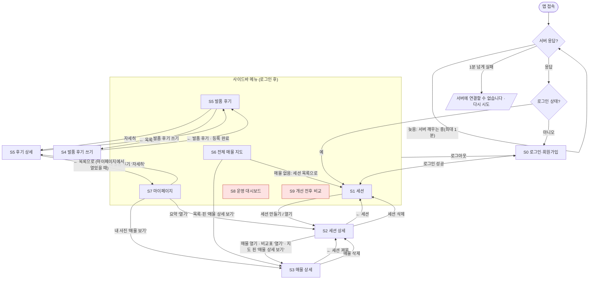

# 화면 설계서 (SCREEN_DESIGN)

집 보기 메모 비교 서비스의 화면 설계서입니다. 실제 화면 코드(`frontend/`)를 읽고 그 내용대로 썼습니다.
기준: `main` 2026-10-19 (PR #34까지 병합 뒤) + 2026-10-20 공통 테마·사이드바·세션 목록/상세·매물 상세 화면 개편(`feat/ui-theme`). 화면을 바꾸는 PR은 이 문서도 같은 PR에서 고칩니다(`CLAUDE.md` 3절).

- 화면 기술: Streamlit 1.65 (`frontend/app.py` 진입점, `layout="wide"`).
- 서버 호출: 모든 화면은 `frontend/core/api.py`로 FastAPI 서버를 부릅니다. 엔드포인트의 요청·응답 형식은 API 설계 문서(`docs/API_DESIGN.md`)와 `docs/CONTRACT.md`를 봅니다.
- 이 문서에서 `API` 칸은 화면이 부르는 엔드포인트입니다. 표의 문구는 화면에 실제로 나오는 문구입니다.

## 목차

1. [화면 목록](#1-화면-목록)
2. [IA와 화면 이동](#2-ia와-화면-이동)
3. [공통 UI 기준](#3-공통-ui-기준)
4. [화면별 설계](#4-화면별-설계)
5. [공통 상태: 로딩·성공·실패·빈 목록](#5-공통-상태-로딩성공실패빈-목록)
6. [문서 유지 규칙](#6-문서-유지-규칙)

---

## 1. 화면 목록

로그인 전에는 로그인 화면만 보입니다. 로그인 후 사이드바 메뉴는 `order` 순서로 나옵니다(`frontend/app.py`, 각 기능의 `pages.py`).

| ID | 화면 | 유형 | 사이드바 | 권한 | 코드 |
|---|---|---|---|---|---|
| S0 | 로그인·회원가입 | 입력 | (로그인 전 단독) | 모두 | `features/auth/pages.py` |
| S1 | 세션 목록 | 메인 | 10 세션 | 로그인 사용자 | `features/sessions/pages.py` |
| S2 | 세션 상세 | 상세·입력 | (숨김) S1·마이페이지의 버튼 | 로그인 사용자(본인 세션) | `core/host_pages.py` + 슬롯 `session_detail` |
| S3 | 매물 상세 | 상세·입력 | (숨김) S2·전체 매물·마이페이지의 버튼 | 로그인 사용자(본인 매물) | `core/host_pages.py` + 슬롯 `listing_detail` |
| S4 | 발품 후기 쓰기 | 입력 | (숨김) S5의 [발품 후기 쓰기] | 로그인 사용자 | `features/community/pages.py` |
| S5 | 발품 후기 목록·상세 | 메인·상세 | 65 발품 후기(상세 66 `balpum_post`는 숨김) | 로그인 사용자(남의 글은 보기만) | `features/community/pages.py`, `components.py` |
| S6 | 전체 매물(지도) | 메인 | 70 전체 매물 | 로그인 사용자(본인 매물) | `features/map/pages.py` |
| S7 | 마이페이지 | 설정 | 80 마이페이지 | 로그인 사용자 | `features/mypage/pages.py` |
| S8 | 운영 대시보드 | 메인 | 90 운영 대시보드 | **운영자만** | `features/admin_logs/pages.py` |
| S9 | 개선 전후 비교 | 메인 | 95 개선 전후 비교 | **운영자만** | `features/evals/pages.py` |
| E | 공통 오류·안내 상태 | 오류 | (모든 화면 안) | — | `core/ui.py`, `core/slots.py`, `app.py` |

- 운영자 화면(S8·S9)은 일반 계정의 사이드바에 나오지 않습니다. 주소로 직접 들어와도 "운영자만 볼 수 있습니다. 다른 메뉴를 이용하세요."가 나오고, 서버도 403을 돌려줍니다.
- 세션 상세(S2)·매물 상세(S3)·발품 후기 쓰기(S4)·발품 후기 상세(S5 상세)는 사이드바 메뉴에 없습니다(`PAGES`의 `"hidden": True` → `st.Page(visibility="hidden")`). 다른 화면의 버튼으로만 들어가고, 화면 맨 위의 뒤로가기 버튼([← 세션]·[← 세션 제목]·[← 발품 후기]·[← 목록으로])으로 돌아갑니다. 고른 세션·매물이 없으면 안내만 보입니다(5.3절).
- 발품 후기 상세는 목록과 다른 페이지(`balpum_post`)라서 브라우저 뒤로가기를 누르면 연 곳의 목록(발품 후기 목록 또는 마이페이지 '내 발품 후기' 탭)으로 돌아갑니다. 사이드바 '발품 후기'와 마이페이지 '내 발품 후기' 탭은 마지막에 본 후기가 아니라 늘 목록을 보여 줍니다. 고른 후기 없이 상세 주소로 들어오면 목록으로 갑니다. 마이페이지에서 연 상세는 마이페이지 제목·탭을 그대로 두고 '내 발품 후기' 탭 안에 보입니다.

### 상세 화면을 이루는 섹션(슬롯)

S2·S3는 여러 기능이 섹션을 붙이는 화면입니다(`core/slots.py`). 섹션은 `order` 순서로 위에서 아래로 그려집니다.

| 화면 | order | 섹션 | 기능 | 코드 |
|---|---|---|---|---|
| S2 세션 상세 | 10 | 요약 숫자 카드, 매물 카드 목록(+사진·상태 칩·월 고정비), AI 정리 배너·지도, '매물' 제목 오른쪽 [새 매물 메모] → 모달 매물 이름·메모 입력 | F2·F3·F13 | `features/sessions/sections.py`, `summary.py`, `analyze_all.py` |
| | 30 | 매물 비교표 | F6 | `features/comparison/comparison_table.py` |
| | 32 | 항목 가중치 설정(바로 아래 적합도 순위에 반영) | F12 | `features/scoring/sections.py` |
| | 35 | 적합도 순위 | F12 | `features/scoring/sections.py` |
| | 40 | 예산(“예산 안만 보기” 토글은 위 비교표·순위에 바로 반영) | F11 | `features/budget/sections.py` |
| | 90 | ⚙️ 세션 관리(세션 제목·방문일 수정, 세션 삭제) | F2 | `features/sessions/sections.py` `render_session_manage` |
| S3 매물 상세 | 10~12 | [⋯] 안 매물 삭제·확인(`menu` 10), 한 번짜리 안내(`notice` 11), 메모 편집(`memo` 탭 12) | F2·F3 | `features/sessions/sections.py` |
| | 20~23 | AI 정리: 제목 오른쪽 버튼(`actions` 20), 안내·빈 상태 카드(`notice` 21), 숫자 카드(`overview` 22), 요약(`summary` 탭 23) | F4·F5 | `features/analysis/sections.py` |
| | 30 | ✏️ AI 결과 수정·피드백(`review` 탭) | F7 | `features/comparison/feedback_form.py` |
| | 40 | 사진(`media` 탭) | F10 | `features/photos/sections.py` |
| | 45 | 항목 만족도(`score` 탭) | F12 | `features/scoring/sections.py` |
| | 50 | 위치(`media` 탭) | F13 | `features/map/listing_map.py` |

S3는 섹션의 `"area"`(자리)로 배치합니다(`core/host_pages.py`, `core/slots.py` `render_slot(slot, ctx, area=…)`): `actions` 제목 오른쪽 버튼 · `menu` [⋯] 팝오버 · `notice` 제목 아래 · `overview` 숫자 카드 · 탭 `summary`·`memo`·`review`·`media`·`score`. `"area"`가 없는 섹션은 탭 아래(`main`)에 그려집니다.

한 섹션이 예외를 내도 나머지 섹션은 그대로 그려지고, 그 자리에만 "이 영역을 불러오지 못했습니다. 새로 고침하거나 잠시 후 다시 시도하세요."가 나옵니다.

---

## 2. IA와 화면 이동



- 운영자 화면(분홍)은 `admin_only` 페이지라 운영자 계정에만 메뉴가 생깁니다.
- 서비스 이름은 **골라방**입니다. 브라우저 탭 제목 "골라방", 탭 아이콘 `frontend/assets/golabang_icon.png`, 사이드바 맨 위 `st.logo`(가로형 `golabang_logo.png`, 사이드바를 접으면 아이콘).
- 사이드바 메뉴는 묶음으로 나눕니다(`app.py` `NAV_GROUPS`, 묶음 제목은 작은 회색): **내 집 보기**(세션·전체 매물·발품 후기) / **계정**(마이페이지) / **운영**(운영 대시보드·개선 전후 비교, 운영자에게만).
- 메뉴마다 Material 아이콘(`app.py` `PAGE_ICONS`, 원 없이): 세션 `home_work` · 발품 후기 `forum` · 전체 매물 `map` · 마이페이지 `person` · 운영 대시보드 `monitoring` · 개선 전후 비교 `compare_arrows`. 글자 15.5px·아이콘 20px, 선택한 메뉴는 흰 알약 + 굵은 강조색 글자.
- 메뉴 아래 사용자 영역: 첫 글자 원형 아바타(강조색) + 굵은 "닉네임 님", 운영자는 작은 "운영자" 칩, 글자형 [로그아웃](key `logout`).
- 세션 상세(S2)·매물 상세(S3)는 메뉴에 없는 숨김 페이지라, 그 화면에서는 선택된 메뉴 표시(흰 알약)가 없습니다(Streamlit 동작).
- 화면 이동은 `core/nav.py`(`go_sessions`·`go_session_detail`·`go_listing_detail`·`go_page`)로만 합니다.

---

## 3. 공통 UI 기준

"회색 배경 위에 흰 카드" 팀 테마를 씁니다. 두 곳에서 정합니다.

- `.streamlit/config.toml` `[theme]`·`[theme.sidebar]`: 색·글꼴·글꼴 굵기·기본 모서리(Streamlit 테마 키).
- `frontend/core/theme.css`: 테마 키로 못 정하는 카드 그림자·안쪽 여백, 탭·사이드바 메뉴, 헤더·본문 폭. `app.py`가 `st.html`로 한 번 불러옵니다(CSS만 있어 화면 자리를 차지하지 않음).
- CSS 선택자는 `data-testid`와 상태 속성(`aria-current`, `data-selected`)만 씁니다. Streamlit 내부 클래스명(`.st-emotion-cache-…`)은 버전마다 바뀌어 쓰지 않습니다.
- `[client] toolbarMode = "minimal"`로 오른쪽 위 메뉴의 개발용 항목(Deploy·다시 실행·캐시 지우기)을 빼고, CSS로 헤더 배경을 투명하게 하고 Deploy 버튼을 숨깁니다. 헤더 자체는 숨기지 않습니다(사이드바 열기 버튼이 헤더 안에 있음). Community Cloud의 "Manage app" 버튼은 앱 바깥에 그려져 숨길 수 없습니다(관리자 계정에만 보임).
- 다크 모드는 따로 맞추지 않습니다(`base = "light"`).

### 3.1 레이아웃과 여백

| 항목 | 기준 | 근거 |
|---|---|---|
| 페이지 폭 | 넓은 화면(`layout="wide"`). 사이드바 + 본문. 본문 최대 폭 1200px, 위 여백 3rem·아래 4rem | `app.py` `st.set_page_config`, `theme.css` `stMainBlockContainer` |
| 페이지 머리 | 제목(`st.title`) 1개 → 한 줄 설명(`st.caption`) | 모든 페이지 |
| 섹션 머리 | 소제목(`st.subheader`) | 상세 화면 섹션 |
| 섹션 구분 | 같은 섹션 안 덩어리 사이는 구분선(`st.divider`), 독립 기능 섹션은 카드(`st.container(border=True)`) | 세션 상세, 예산·가중치·만족도 |
| 카드 | 흰 바탕, 테두리 `#E3E8F2`, 모서리 16px, 부드러운 그림자, 안쪽 여백 1.25rem 1.5rem. 굵은 이름 + 회색 보조 줄(caption) + 오른쪽 [열기]/[자세히] 버튼 | 세션·매물·후기 카드, `theme.css` |
| 카드가 되는 부품 | `st.container(border=True)`, `st.form`, `st.expander`, `st.metric`. 카드 안의 카드는 그림자 없이 평평하게 | `theme.css` |
| 카드 규칙 | **`st.container`는 카드 용도로만, 항상 `border=True`로 씁니다.** Streamlit 1.65에는 테두리 있는 컨테이너만 고르는 `data-testid`가 없어 `stLayoutWrapper > stVerticalBlock`(= 모든 `st.container()`)을 카드로 그리기 때문입니다. 카드가 아닌 묶음은 `st.columns`나 섹션 순서로 나눕니다 | `theme.css` 머리 주석 |
| 그리드 | 세션 카드 3열, 사진 3열, 매물 목록 : 지도 = 3 : 2, 지표 카드 4열 2줄, 요약 지표 5열 | 각 화면 코드 |
| 배너 | 세션 상세의 '✨ 정리 안 된 매물 N곳'만 연파랑 바탕 + 왼쪽 강조색 세로 줄 카드. `st.container(key="p1_ai_banner")`가 붙이는 공식 CSS 클래스 `st-key-p1_ai_banner`로 고릅니다(내부 클래스명 아님) | `features/sessions/analyze_all.py` `BANNER_CSS` |
| 예외 | 전체 매물(S6)만 본문 여백을 0으로 없애 지도를 사이드바 오른쪽 전체에 채움(`!important`라 공통 여백보다 앞섬) | `features/map/pages.py` `FULL_BLEED_CSS` |
| 여백 값 | 카드 안쪽 여백·본문 폭·위 여백 외에는 Streamlit 기본 간격 | `theme.css` |

### 3.2 색상

색은 "의미"로 씁니다. 같은 의미에는 항상 같은 부품을 씁니다.

| 의미 | 부품·표기 | 쓰는 곳 예 |
|---|---|---|
| 성공·완료 | `st.success`(초록 상자), `:green[…]` | "메모를 저장했습니다", 분석 상태 `분석 완료` |
| 안내·빈 목록 | `st.info`(파란 상자) | "아직 매물이 없습니다…" |
| 가벼운 안내 | `st.caption`(작은 회색 한 줄) | 개인정보 안내(`:material/lock:`), 지도 자리 "아직 위치를 넣은 매물이 없습니다…", 매물 카드 "금액 정리 전" |
| 주의·확인 필요 | `st.warning`(노란 상자), `:orange[…]` | 삭제 확인, 입력 누락, `재분석 필요` |
| 네트워크 문제 | `st.warning` + 📡 아이콘 | 서버 연결 실패·응답 지연, 실시간 연결 끊김 |
| 오류·실패 | `st.error`(빨간 상자), `:red[…]` | 서버 오류, 분석 상태 `분석 실패` |
| 비활성·없음 | `:gray[…]`, `st.caption`(회색 글씨) | `분석 전`, 보조 설명 |
| 비교표 최저값 | `:blue[**값** 최저]` | 월세·관리비 최저 매물 |
| 주 버튼 | `type="primary"`(강조색 `#3246D3` 바탕·흰 글씨) | 저장·등록·실행 |
| 일반 버튼 | 기본 버튼(흰 바탕 테두리) | 취소·다시 시도·열기 |
| 글자형 버튼 | `type="tertiary"`(테두리 없이 강조색 글자, 마우스를 올리면 밑줄) | 매물·세션 카드 [상세 보기 →], 비교표 아래 [N번 집 상세 보기 →], 발품 후기 [자세히 보기 →], 사이드바 [로그아웃] |

테마 색(`.streamlit/config.toml` `[theme]`):

| 키 | 값 | 쓰임 |
|---|---|---|
| `primaryColor` | `#3246D3` | 주 버튼, 선택한 탭 글자·밑줄, 링크, 사이드바 선택 메뉴 글자 |
| `backgroundColor` | `#F4F6FB` | 앱 배경(연회색). 카드는 `#FFFFFF`(`theme.css`) |
| `secondaryBackgroundColor` | `#EEF2FB` | 입력칸·선택 상자 바탕 |
| `textColor` | `#110D3C` | 본문·제목 글씨 |
| `grayTextColor` | `#64636D` | `:gray[…]` 보조 글씨, 지표 이름, 안 고른 탭 |
| `borderColor` | `#E3E8F2` | 카드·입력칸·표 테두리 |
| `blueColor` | `#3246D3` | `st.info`, 비교표 최저값 `:blue[…]` |
| `greenColor` · `redColor` | `#16A34A` · `#E5484D` | 성공·`분석 완료`·`예산 안` / 오류·`분석 실패`·`예산 초과` |
| `[theme.sidebar] backgroundColor` | `#F7F9FC` | 사이드바(연한 회청색). 메뉴는 회색 글자·아이콘, 선택한 메뉴는 흰 알약(모서리 12px, 옅은 그림자) + 강조색 굵은 글자·아이콘, 메뉴 간격 넉넉하게. 메뉴와 사용자 영역 사이 구분선은 옅게 |

- 노랑·주황은 Streamlit 기본값을 씁니다.
- 코드에서 직접 정한 색은 지도 부품(`features/map/components.py`, 파란 계열 핀·회색 글씨 카드), 세션 상세 매물 카드(`features/sessions/sections.py`: 사진 `+N` 표시 짙은 반투명 바탕·흰 글씨, 사진 없는 자리 연파랑 `#EEF2FB`, 월 고정비 숫자 `#3246D3`), AI 정리 배너(`features/sessions/analyze_all.py`: 연파랑 `#EEF2FB` 바탕, 왼쪽 강조색 세로 줄 4px, 남색 제목), 사진 없는 매물의 집 아이콘(강조색 선)뿐입니다. 테마 색과 같은 값을 씁니다.
- 운영 대시보드의 상태 열은 아이콘으로 구분합니다: `✅ 200`(400 미만) · `⚠️ 404`(4xx) · `🛑 500`(5xx) (`features/admin_logs/logic.py` `status_badge`).

### 3.3 글꼴

| 항목 | 기준 |
|---|---|
| 글꼴 | Pretendard(`Pretendard Variable`, jsDelivr CDN에서 `[theme] font`로 불러옴). 못 불러오면 기본 sans-serif. 코드 블록만 고정폭 |
| 기본 크기 | 16px(Streamlit 공식 문서: `baseFontSize`를 정하지 않으면 16px) |
| 굵기 | 본문 400, 페이지 제목(h1) 800, 소제목(h2·h3) 700, 지표 숫자 800, 입력 라벨 500, 지표 이름 600 |
| 크기 단계 | 페이지 제목 `st.title` > 섹션 `st.subheader` > 본문 `st.markdown` > 보조 `st.caption`(작은 회색) |
| 강조 | 굵게(`**…**`)는 이름·라벨에만. 금액은 `st.metric` 큰 숫자 |
| 지도 카드 | 부모 글꼴을 그대로 씀(`font-family: inherit`), 12~13px |

### 3.4 버튼

| 규칙 | 내용 |
|---|---|
| 주 버튼 1개 | 한 덩어리에 주 버튼(`primary`)은 하나만 둡니다(저장·등록·실행). 같이 있는 [취소]·[비우기]·[임시 저장]은 일반 버튼 |
| 버튼 문구 | 하는 일을 동사로: "메모 저장", "AI로 정리하기", "이 사진 올리기", "이 위치로 저장" |
| 폭 | 카드 안·두 버튼 나란히는 칸을 꽉 채움(`width="stretch"`) |
| 모양 | 모서리 8px(`buttonRadius`), 높이 2.5rem 이상, 좌우 여백 1rem, 글자 600. 주 버튼은 옅은 강조색 그림자. 입력칸·상자 모서리는 10px(`baseRadius`) |
| 탭 | 글자 + 강조색 밑줄. 선택한 탭은 강조색 굵은 글자, 안 고른 탭은 회색 |
| 비활성 | 할 수 없는 상태면 회색 비활성(`disabled`): 메모가 비면 [AI로 정리하기], 평가 실행 중이면 [평가 실행], 좌표가 없으면 [이 위치로 저장] |
| 삭제 2단계 | [삭제] → 노란 경고("…되돌릴 수 없습니다.") → [삭제](주 버튼) / [취소]. 세션·매물·사진·발품 후기 모두 같음 |
| 다시 시도 | 목록을 못 불러오면 오류 문구 아래 [다시 시도] |

### 3.5 입력폼

| 규칙 | 내용 |
|---|---|
| 묶음 제출 | 여러 칸은 `st.form`으로 묶어 버튼을 눌렀을 때만 보냅니다(세션 만들기·수정, 로그인, 예산, 피드백, 후기 수정, 닉네임·비밀번호, 만족도) |
| 필수 표시 | 라벨 끝 `*`(발품 후기), 선택 칸은 라벨에 `(선택)` |
| 자리표시자 | 입력 예를 회색으로: "예: 보증금 500 / 월세 45 / 관리비 7…", "비우면 제한 없음" |
| 길이 제한 | 글자 수 제한을 칸에 둡니다: 메모 5,000자, 세션 제목 100자, 닉네임 20자, 후기 제목 100자·본문 3,000자·주소 200자 |
| 숫자 | 금액은 만원 단위 숫자 칸(`number_input`, 0 이상), 만족도 0~100(5씩), 가중치 0~100 슬라이더 |
| 화면 검사 | 보내기 전에 빈 칸·길이·비밀번호 확인을 화면에서 먼저 검사하고 노란 경고로 알립니다. 서버도 다시 검사합니다 |
| 개인정보 | 메모·후기·위치 입력 근처에 실제 주소·연락처·실명 금지 안내(🔒) |

### 3.6 표

| 표 | 그리는 방법 | 규칙 |
|---|---|---|
| 매물 비교표·적합도 순위 | 마크다운 표(`st.markdown`). 공통 스타일(`theme.css`): 폭 100%, 흰 바탕, 바깥 테두리·모서리 12px, 머리 줄 연한 바탕(`#F5F7FC`)·굵게·회색 글자, 행 사이 옅은 구분선(`#EEF1F6`), 세로 줄 없음, 한국어 낱말은 끊지 않음(`word-break: keep-all`). 열이 많아 넘치면 표만 가로 스크롤 | 행 = 매물, 열 = 매물·상태·항목·추가 열(예산·적합도). `미기재` = 메모에 없음(0원 아님), `—` = 분석 결과 없음. 최저값은 파란 굵은 글씨 |
| 운영 로그·지표·평가 실행 | `st.dataframe`(정렬·스크롤 되는 표) | 행 번호 숨김, 폭 꽉 채움. 실시간 로그 표는 높이 360px, 최근 100건 |

### 3.7 차트

| 차트 | 화면 | 내용 |
|---|---|---|
| 꺾은선 `st.line_chart` | S8 운영 대시보드 | 처리 시간 중앙값·상위 5%(ms), 실패율 |
| 막대 `st.bar_chart` | S8 운영 대시보드 | 요청 수(높이 140px) |
| 지표 카드 `st.metric` | S3·S7·S8 | 금액(보증금·월세·관리비), 요약 개수, 운영 지표 8개 |

- 차트 색은 Streamlit 기본 차트 색을 씁니다.
- 기간 안에 요청이 없으면 차트를 그리지 않고 "이 기간에는 요청이 없어 차트를 그리지 않았습니다. 기간을 늘려 보세요."를 보여 줍니다.

### 3.8 아이콘·빈 화면·알림·오류 (공통 함수 `core/ui.py`)

| 규칙 | 내용 |
|---|---|
| 섹션 제목 | `icon_title(icon, text, tone)`: 지름 32px 연한 색 원 안의 Material Symbols Rounded 아이콘 + 굵은 글자(간격 8px). 섹션 제목·요약 카드 라벨에는 컬러 이모지를 쓰지 않습니다 |
| 색(tone) | 기본 `blue`(연파랑 바탕 + 강조색 아이콘). 의미 있는 곳만: `green` 예산 안·장점 / `orange` 확인 필요·단점 |
| 아이콘 | 매물 `home` · 새 매물 메모 `edit_note` · 예산 `account_balance_wallet` · 매물 비교표 `table_chart` · 항목 가중치·만족도 `tune` · 적합도 순위 `emoji_events` · 지도·위치 `location_on` · AI 정리 `auto_awesome` · 수정·피드백 `rate_review` · 세션 관리 `settings` · 사진 `photo_camera` · 요약 카드: 본 집 `home`, 예산 안 `check_circle`(green), 확인 필요 `error`(orange), 최저 월 고정비 `savings` |
| 펼침 상자·버튼 | 원 없이 `icon=":material/…:"`(새 매물 메모·세션 관리·새 집 보기 세션 만들기·AI로 정리하기). 상태 칩(배지)에는 아이콘을 넣지 않습니다 |
| 빈 화면 | 아이콘 원 + 한 줄 설명 + 다음 행동 1개(`empty_state`): 세션 0개 → 카드 안 만들기 폼 [세션 만들기] · 매물 0개 → [첫 집 메모 적기](새 매물 메모 모달을 연다) · 발품 후기 0개 → [발품 후기 쓰기] · 사진 없음 → 카드 안 사진 올리기 · 위치 없음 → 아이콘 + 한 줄, 바로 아래 [주소 검색] |
| 알림(토스트) | 저장·삭제·AI 정리 완료는 기존 안내에 더해 오른쪽 아래 짧은 토스트(`notify`, 첫 문장만): "메모를 저장했어요", "AI 정리를 마쳤어요", "수정·평가를 저장했어요" 등 |
| 오류 | `show_api_error`: 첫 줄 "무엇이 잘못됐는지", 둘째 줄 "다음에 할 일". 빨간 상자 대신 차분한 회청색 바탕 + 왼쪽 회색 줄(주의는 옅은 모래색), Material 아이콘 |
| 페이지 제목 | h1 2.2rem |

### 3.9 시각·금액 표기

- 시각은 서울 기준 `YYYY-MM-DD HH:MM`(`core/ui.py` `fmt_kst`), 값이 없으면 `-`.
- 금액은 `500만원`처럼 만원 단위, 값이 없으면 `미기재`(`fmt_manwon`). 예산 상한이 비면 `제한 없음`.

---

## 4. 화면별 설계

와이어프레임은 글자로 그린 배치도입니다. `[ ]`는 버튼, `( )`는 선택지, `▢`는 입력칸, `▣`는 표·지도·이미지 영역입니다.

### 4.0 공통 틀 (로그인 후 모든 화면)

```text
┌───────────────┬──────────────────────────────────────────────────────────┐
│ (로고 자리)      │ 🔒 실제 주소·연락처·실명을 적지 마세요. 메모는 AI(Gemini 무료 … (회색 한 줄) │
│ (◉ 세션)  흰 알약 │──────────────────────────────────────────────────────────│
│  ▤ 발품 후기     │   (각 화면 본문: 연회색 배경 위 흰 카드)                       │
│  ▤ 전체 매물     │                                                          │
│  ▤ 마이페이지    │                                                          │
│  ▤ 운영 대시보드* │                                                          │
│  ▤ 개선 전후 비교*│                                                          │
│ ─ ─ ─ ─ ─ ─ ─  │                                                          │
│ **닉네임** 님     │                                                          │
│ ⇥ 로그아웃(글자형) │                                   * 운영자에게만 보임       │
└───────────────┴──────────────────────────────────────────────────────────┘
```

- 개인정보 안내는 로그인 전후 모든 화면 맨 위에 작은 회색 한 줄(자물쇠 아이콘 + 문구)로 나옵니다(`core/ui.py` `privacy_notice`, `st.caption`).

### 4.1 S0 로그인·회원가입

```text
┌──────────────────────────────────────────────┐
│ [골라방 가로형 로고]                              │
│ 집 보고 적은 메모를 AI가 비교표로 정리해 드려요(회색) │
│ (●로그인) (○회원가입)                           │
│ ┌──────────────────────────────────────────┐ │
│ │ 이메일    ▢ name@example.com              │ │
│ │ 비밀번호  ▢ ••••••   (회원가입: 6자 이상)    │ │
│ │ [            로그인 / 회원가입           ]  │ │
│ └──────────────────────────────────────────┘ │
└──────────────────────────────────────────────┘
```

| 액션 | 화면 검사 | API | 로딩 | 성공 | 실패 |
|---|---|---|---|---|---|
| [로그인] | 이메일·비밀번호 빈 칸 → "이메일과 비밀번호를 모두 입력하세요." | `POST /auth/login` | "처리하는 중…" | 토큰 저장 → S1 | 401 `INVALID_CREDENTIALS` "이메일 또는 비밀번호가 맞지 않습니다. 입력을 확인하고 다시 시도하세요." / `EMAIL_NOT_CONFIRMED` "아직 메일 확인을 하지 않았습니다. 메일 확인 후 로그인하세요." |
| [회원가입] | 6자 미만 → "비밀번호는 6자 이상으로 정하세요." | `POST /auth/signup` | "처리하는 중…" | 바로 로그인 → S1. 메일 확인이 켜져 있으면 초록 "가입했습니다. 메일 확인 후 로그인하세요." | 422 `VALIDATION_ERROR` 서버 문구 + "표시된 칸을 고친 뒤 다시 시도하세요." |

### 4.2 S1 세션 목록

```text
┌──────────────────────────────────────────────────────────────┐
│ 집 보기 세션                                                   │
│ 하루 동안 본 집들을 한 세션에 모아 메모하고 비교하세요.               │
│ ▸ ➕ 새 집 보기 세션 만들기 (강조색 글자, 세션이 없으면 펼쳐진 상태)   │
│    제목 ▢ 예: 10월 셋째 주 토요일 신촌   방문일(선택) ▢ YYYY-MM-DD   │
│    보증금 상한(만원, 선택) ▢   월 고정비 상한(만원, 선택) ▢ (비우면 제한 없음) │
│    [세션 만들기]                                               │
│ 내 세션 3개                                                    │
│ ┌──────────────┐ ┌──────────────┐ ┌──────────────┐            │
│ │ **신촌 토요일** │ │ **망원 일요일** │ │ **…**          │            │
│ │ 방문일 10-18   │ │ 방문일 미정     │ │               │            │
│ │ · 매물 3곳     │ │ · 매물 1곳     │ │               │            │
│ │ 만든 시각 …    │ │ 만든 시각 …    │ │               │            │
│ │  상세 보기 →   │ │  상세 보기 →   │ │  상세 보기 →   │            │
│ └──────────────┘ └──────────────┘ └──────────────┘            │
└──────────────────────────────────────────────────────────────┘
```

| 액션 | API | 로딩 | 성공 | 실패·예외 |
|---|---|---|---|---|
| 화면 열기 | `GET /sessions` | "세션을 불러오는 중…" | 카드 3열 | 오류 문구 + [다시 시도] |
| 세션 없음 | — | — | 파란 "첫 집 보기 세션을 만들어 보세요. 위의 '➕ 새 집 보기 세션 만들기'에서 제목을 적고 만들면 됩니다." | — |
| [세션 만들기] | `POST /sessions`, 예산을 하나라도 적었으면 이어서 `PUT /sessions/{id}/budget`(둘 다 비우면 부르지 않음) | "세션을 만드는 중…"·"예산을 저장하는 중…" | S2로 이동, 초록 "세션을 만들었습니다. 아래에 첫 집 메모를 적어 보세요." 적은 예산은 S2 '예산'에 채워져 있음 | 제목 빈 칸 → "세션 제목을 입력하세요." / 서버 오류 문구 / 예산 저장만 실패 → 그래도 S2로 이동, 노란 "세션은 만들었지만 예산은 저장하지 못했습니다. 아래 '예산'에서 다시 저장하세요." |
| [상세 보기 →] (글자형, key `p1_open_session:{id}`) | — | — | S2로 이동 | — |

### 4.3 S2 세션 상세

```text
┌──────────────────────────────────────────────────────────────────────┐
│ [← 세션]                                                              │
│ # 신촌 토요일                                                          │
│ 방문일 2026-10-18 · 매물 3곳 · 만든 시각 …                               │
│ ┌ 🏠 본 집 ───┐ ┌ ✅ 예산 안 ──┐ ┌ ⚠️ 확인 필요 ┐ ┌ 💸 최저 월 고정비┐     │
│ │ N곳         │ │ N곳 / —     │ │ N건 / —     │ │ N만원 / —      │       │
│ └────────────┘ └────────────┘ └────────────┘ └───────────────┘       │
│ ## 🏠 매물                                                             │
│ ┌──────────────────────────────────────┐ ┌─────────────────────────┐ │
│ │ ┌────┐ 1번방 ✎ (크고 굵게)     월 N만원 │ │▌✨ 정리 안 된 매물 N곳     │ │
│ │ │사진+2│ 역 도보 8분 · 3층 · 남향   보증금 … │ │▌분석 전·실패·메모가 바뀐…(회색)│ │
│ │ └────┘ (분석 완료)(예산 안)(+N) 상세 보기 →│ │▌[      AI로 정리하기      ] │ │
│ └──────────────────────────────────────┘ └─────────────────────────┘ │
│ ┌──────────────────────────────────────┐ ## 📍 지도                   │
│ │ ┌────┐ 2번 집                 금액 정리 전 │ ▣ 매물 지도(카카오)          │
│ │ │ ⌂  │ 메모 첫 줄 …(한 줄)                 │   핀 = "N번 집" → 정보 카드   │
│ │ └────┘ (분석 전)              상세 보기 →│   [매물 상세 보기 →]          │
│ └──────────────────────────────────────┘ (위치 없음: 회색 한 줄 안내)   │
│                       (매물 목록 3 : 오른쪽 열 2)                       │
│ (매물 제목 오른쪽 [새 매물 메모] → 모달 창 '새 매물 메모 추가'에서 입력)        │
│    매물 이름 * ▢ 예: 1번방 (필수, 최대 30자)                               │
│    이번 집 메모 ▢▢▢▢▢▢▢▢▢▢▢▢▢▢ (최대 5,000자) · 마지막 임시 저장 …           │
│    [        메모 저장        ] [        임시 저장        ]               │
│ ## 📊 매물 비교표 (?)                                                   │
│ ▣ | 매물 | 상태 | 보증금 | 월세 | 관리비 | 월 고정비 | 포함 내역 | 교통 |     │
│   | 층수 | 방향 | 장점 | 단점 | 추가 확인 항목 | 예산 | 적합도 |              │
│ 파란 글씨는 값이 적힌 매물 중 최저값입니다. 미기재 = 메모에 없음(0원 아님)…    │
│ [2번 집 열기]  (분석이 필요한 매물 바로 가기)                              │
│ ┌ ⚖️ 항목 가중치 ─────────────────────────────────────────────────────┐ │
│ │ ◯ 항목 가중치 사용   이 세션에 쓸 가중치 프로필 [겨울 6개월 ▾]           │ │
│ │ 적용 중인 가중치: …    ▸ 가중치 프로필 만들기·고치기                     │ │
│ └──────────────────────────────────────────────────────────────────┘ │
│ ## 🏆 적합도 순위                                                         │
│ ▣ 순위 표                                                             │
│ ┌ 💰 예산 ───────────────────────────────────────────────────────────┐ │
│ │ 보증금 상한(만원) ▢ 비우면 제한 없음   월 고정비 상한(만원) ▢            │ │
│ │ [저장] [비우기]       ◯ 예산 안만 보기                                │ │
│ └──────────────────────────────────────────────────────────────────┘ │
│ ▸ ⚙️ 세션 관리 (접힘. 삭제 확인 중에는 펼침)                               │
│    **세션 제목·방문일 수정** 제목 ▢ 방문일 ▢ ☐ 방문일 비우기 [수정 저장]      │
│    ───  [세션 삭제] → 노란 확인 → [삭제] / [취소]                          │
└──────────────────────────────────────────────────────────────────────┘
```

| 액션 | API | 로딩 | 성공 | 실패·예외 |
|---|---|---|---|---|
| 화면 열기 | `GET /sessions/{id}` | "세션을 불러오는 중…" | 제목·방문일·매물 수 | 404 `SESSION_NOT_FOUND` "세션을 찾을 수 없습니다. 세션 목록에서 다시 고르세요." + [← 세션] |
| [← 세션] | — | — | S1로 | — |
| 요약 숫자 카드 | `GET /sessions/{id}/comparison`(필터 없이, 아래 비교표와 같은 API) | — | `st.metric` 4개(라벨 앞 이모지 🏠·✅·⚠️·💸): 본 집 `N곳`(매물 수) · 예산 안 `N곳`(예산 판정 '예산 안' 수) · 확인 필요 `N건`(매물별 추가 확인 항목 수의 합) · 최저 월 고정비 `N만원`. 값이 없으면 `—`(예산 미설정·매물 1곳이면 예산 안, 분석된 매물이 없으면 확인 필요, 월 고정비가 계산된 매물이 없으면 최저 월 고정비) | 비교표 응답을 못 받으면 오류 상자 없이 본 집만 숫자, 나머지 `—` + 회색 "요약 숫자를 불러오지 못했습니다. 아래 매물 비교표에서 확인하거나 새로 고쳐 주세요." |
| 매물 목록 | `GET /sessions/{id}/listings`, 사진 `GET /me/photos`, 숫자·예산 판정은 위의 비교표 응답 | "매물을 불러오는 중…" | 매물 카드: 왼쪽 대표 사진(여러 장이면 `+N`, 없으면 연파랑 바탕 + 집 아이콘) · 가운데 크고 굵은 매물 이름(없으면 "N번 집")과 바로 옆 연필 버튼(key `p1_edit_listing:{id}`, 도움말 "이름·메모 수정"), 작은 회색 한 줄 정보(교통 · 층수 · 방향, 분석 값이 없으면 메모 첫 줄. 넘치면 …), 색 칩 · 오른쪽 월 고정비(파란 큰 숫자)·보증금과 글자형 [상세 보기 →](key `p1_open_listing:{id}`). 분석 값이 없으면(분석 전·실패) 금액 대신 회색 한 줄 "금액 정리 전". 관리비 미기재면 월세만 "월 N만원+?" + "관리비 미기재" | 오류 + [다시 시도]. 사진·비교표를 못 불러와도 카드는 사진·숫자 없이 보임 |
| 상태 칩 | — | — | `:색-badge[…]` 마크다운 배지. 분석 상태(초록 `분석 완료` · 회색 `분석 전` · 빨강 `분석 실패`, 주황 `재분석 필요`), 예산 판정(초록 `예산 안` · 빨강 `예산 초과` · 회색 `판단 불가`, 예산 미설정이면 없음), 추가 확인 항목(파랑 `소음 확인`). 이 순서로 최대 3개만 보이고 나머지는 회색 `+N` 하나. 칩에는 이모지를 넣지 않습니다 | — |
| 매물 없음 | — | — | 빈 화면 카드 "아직 매물이 없어요. 본 집 메모를 적으면 AI가 비교표로 정리해 드려요." + [첫 집 메모 적기](모달을 연다) | 매물 1곳이면 "매물을 하나 더 추가하면 비교할 수 있습니다." |
| [AI로 정리하기] ('✨ 정리 안 된 매물 N곳' 배너, 오른쪽 열 맨 위) | 정리 안 된 매물(메모가 있고 분석 전·실패·재분석 필요)마다 차례로 `POST /listings/{id}/analyses` (`use_cache: true`) | "AI가 매물을 정리하는 중… (1/N) N번 집" | 초록 "N곳을 정리했습니다. 아래 매물 비교표에 바로 반영됐어요." 후 화면 다시 그림(요약 숫자·카드·비교표·적합도 순위 갱신). 배너(연파랑 `#EEF2FB` 바탕 + 왼쪽 강조색 세로 줄, 남색 제목 "✨ 정리 안 된 매물 N곳", 회색 한 줄 "분석 전·실패·메모가 바뀐 매물만 한 번에 정리합니다.", 기본 primary 버튼)는 정리할 매물이 있을 때만 보이고, 없으면 배너 대신 회색 "✓ 모든 매물이 정리되어 있습니다…" | 일부 실패: 노란 "N곳은 정리했고 M곳은 실패했습니다. [AI로 정리하기]를 다시 누르면 실패한 매물만 다시 정리해요." / 모두 실패: 노란 "N곳 모두 정리하지 못했습니다. 잠시 후 [AI로 정리하기]를 다시 눌러 주세요." |
| 매물 지도("📍 지도" 소제목 아래) | `GET /sessions/{id}/locations` | — | 핀 표시, 핀 → 정보 카드 → [매물 상세 보기] → S3 | 위치 없음: 회색 한 줄 "아직 위치를 넣은 매물이 없습니다…" / 키 없음: "카카오 JavaScript 키가 없어 지도를 표시할 수 없습니다…" |
| [새 매물 메모](매물 제목 오른쪽) → 모달 창 '새 매물 메모 추가' · 맨 위 매물 이름(필수, 예: 1번방, 최대 30자) · 그 아래 메모 입력(자동 저장, 모달 안에서만 다시 그림). 이름은 초안에 저장하지 않습니다. [메모 저장]이 성공하면 모달이 닫히고 화면 위에 저장 안내 | `GET`·`PUT /sessions/{id}/draft` | "임시 저장한 메모를 확인하는 중…" | "마지막 임시 저장 …" 갱신. 복원 시 "임시 저장한 내용을 불러왔습니다(… 저장). '메모 저장'을 눌러야 반영됩니다." | 410 `DRAFT_EXPIRED` "초안이 만료되었습니다… 다시 작성하세요." / `KV_UNAVAILABLE` "임시 저장에 실패했습니다. 입력한 내용은 화면에 남아 있습니다. '메모 저장'으로 저장하세요." |
| [메모 저장] | `POST /sessions/{id}/listings` (`name`·`memo_text`) | "저장하는 중…" | 초록 "1번방을(를) 저장했습니다. 매물을 눌러 분석을 실행하거나 다음 집 메모를 적으세요.", 입력칸 비움. 매물 카드·비교표·순위·지도에 이 이름으로 보임(이름이 없는 예전 매물은 "N번 집") | 빈 이름 → "매물 이름을 입력하세요. (예: 1번방)" / 빈 메모 → "메모가 비어 있습니다. 내용을 적은 뒤 저장하세요." |
| 연필 버튼(매물 카드 이름 옆) → 모달 창 '매물 수정' · 매물 이름(필수, 지금 이름으로 채움) · 메모(저장된 메모 또는 매물 상세와 같은 초안, 자동 저장) → [수정 저장] | `GET`·`PUT /listings/{id}/draft`, `PATCH /listings/{id}` (`name`·`memo_text`) | "저장하는 중…" | 모달이 닫히고 화면 위에 "1번방을(를) 수정했습니다." 메모가 바뀌어 다시 정리해야 하면 " 메모가 바뀌었으니 [AI로 정리하기]로 다시 정리하세요."를 붙임 | 빈 이름 → "매물 이름을 입력하세요. (예: 1번방)" / 빈 메모 → "메모가 비어 있습니다. 내용을 적은 뒤 저장하세요." |
| ⚙️ 세션 관리(펼침 상자, 페이지 맨 아래 order 90. 삭제 확인 중에는 펼친 상태) → [수정 저장] | `PATCH /sessions/{id}` | "저장하는 중…" | "세션 정보를 수정했습니다." | 빈 제목 → "세션 제목을 입력하세요. 빈 제목은 저장할 수 없습니다." |
| [세션 삭제] | `DELETE /sessions/{id}` | "삭제하는 중…" | 확인 → S1, "'제목' 세션을 삭제했습니다." | 확인 문구 "…세션과 매물 N곳의 메모·분석·사진이 모두 삭제됩니다. 되돌릴 수 없습니다." / `CLEANUP_FAILED` "사진 정리에 실패했습니다. 다시 삭제하세요" |
| 예산 [저장]·[비우기] | `GET`·`PUT /sessions/{id}/budget` | "예산을 불러오는 중…"·"저장하는 중…" | "예산을 저장했습니다." / "예산을 비웠습니다." | 오류 + [다시 시도] |
| 예산 안만 보기(토글) | `GET /sessions/{id}/budget/evaluations`, 비교표 `?filters=within_budget` | "숨긴 매물을 확인하는 중…" | "예산 필터 적용 중 · 예산 초과 2건 · 판단 불가 1건 숨김" + 판단 불가 매물별 다음 행동 | 상한이 없으면 토글 비활성 + "예산을 먼저 입력하세요…" |
| 항목 가중치 토글·프로필 선택 | `GET /weight-profiles`, `GET`·`PUT /sessions/{id}/scoring` | "저장하는 중…" | "항목 가중치를 켰습니다." / "'프로필'로 계산합니다." | 실패 시 오류 + 위젯을 저장된 값으로 되돌림 |
| 비교표 | `GET /sessions/{id}/comparison` | "비교표를 불러오는 중…" | 표 + 분석 필요한 매물 [열기]. 제목 옆 (?)에 마우스를 올리면 "관리비가 비싸도 **포함 내역**이 많으면 더 쌀 수 있어요. '미기재'는 집주인에게 꼭 물어보세요." ('포함 내역' = 관리비에 들어 있는 항목, 예: 인터넷·수도) | 매물 1곳 이하: "매물을 하나 더 추가하세요" / 필터로 0건: "예산 안에 드는 매물이 없습니다. 예산 필터를 끄면 모든 매물을 볼 수 있습니다." / 열 하나 실패: 칸에 "불러오지 못함" |
| 적합도 순위 | `GET /sessions/{id}/scores` | "적합도를 계산하는 중…" | 순위 표 | "아직 만족도를 입력한 매물이 없습니다. 매물 화면의 '항목 만족도'에서 입력하세요." |

### 4.4 S3 매물 상세

분석 완료:

```text
┌──────────────────────────────────────────────────────────────────────┐
│ ← 신촌 토요일 (글자형)                                                   │
│ # 1번 집 (분석 완료)(예산 안)                        [✨ 다시 정리]  [⋯]   │
│ 신촌 토요일 · 메모 수정 2026-10-18 13:05            (메모 그대로면 비활성)    │
│ ┌ 보증금 ┐ ┌ 월세 ┐ ┌ 관리비 ┐ ┌ 월 고정비 ┐  (st.metric 4칸, 아이콘 라벨)      │
│ 🚇 교통 · ▤ 층 · 🧭 방향 · 관리비 포함: … (Material 아이콘, 한 줄)            │
│ [요약] [메모] [수정·평가] [사진·위치] [내 점수]   (Material 아이콘 탭)         │
│ ┌ 요약 ──────────────────────────────────────────────────────────────┐ │
│ │ ┌ 👍 장점 (연한 초록) ┐ ┌ 👎 단점 (연한 빨강) ┐  없으면 작은 회색 안내      │ │
│ │ 애매한 구절(있을 때)                                                   │ │
│ │ 확인 상태: ✔ 확인됨 (채광)(층수) · ? 모호함 (소음) · 🔍 미확인 (수압) · ! 미기재 … │ │
│ │ ▸ 근거 문장 보기                                                       │ │
│ └──────────────────────────────────────────────────────────────────┘ │
│ ┌ 💬 다음 방문 때 물어볼 것 N개 ─────────────────────────────────────┐   │
│ │ ☐ **소음** · 밤이나 주말에 …   (4개까지, 체크는 저장하지 않음)          │   │
│ │ ▸ +N개 더 보기                                                      │   │
│ │ 분석 … · 프롬프트 v2 · ✎ 표시는 직접 고친 값입니다.                      │   │
│ └────────────────────────────────────────────────────────────────┘   │
└──────────────────────────────────────────────────────────────────────┘
```

분석 전·실패:

```text
┌──────────────────────────────────────────────────────────────────────┐
│ ← 신촌 토요일                                                          │
│ # 4번 집 (분석 전)                                              [⋯]   │
│ 신촌 토요일 · 메모 수정 …                                               │
│ ┌──────────────────────────────────────────────────────────────────┐ │
│ │                         ✦ (강조색 아이콘)                           │ │
│ │                    아직 정리 전이에요 / 정리하지 못했어요              │ │
│ │       메모를 AI가 금액·확인 항목·물어볼 것으로 정리해 드려요. / 실패 이유    │ │
│ │ [                       ✨ AI로 정리하기                       ]     │ │
│ └──────────────────────────────────────────────────────────────────┘ │
│ [메모 고치기] [사진·위치] [내 점수]                                       │
└──────────────────────────────────────────────────────────────────────┘
```

[⋯] 팝오버(공통): [🗑 매물 삭제](글자형) → 같은 팝오버 안에 "**N번 집을(를) 삭제할까요?**" + 회색 "메모·분석·사진이 모두 삭제됩니다…" + [삭제](테두리 버튼·빨간 글씨) / [취소].

- 탭에는 key(`listing_tabs:{id}:{분석 완료 여부}`)와 `on_change="rerun"`을 줘서 고른 탭을 기억합니다. 탭 안 버튼으로 화면을 다시 그려도 첫 탭으로 돌아가지 않습니다(분석 전 → 완료처럼 탭 묶음이 바뀌면 첫 탭부터).
- 숨은 탭의 내용도 함께 그립니다(입력 중인 값이 사라지지 않게).
- 이 화면의 가벼운 안내(사진 없음, 위치 없음, 이전 수정값 안내 등)는 파란 상자 대신 작은 회색 글씨(`st.caption`)입니다.

| 액션 | API | 로딩 | 성공 | 실패·예외 |
|---|---|---|---|---|
| 화면 열기 | `GET /listings/{id}`, `GET /sessions/{session_id}`, 예산 칩·월 고정비 `GET /sessions/{session_id}/comparison`(세션 화면과 같은 API, 못 받으면 칩·월 고정비 없이) | "매물을 불러오는 중…" | 제목·칩·탭 | 404 `LISTING_NOT_FOUND` "매물을 찾을 수 없습니다. 세션 화면에서 다시 고르세요." + [← 세션] |
| [← 세션 제목] (글자형, key `host_back_session`) | — | — | S2로 | — |
| [메모 저장] | `PATCH /listings/{id}` (초안 `GET`·`PUT /listings/{id}/draft`) | "저장하는 중…" | "메모를 저장했습니다(시각)." 분석 뒤 바뀌었으면 "메모를 저장했습니다. 분석 뒤에 메모가 바뀌었으니 분석을 다시 실행하세요." | S2 메모 입력과 같음 |
| [⋯] → [매물 삭제] → [삭제] (모두 팝오버 안, key `p1_delete_listing*`) | `DELETE /listings/{id}` | "삭제하는 중…" | S2로, "N번 집을(를) 삭제했습니다." | 확인 문구 "…메모·분석·사진이 모두 삭제됩니다. 지운 번호는 다시 쓰지 않습니다. 되돌릴 수 없습니다." |
| [✨ AI로 정리하기](빈 상태 카드) · [✨ 다시 분석](제목 오른쪽) | `POST /listings/{id}/analyses`, 결과 `GET /listings/{id}/analyses/latest` | "AI가 메모를 정리하는 중입니다(보통 몇 초, 최대 1분)…" | "정리했습니다. 아래 결과를 확인하고, 틀린 값은 고쳐 주세요." 후 숫자 카드·요약 탭 | 오류 코드별 문구(`core/ui.py`) + 요청 번호 |
| 분석 버튼 상태 (key `analysis_run_{id}` 하나) | — | — | 분석 없음·최신 실패 → 빈 상태 카드 안 [✨ AI로 정리하기](primary, 제목 오른쪽 버튼 없음) / 메모 바뀜 → 제목 오른쪽 [✨ 다시 분석](primary) / 최신 성공·메모 그대로 → [✨ 다시 정리](비활성, help "메모를 고치면 다시 정리할 수 있어요") / 메모가 비면 비활성 | — |
| 수정·피드백 [저장] | `POST /analyses/{analysis_id}/feedback` | "저장하는 중…" | 초록 "반영됨", 결과 카드에 ✎ 표시 | 두 체크 동시 선택 → "…중 하나만 고른 뒤 저장하세요." / 바뀐 것 없음 → "바뀐 내용이 없습니다. 값을 고치거나 평가를 고른 뒤 저장하세요." / 분석 실패 상태 → 회색 안내 |
| [이전 수정 N개 적용] | `POST /analyses/{analysis_id}/feedback` | "저장하는 중…" | 이전 분석에서 고친 값을 이번 분석에 적용 | — |
| [이 사진 올리기] | `POST /listings/{id}/photos` | "사진을 올리는 중…" | "사진을 올렸습니다." 업로더 비움 | 10MB 초과 → "사진이 너무 큽니다. 한 장에 10MB 이하로 줄여서 다시 올리세요." / 형식 → "JPG·PNG·WEBP 사진만 올릴 수 있습니다. 다른 파일을 고르세요." / 빈 파일 → "빈 파일입니다. 사진 파일을 다시 고르세요." / `STORAGE_UNAVAILABLE` "사진 저장소에 연결하지 못했습니다. 잠시 후 다시 올리세요." |
| 사진 목록 | `GET /listings/{id}/photos` | "사진을 불러오는 중…" | 3열 사진, "N장 · 미리보기 주소는 10분 동안만 열립니다…" | 없음 → "아직 올린 사진이 없습니다. 위에서 사진을 골라 올려 보세요." / 미리보기 실패 → "미리보기를 불러오지 못했습니다. 새로 고침해 보세요." |
| 사진 [삭제] | `DELETE /photos/{id}` | "지우는 중…" | 사진 사라짐 | 확인 "이 사진을 지울까요? 되돌릴 수 없습니다." |
| [만족도 저장]·[모두 비우기] | `GET`·`PUT /listings/{id}/satisfaction` | "만족도를 불러오는 중…"·"저장하는 중…" | "만족도를 저장했습니다. 세션 화면의 적합도 순위에 바로 반영됩니다." / "만족도를 모두 비웠습니다." | 오류 + [다시 시도] |
| [주소 검색]·[주소 바꾸기] | (카카오 주소 검색 창) → 지도에서 좌표 확인 | — | 임시 핀 표시 | 키 없음 → 노란 "카카오 JavaScript 키가 없어…" |
| [이 위치로 저장] | `PUT /listings/{id}/location` | — | 잠깐 뜨는 알림(toast) "N번 집 위치를 저장했습니다.", 저장한 주소 표시, S2 지도에 핀 | 좌표를 못 구하면 버튼 비활성 |
| [위치 지우기] | `DELETE /listings/{id}/location` | — | "아직 위치가 없습니다. 주소를 검색해 저장하면 세션 화면의 매물 지도에 표시됩니다." | — |

### 4.5 S4 발품 후기 쓰기

```text
┌──────────────────────────────────────────────────────────────┐
│ [← 발품 후기]                                                   │
│ # 발품 후기 쓰기                                                │
│ 직접 방문한 집의 구조·설비·소음·채광 등을 주소 기준으로 공유하세요.      │
│ 🔒 연락처·실명은 적지 마세요. 단독·다가구 주택은 주소만으로 …          │
│ 지번 주소 * ▢ '주소 검색'으로 고르거나 직접 입력        [주소 검색]    │
│ 주제 * [주제를 고르세요 ▾]                                       │
│ 층수 (선택) [비워도 돼요 ▾]     방문일 (선택) ▢ YYYY-MM-DD        │
│ 제목 * ▢ 예: 보일러가 욕실 안쪽에 있어요                           │
│ 내용 * ▢▢▢▢▢▢▢▢▢▢▢▢ (최대 3,000자)                               │
│ 사진 (선택, JPG·PNG, 5MB, 1장) ▢                                 │
│ ☐ 사진과 내용에 연락처·실명 같은 개인정보가 없는지 확인했어요         │
│ [등록]                                                         │
└──────────────────────────────────────────────────────────────┘
```

- 주제: 구조·설비 / 소음 / 채광 / 주변 환경 / 기타. 층수: 지하 3층~50층.

| 액션 | API | 로딩 | 성공 | 실패·예외 |
|---|---|---|---|---|
| [← 발품 후기] | — | — | S5로 | — |
| [주소 검색] | (카카오 우편번호 창, 키 필요 없음) | — | 지번 주소가 칸에 들어감 | — |
| [등록] | `POST /community/posts`, 사진이 있으면 `POST /community/posts/{id}/photo` | "등록하는 중…" → "사진을 올리는 중…" | S5 목록으로 이동해 초록 "후기를 등록했습니다." (다음에 쓰기 화면을 열면 칸이 비어 있음) | 필수 칸 누락 → 칸별 노란 경고, 확인 체크 안 함 → "개인정보 확인란에 체크해 주세요." / 연락처·이메일 모양이 있으면 422 문구 / 사진만 실패 → 목록으로 이동해 "후기는 등록했지만 사진은 올리지 못했습니다. 목록의 내 글에서 다시 올려 주세요." |

### 4.6 S5 발품 후기 목록·상세

```text
목록                                                 상세 (자세히)
┌───────────────────────────────────────────┐   ┌─────────────────────────────────┐
│ # 발품 후기                  [발품 후기 쓰기] │   │ [← 목록으로]                      │
│ 집 보러 가기 전, 같은 주소·층의 후기로 …        │   │ ┌─────────────────────────────┐ │
│ ┌───────────────────────────────────────┐ │   │ │ ## 보일러가 욕실 안쪽에 있어요   │ │
│ │ 지번 주소 검색 ▢ 예: OO동 123            │ │   │ │ 주소 · 3층 · 구조·설비 · 닉네임 │ │
│ │ 층 [전체 ▾]          주제 [전체 ▾]       │ │   │ │ · 10-17 방문                 │ │
│ │ [     조회     ] [    초기화    ]        │ │   │ │ 작성 … · 수정 …               │ │
│ └───────────────────────────────────────┘ │   │ │ ▣ 사진                       │ │
│ 후기 12개   (●최신순 ○좋아요 많은순)          │   │ │ 본문 …                        │ │
│ ┌───────────────────────────────────────┐ │   │ │ [♡ 좋아요 8] 도움이 됐다면 …    │ │
│ │ **제목 📷** `내 글`              [자세히] │ │   │ │ (내 글: ♥ 좋아요 8 · 내 글에는 │ │
│ │ 주소 · 3층 · 소음 · 닉네임 · 방문일 미입력 │ │   │ │  누를 수 없어요)               │ │
│ │ ♥ 8                                   │ │   │ └─────────────────────────────┘ │
│ └───────────────────────────────────────┘ │   │ (내 글일 때만)                   │
│                                           │   │ [수정]  [삭제]                   │
│                                           │   │  → 수정 폼 + 사진 바꾸기·지우기     │
└───────────────────────────────────────────┘   └─────────────────────────────────┘
```

| 액션 | API | 로딩 | 성공 | 실패·예외 |
|---|---|---|---|---|
| [발품 후기 쓰기] (제목 옆, 항상 보임) | — | — | S4로 | — |
| 화면 열기·[조회] | `GET /community/posts?address=&floor=&topic=` | "후기를 불러오는 중…" | 카드 목록(고른 정렬, 처음엔 최신순). 카드마다 좋아요 수(내가 누른 글 ♥, 아니면 ♡) | 오류 + [다시 시도] |
| 정렬 (최신순 · 좋아요 많은순) | `GET /community/posts?sort=likes` (최신순은 `sort` 없이) | 같음 | 좋아요 많은 글부터, 같으면 최신순. 주소·층·주제 조건과 함께 쓴다 | — |
| [초기화] | `GET /community/posts` | 같음 | 전체 목록 | — |
| 후기 없음 | — | — | 조건 없음: "아직 등록된 후기가 없어요. 처음으로 써 보세요." / 조건 있음: "이 조건에 맞는 후기가 아직 없어요. 처음으로 써 보세요." | — |
| [자세히] | `GET /community/posts/{id}` | — | 상세 페이지(`balpum_post`)로 이동. [← 목록으로]·브라우저 뒤로가기는 연 곳의 목록으로 | 404 "발품 후기를 찾을 수 없습니다. 목록을 새로 고쳐 주세요." |
| [♡ 좋아요 N] / [♥ 좋아요 N] (상세, 남의 글) | 누르기 `PUT`, 취소 `DELETE /community/posts/{id}/like` | — | ♥로 바뀌고 수 +1 / ♡로 돌아가고 수 −1. 옆 안내 "도움이 됐다면 눌러 주세요" / "다시 누르면 취소돼요" | 403 "내가 쓴 후기에는 좋아요를 누를 수 없습니다." |
| [수정] → [수정 저장] (내 글) | `PATCH /community/posts/{id}` | — | 수정된 상세 | 403 "내가 쓴 후기만 고치거나 지울 수 있습니다." |
| 사진 바꾸기·지우기 (내 글) | `POST`·`DELETE /community/posts/{id}/photo` | — | 사진 바뀜 | `STORAGE_UNAVAILABLE` 문구 |
| [삭제] (내 글) | `DELETE /community/posts/{id}` | — | 목록으로 | 확인 "이 후기를 지울까요? 사진도 함께 지워지고 되돌릴 수 없습니다." |

- 남의 글에는 [수정]·[삭제]가 없습니다. 작성자는 닉네임만 보입니다.
- 좋아요는 상세에서만 누릅니다. 한 사람이 한 글에 1번, 내 글에는 버튼 없이 "♥ 좋아요 N · 내 글에는 누를 수 없어요"만 보입니다. 누른 사람은 보이지 않습니다.

### 4.7 S6 전체 매물 (지도)

```text
┌──────────────────────────────────────────────────────────────────────┐
│ ▣ 화면 전체 카카오 지도 (본문 여백 없음)                                   │
│ ┌ 매물 목록 패널 ─────────[접기]┐                                       │
│ │ ┌───┐ 1번 집 · 분석 완료      │   ┌신촌 토요일┐   ┌망원 일요일┐          │
│ │ │   │                       │   │ 1번 집  │   │ 2번 집  │  ← 핀 이름표 │
│ │ │사진│ 메모 앞부분…            │                 ┌──────────────┐     │
│ │ └───┘ 신촌 토요일 · 500/45    │                 │ 2번 집        │     │
│ │ 2번 집 …   (누르면 지도 이동)   │                 │ 주소 · 보증금 · │     │
│ └─────────────────────────────┘                 │ 월세 · 관리비   │     │
│                                                 │[매물 상세 보기 →]│     │
│                                                 └──────────────┘     │
└──────────────────────────────────────────────────────────────────────┘
```

| 액션 | API | 로딩 | 성공 | 실패·예외 |
|---|---|---|---|---|
| 화면 열기 | `GET /me/locations`, 사진 `GET /me/photos` | — | 내 모든 세션의 위치 있는 매물 핀(이름표 두 줄: 위 세션 이름, 아래 N번 집) + 왼쪽 위 목록 패널 | 오류 + [다시 시도] |
| 목록 항목 클릭 | — | — | 지도가 그 매물로 이동하고 정보 카드가 열림 | — |
| 핀 클릭 | — | — | 정보 카드 + 목록 항목 강조 | — |
| [매물 상세 보기 →] | — | — | S3로 | — |
| 위치 있는 매물 없음 | — | — | 매물은 있음: "아직 위치를 넣은 매물이 없습니다. 매물을 열고 '위치'에서 주소를 검색해 저장하면 여기에 표시됩니다." / 매물도 없음: "아직 매물이 없습니다. 세션 목록에서 세션을 만들고 집 메모를 저장한 뒤 위치를 넣어 보세요." + [세션 목록으로] | — |
| 카카오 키 없음 | — | — | 키 입력칸 + "카카오 개발자 콘솔의 Web 도메인에 접속 주소…를 등록해 주세요." | — |

### 4.8 S7 마이페이지

```text
┌──────────────────────────────────────────────────────────────┐
│ # 마이페이지                                                   │
│ [내 정보] [내 사진] [요약] [가중치 프로필] [내 발품 후기]   ← 탭 5개   │
│ ─ 내 정보 ─                                                    │
│  ## 닉네임      닉네임 ▢ (최대 20자)   [닉네임 저장]                │
│  ## 비밀번호 변경  지금 ▢  새 ▢(6자 이상)  확인 ▢  [비밀번호 바꾸기]   │
│ ─ 내 사진 ─   모두 N장 · 최신순 · 나만 볼 수 있습니다.  ▣▣▣ [매물 보기] │
│ ─ 요약 ─      세션 | 매물 | 분석 | 사진 | 피드백  (지표 5칸)          │
│               최근 세션: 제목 · 방문일 · 매물 N곳   [열기]            │
│ ─ 가중치 프로필 ─  프로필 표, 고칠 프로필 [▾], 이름 ▢, 항목별 슬라이더  │
│ ─ 내 발품 후기 ─  내가 쓴 후기 카드 [자세히] → 수정·삭제               │
└──────────────────────────────────────────────────────────────┘
```

| 액션 | API | 로딩 | 성공 | 실패·예외 |
|---|---|---|---|---|
| [닉네임 저장] | `PATCH /me` | "저장하는 중…" | 초록 "닉네임을 '…'(으)로 바꿨습니다.", 사이드바 닉네임 바뀜 | 빈 칸 → "닉네임을 1자 이상 입력하세요." / 20자 초과 → "닉네임은 20자 이하로 정하세요." |
| [비밀번호 바꾸기] | `POST /me/password` | "바꾸는 중…" | "비밀번호를 바꿨습니다. 다음 로그인부터 새 비밀번호를 쓰세요." | 빈 칸 → "세 칸을 모두 입력하세요." / 6자 미만 / 확인 값 다름 / 지금과 같음 → 노란 경고. 지금 비밀번호 틀림 → "지금 비밀번호가 맞지 않습니다…" / 재로그인 필요 → "보안을 위해 다시 로그인한 뒤 바꿔야 합니다…" |
| 내 사진 | `GET /me/photos` | "사진을 불러오는 중…" | 3열 사진, [매물 보기] → S3 | 없음 → "아직 올린 사진이 없습니다. 매물 상세 화면에서 사진을 올려 보세요." |
| 요약 | `GET /me/summary` | "불러오는 중…" | 지표 5칸, 최근 세션 [열기] → S2 | 세션 없음 → "아직 세션이 없습니다…" + [세션 목록으로] |
| 가중치 프로필 저장·삭제 | `GET /weight-profiles`, `GET /score-items`, `POST`·`PUT`·`DELETE /weight-profiles/{id}` | "가중치 프로필을 불러오는 중…"·"저장하는 중…"·"삭제하는 중…" | 저장·삭제 안내 | 이름 빈 칸 → "프로필 이름을 입력하세요." / 프로필 없음 → "아직 만든 프로필이 없습니다…" |
| 내 발품 후기 | `GET /community/posts?mine=true` | — | 내 글만, S5 상세와 같은 수정·삭제 | — |

### 4.9 S8 운영 대시보드 (운영자 전용)

```text
┌──────────────────────────────────────────────────────────────────────┐
│ # 운영 대시보드                                                        │
│ 요청 로그를 실시간으로 보고, 처리 시간·실패율·평가 지표를 확인합니다.          │
│ 기간 [최근 24시간 ▾]  상태 [전체 ▾]  프롬프트 버전 [전체 ▾]  ◯ 운영자 요청 포함 │
│ ## 실시간 로그                                                         │
│ 🟢 실시간 연결됨. 새 요청이 생기면 바로 아래에 나타납니다.                    │
│ ▣ 시각 | 상태 | 요청 | 처리 | AI | 오류 코드 | 버전 | 캐시 | 사용자 | id     │
│ ## 지표 · 최근 24시간                                   [지표 새로 고침]  │
│ 요청 수 | 실패율 | 처리 시간 중앙값 | 처리 시간 상위 5%                       │
│ AI 시간 중앙값 | 캐시 적중률 | 필드 수정 비율 | 👎 비율                       │
│ ▣ 꺾은선(처리 시간·실패율)   ▣ 막대(요청 수)                                │
│ 실패 유형 분포 ▣          프롬프트 버전별 비교 ▣                            │
│ ## 사용자 평가 사례   👎 사유별 개수 ▣                                       │
│ (●전체 ○👍 좋은 평가 ○👎 낮은 평가)   최근 20건 ▣                           │
└──────────────────────────────────────────────────────────────────────┘
```

- 기간: 최근 1시간·6시간·24시간(기본)·7일·30일. 상태: 전체·성공(400 미만)·실패(400 이상)·4xx·5xx.

| 액션 | API | 로딩 | 성공 | 실패·예외 |
|---|---|---|---|---|
| 화면 열기 | 실시간 `GET /admin/logs/stream`(SSE), 최근 로그 `GET /admin/logs` | — | 최근 로그 표 + 🟢 연결 표시 | 일반 계정 → "운영자만 볼 수 있습니다. 다른 메뉴를 이용하세요." |
| 실시간 연결 끊김 | 다시 연결되면 `GET /admin/logs?after_id=` 로 빈 구간을 채움 | 연결 중 안내 | 놓친 로그 채움(id로 중복 제거) | 📡 노란 경고 + [다시 연결] |
| 필터 바꾸기(기간·상태·버전·운영자 요청) | 지표 `GET /admin/metrics?from=&to=&prompt_version=&include_admin=` | "지표를 계산하는 중…" | 표·지표·차트 다시 그림 | 조건에 맞는 요청 없음 → "조건에 맞는 요청이 없습니다. 위의 상태·버전 필터나 '운영자 요청 포함'을 바꿔 보세요." |
| [지표 새로 고침] | `GET /admin/metrics` | "지표를 계산하는 중…" | 지표 새로 계산 | 요청이 너무 많음 → "기간 안 요청이 너무 많아 앞부분만 계산했습니다. 기간을 줄여 다시 보세요." |
| 로그 없음 | — | — | "아직 기록된 요청이 없습니다. 앱에서 요청이 생기면 여기에 바로 나타납니다." | — |
| 사용자 평가 사례(전체·👍·👎 고르기, 기본 전체) | `GET /admin/feedback?rating=up&limit=20`·`?rating=down&limit=20` (전체는 둘 다 받아 최신순으로 합침) | — | 최근 20건 표(시각·평가·사유·의견·메모 앞부분·분석 요약·버전, 사유는 👎만) | 없음 → "아직 사용자 평가가 없습니다…"(👍만·👎만 고르면 "아직 👍 평가가 없습니다…"·"아직 👎 평가가 없습니다…") |

### 4.10 S9 개선 전후 비교 (운영자 전용)

```text
┌──────────────────────────────────────────────────────────────────────┐
│ # 개선 전후 비교                                                       │
│ 같은 기준 세트·모델·설정으로 프롬프트 버전만 바꿔 돌리고, …                    │
│ ## 실행     프롬프트 버전 [v2 ▾]   [평가 실행]                             │
│ 사례마다 AI를 한 번 부르고, … (20건이면 1~3분)                             │
│ ## 실행 목록   ▣ 실행 표      ▸ 실패한 실행 N건                             │
│ ## 개선 전후 비교   개선 전 [v1 … ▾]   개선 후 [v2 … ▾]                     │
│ 같은 조건: 모델 … · thinking_level …                                     │
│ ▣ 지표 표(필드 정확도·빠진 항목 정확도 …)   ▸ 지표 계산 방법                   │
│ ▣ 실패 유형 표(NUM·CHK …)                                               │
│ 사례별 결과   ◯ 달라진 사례만   유형(tags) [전체 ▾]                        │
│ ▸ 사례 1 …  (펼치면 메모·필드 비교 표·사람이 판단할 항목 표)                   │
└──────────────────────────────────────────────────────────────────────┘
```

| 액션 | API | 로딩 | 성공 | 실패·예외 |
|---|---|---|---|---|
| 화면 열기 | `GET /admin/eval-runs` | "실행 목록을 불러오는 중…" | 실행 목록 | 일반 계정 → "운영자만 볼 수 있습니다…" / 오류 + [다시 시도] |
| [평가 실행] | `POST /admin/eval-runs` | "실행을 시작하는 중…" | "v2 평가를 시작했습니다. 진행 상태를 아래에서 확인하세요." 진행 중이면 몇 초마다 자동 확인 | 진행 중 실행이 있으면 버튼 비활성 / `EVAL_RUN_IN_PROGRESS`·`EVAL_CASES_EMPTY` 문구 |
| 개선 전·후 고르기 | `GET /admin/eval-runs/{after_id}/results?compare_to={before_id}` | "사례별 결과를 불러오는 중…" | 지표·실패 유형·사례별 표 | 완료된 실행 2개 미만 → "완료된 실행이 2개 이상 있어야 비교할 수 있습니다…" / 같은 실행 → "서로 다른 실행 두 개를 고르세요." / 조건 다름 → "비교 조건이 다릅니다: …" |
| 달라진 사례만·유형 필터 | — | — | 걸러진 사례 "N / M건" | 0건 → "조건에 맞는 사례가 없습니다. 필터를 바꿔 보세요." |

---

## 5. 공통 상태: 로딩·성공·실패·빈 목록

### 5.1 로딩

- 서버를 부르는 모든 동작은 회전 표시(`st.spinner`)와 "…하는 중…" 문구를 보여 줍니다(4절 표의 로딩 칸).
- AI 분석은 오래 걸릴 수 있어 "보통 몇 초, 최대 1분"을 함께 적습니다.
- 메모 자동 저장은 화면 전체를 다시 그리지 않도록 메모 칸만 다시 그립니다(`st.fragment`).

### 5.2 서버 깨우기 (무료 서버 잠듦)

```text
┌──────────────────────────────────────────────┐
│ ◌ 서버를 깨우는 중입니다(최대 1분)               │
│                                              │
│ (1분이 지나도 응답 없음)                        │
│ ✖ 서버에 연결할 수 없습니다. 잠시 후 '다시 시도'를  │
│   누르세요.                                   │
│ [다시 시도]                                    │
└──────────────────────────────────────────────┘
```

- 앱에 처음 들어올 때 `GET /health`가 3초 안에 오지 않으면 이 화면이 나옵니다(`app.py` `wake_server`). 한 번 깨어나면 같은 브라우저 세션에서는 다시 확인하지 않습니다.

### 5.3 고른 대상 없음 · 권한 없음

| 상황 | 화면 |
|---|---|
| 세션 상세를 주소로 바로 열었는데 고른 세션이 없음 | 파란 "볼 세션을 아직 고르지 않았습니다. 사이드바의 '세션'에서 세션을 고르세요." + [← 세션] |
| 매물 상세를 주소로 바로 열었는데 고른 매물이 없음 | 회색 "볼 매물을 아직 고르지 않았습니다. 세션 화면에서 매물을 고르세요." + [← 세션] |
| 남의 세션·매물(주소로 접근) | 서버가 404로 답해 "세션(매물)을 찾을 수 없습니다…"로 보임(남의 것이 있는지조차 알리지 않음) |
| 일반 계정이 운영자 화면 | 메뉴에 없음. 직접 들어오면 빨간 "운영자만 볼 수 있습니다. 다른 메뉴를 이용하세요." |
| 로그인 만료 | 서버가 401을 주면 화면이 `POST /auth/refresh`로 토큰을 한 번 새로 받아 다시 시도합니다. 그래도 실패하면 로그인 상태를 지우고 `AUTH_REQUIRED` "로그인이 끝났습니다. 다시 로그인해 주세요." |

### 5.4 오류 문구 규칙

모든 오류는 `core/ui.py` `show_api_error`로 보여 줍니다. 규칙은 **"무슨 일인지 + 다음에 할 일 한 줄"** 입니다.

- 네트워크·시간 초과(`NETWORK_ERROR`·`TIMEOUT`)는 📡 노란 경고, 나머지는 빨간 오류.
- 서버가 요청 번호를 주면 아래에 "문의 시 요청 번호: …"를 작게 붙입니다.
- 메모 원문·토큰·키는 오류 문구에 넣지 않습니다.

| 오류 코드 | 화면 문구 | 다음에 할 일 |
|---|---|---|
| `AUTH_REQUIRED` | 로그인이 끝났습니다. | 다시 로그인해 주세요. |
| `INVALID_CREDENTIALS` | 이메일 또는 비밀번호가 맞지 않습니다. | 입력을 확인하고 다시 시도하세요. |
| `EMAIL_NOT_CONFIRMED` | 아직 메일 확인을 하지 않았습니다. | 메일 확인 후 로그인하세요. |
| `FORBIDDEN` | 이 화면을 볼 권한이 없습니다. | 다른 메뉴를 이용하세요. |
| `SESSION_NOT_FOUND` | 세션을 찾을 수 없습니다. | 세션 목록에서 다시 고르세요. |
| `LISTING_NOT_FOUND` | 매물을 찾을 수 없습니다. | 세션 화면에서 다시 고르세요. |
| `ANALYSIS_NOT_FOUND` | 분석 결과가 없습니다. | 분석을 먼저 실행하세요. |
| `PHOTO_NOT_FOUND` | 사진을 찾을 수 없습니다. | 목록을 새로 고치세요. |
| `DRAFT_NOT_FOUND` | 저장된 임시 메모가 없습니다. | 새로 작성하세요. |
| `DRAFT_EXPIRED` | 임시 메모 보관 기간이 지났습니다. | 새로 작성하세요. |
| `VALIDATION_ERROR` | 입력값을 확인해 주세요. (서버 문구가 있으면 그 문구) | 표시된 칸을 고친 뒤 다시 시도하세요. |
| `AI_RATE_LIMITED` | 분석 요청이 많습니다. | 잠시 후 다시 시도하세요. |
| `AI_FORMAT_ERROR` | AI 응답을 정리하지 못했습니다. | 다시 시도하세요. 계속되면 메모를 조금 고쳐 보세요. |
| `AI_TIMEOUT` | AI 응답이 늦습니다. | 잠시 후 다시 시도하세요. |
| `AI_UPSTREAM_ERROR` | AI 서비스에서 문제가 생겼습니다. | 잠시 후 다시 시도하세요. |
| `STORAGE_UNAVAILABLE` | 사진 저장소에 연결할 수 없습니다. | 잠시 후 다시 올려 주세요. |
| `EVAL_CASES_EMPTY` | 기준 세트가 비어 있습니다. | scripts/load_eval_cases.py로 사례를 먼저 넣으세요. |
| `EVAL_RUN_IN_PROGRESS` | 이미 진행 중인 평가 실행이 있습니다. | 끝난 뒤 다시 실행하세요. |
| `EVAL_RUN_NOT_FOUND` | 평가 실행을 찾을 수 없습니다. | 실행 목록에서 다시 고르세요. |
| `CONFIG_MISSING` | 서버 설정이 끝나지 않았습니다. | 관리자에게 알려 주세요. |
| `KV_UNAVAILABLE` | 임시 저장소에 연결할 수 없습니다. | 잠시 후 다시 시도하세요. 저장은 본 메모 저장을 이용하세요. |
| `CLEANUP_FAILED` | 파일 정리 중 문제가 생겨 삭제하지 못했습니다. | 다시 삭제를 눌러 주세요. |
| `INTERNAL_ERROR` | 서버에서 문제가 생겼습니다. | 잠시 후 다시 시도하세요. |
| `NETWORK_ERROR` | 서버에 연결할 수 없습니다. | 인터넷 연결을 확인하고 다시 시도하세요. |
| `TIMEOUT` | 서버 응답이 늦습니다. | 잠시 후 다시 시도하세요. |
| (목록에 없는 코드) | 서버 문구 또는 "요청을 처리하지 못했습니다." | 잠시 후 다시 시도하세요. |

- 발품 후기(`features/community/components.py`)와 사진(`features/photos/components.py`)은 같은 규칙으로 자기 기능 문구를 따로 둡니다(예: "발품 후기를 찾을 수 없습니다. 목록을 새로 고쳐 주세요.").

### 5.5 빈 목록 문구 모음

| 화면 | 문구 | 다음 행동 |
|---|---|---|
| S1 세션 없음 | 첫 집 보기 세션을 만들어 보세요. … | 만들기 폼이 펼쳐져 있음 |
| S2 매물 없음 | 아직 매물이 없어요. 본 집 메모를 적으면 AI가 비교표로 정리해 드려요. | [첫 집 메모 적기] → 새 매물 메모 모달 |
| S2 비교표 매물 1곳 | 매물을 하나 더 추가하세요 | — |
| S2 예산 필터 0건 | 예산 안에 드는 매물이 없습니다. 예산 필터를 끄면 모든 매물을 볼 수 있습니다. | 토글 끄기 |
| S2 적합도 순위 | 아직 만족도를 입력한 매물이 없습니다. … | 매물 화면 |
| S2·S6 지도 위치 없음 | 아직 위치를 넣은 매물이 없습니다. … | 매물 '위치' |
| S3 분석 없음 | 아직 정리하지 않았습니다. ‘AI로 정리하기’를 누르면 … | [AI로 정리하기] |
| S3 사진 없음 | 아직 올린 사진이 없습니다. 위에서 사진을 골라 올려 보세요. | 업로더 |
| S5 후기 없음 | 아직 등록된 후기가 없어요. 처음으로 써 보세요. | 제목 옆 [발품 후기 쓰기] |
| S7 사진·세션 없음 | 아직 올린 사진이 없습니다… / 아직 세션이 없습니다… | [세션 목록으로] |
| S8 로그·👎 없음 | 아직 기록된 요청이 없습니다… / 아직 👎 평가가 없습니다… | — |
| S9 실행 없음 | 아직 실행한 평가가 없습니다. 위에서 v1을 먼저 실행하세요. | [평가 실행] |

---

## 6. 문서 유지 규칙

- 화면을 추가·변경하는 PR은 이 문서의 해당 부분도 같은 PR에서 고칩니다(`CLAUDE.md` 3절).
  - 새 페이지: 1절 화면 목록 표, 2절 Mermaid 그림, 4절에 화면 하나.
  - 상세 화면에 섹션 추가: 1절 섹션 표, 4.3 또는 4.4의 와이어프레임과 액션 표.
  - 새 오류 코드: `core/ui.py` `ERROR_MESSAGES`와 5.4절 표.
- 문서와 화면이 다르면 화면 코드를 기준으로 문서를 고치고, 그 차이를 PR 설명에 적습니다(`CLAUDE.md` 7절).
- 엔드포인트의 요청·응답 필드는 이 문서에 다시 적지 않고 API 설계 문서를 봅니다.
